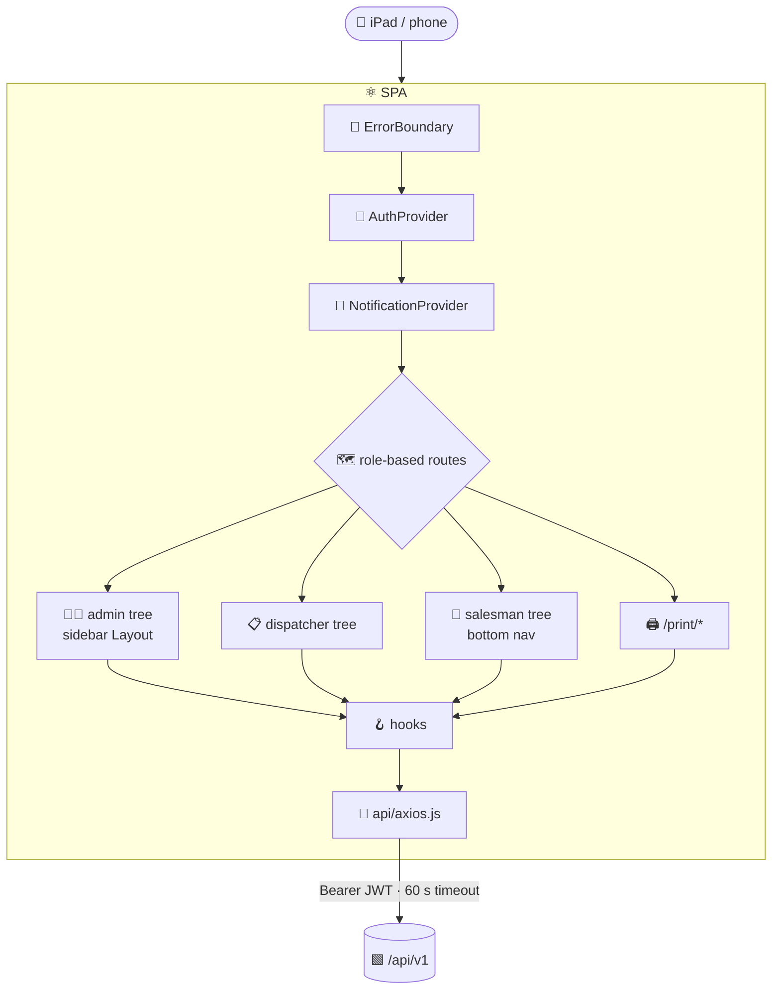

# ⚛️ VMD Client — Single-Page App

> React 19 front end for the Vikas Milk Dairy Distribution Manager. Role-based screens for owners, office staff,
> dispatchers (iPad) and salespeople (phone), plus print/PDF output. Deployed to **Vercel** from this folder.

[⬅️ Repository README](../README.md) · [System docs](../docs/README.md) · [Engineering contract](CLAUDE.md)

| | |
|---|---|
| **Framework** | React 19 · React Router 7 |
| **Build** | Vite 8 (code-split, lazy pages) |
| **Styling** | Tailwind CSS 3 · clsx · tailwind-merge · lucide-react icons |
| **Data** | One axios instance (`src/api/axios.js`) + `useApiResource` / `useMutation` hooks |
| **Output** | Print routes + jsPDF bills (share sheet / WhatsApp fallback) |
| **Tests** | Vitest + React Testing Library (here) · Playwright UI suite in [`automation-ui/`](automation-ui/README.md) |

---

## 🧭 At a glance



## ⚡ Quick start

```bash
cd client
npm install
echo "VITE_API_BASE_URL=http://localhost:3001/api/v1" > .env
npm run dev                 # http://localhost:5173
```

| Script | Purpose |
|---|---|
| `npm run dev` | Vite dev server with HMR |
| `npm run build` | Production build → `dist/` |
| `npm run preview` | Serve the production build |
| `npm run lint` | ESLint (React, hooks, refresh rules) |
| `npm test` | Vitest once |
| `npm run test:coverage` | Vitest + v8 coverage gate |

## 🗂️ Folder layout

```
client/
├── src/
│   ├── api/            # axios instance · cold-start tracker
│   ├── context/        # AuthContext · NotificationContext
│   ├── hooks/          # data + UI hooks
│   ├── components/     # shell, shared widgets, ui/ primitives
│   ├── pages/          # dashboard, daily, payments, reports, setup, salesman, dairy
│   ├── utils/          # dates (IST), session, layout sort, bill PDF, formatting, version
│   ├── test/setup.js   # RTL setup
│   └── App.jsx         # route tree
├── automation-ui/      # 🎭 Playwright UI suite (separate project)
├── docs/               # 📚 this component's documentation
├── vite.config.js · eslint.config.js · tailwind.config.js · vercel.json · .vercelignore
```

## 📚 Documentation

| Document | Contents |
|---|---|
| [🏗️ Architecture](docs/architecture.md) | Provider stack, module boundaries, render lifecycle |
| [🗺️ Routing & access](docs/routing-and-access.md) | Route trees per role, guards, navigation, legacy redirects |
| [🔌 Data layer](docs/data-layer.md) | axios instance, 401 handling, cold start, hooks, contexts |
| [🧩 UI components & styling](docs/ui-components.md) | Shell, shared components, BrandedLoader, Tailwind, brand colours |
| [📄 Pages catalogue](docs/pages-catalog.md) | Every screen, its role, APIs and key behaviour |
| [🖨️ Printing & PDF](docs/printing-and-pdf.md) | Print routes, bill PDF and sharing |
| [🧪 Testing](docs/testing.md) | Vitest + RTL patterns, mocks, coverage |
| [🚀 Build & deploy](docs/build-and-deploy.md) | Vite build, version injection, Vercel |
| [📐 Coding standards](docs/coding-standards.md) | Patterns, anti-patterns, review checklist |
| [🎭 UI automation suite](automation-ui/README.md) | Live browser tests against the deployed app |

## 📐 Non-negotiables

1. 🔌 All HTTP through `src/api/axios.js` — never `fetch` or a new axios instance.
2. 🕰️ Dates through `src/utils/dateUtils.js` (IST) — never `new Date()` for a business date.
3. 💤 Pages are `lazy()` in `App.jsx`; routes are declared only there.
4. ⏳ `BrandedLoader` for page/section loading, `TumblerSpinner` in buttons — never `Loader2`.
5. 🔢 Product lists sorted with `src/utils/productLayout.js`.
6. 🔑 Auth is the `Authorization` header from `localStorage`; never rely on the cookie.

Full rules: [CLAUDE.md](CLAUDE.md) · [root CLAUDE.md](../CLAUDE.md)
