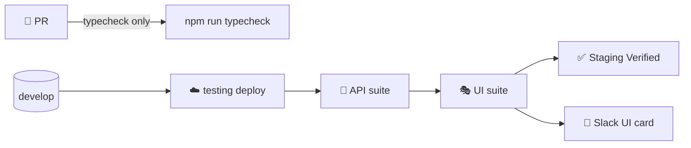

# 🎭 VMD UI Automation Suite

> Black-box browser tests against a **deployed** VMD environment — Playwright Test + TypeScript. Real browser →
> real frontend → real API → real database. Nothing is mocked.

[⬅️ Client README](../README.md) · [Engineering contract](CLAUDE.md) · API companion: [server/automation](../../server/automation/README.md)

| | |
|---|---|
| **Runs** | after the API suite in `staging-pipeline.yml` (merge to `develop`) |
| **Devices** | iPad (gen 7) portrait 810×1080 + landscape 1080×810 · Pixel 7 phone 412×839 — all Chromium |
| **Session** | one real sign-in per run, reused via `.auth/admin.json` |
| **Data** | throwaway `E2E-…` records removed by fixtures |
| **Reports** | `playwright-report/` (HTML), `test-results/` (traces, screenshots, `results.json`) |

---

## 🧭 Where it fits



## ⚡ Quick start

```bash
cd client/automation-ui
npm ci
npx playwright install --with-deps chromium     # first time only

WEB_BASE_URL=http://localhost:5173 \
E2E_ADMIN_USERNAME=... E2E_ADMIN_PASSWORD=... \
  npm test                                     # npm run test:headed to watch · npm run report for HTML

npx playwright test --project=setup --project='*-ipad-portrait'   # one screen
npx playwright show-trace test-results/<test>/trace.zip           # debug a failure
```

| Script | Purpose |
|---|---|
| `npm test` | Run all projects |
| `npm run test:headed` | Watch the browser |
| `npm run typecheck` | `tsc --noEmit` (what PR CI runs) |
| `npm run report` | Open the last HTML report |

## 🗂️ Layout

```
client/automation-ui/
├── playwright.config.ts     # projects: setup → signed-in / signed-out on 2 iPad screens · salesman-phone
├── src/
│   ├── env.ts               # settings from environment variables
│   ├── fixtures.ts          # extended test: trackRoute cleanup
│   └── pages/               # LoginPage · DashboardPage · RouteSetupPage
└── tests/
    ├── auth.setup.ts        # sign in once, save .auth/admin.json
    ├── login.spec.ts        # sign in, wrong credentials, signed-out redirect
    ├── dashboard.spec.ts    # quick actions, payable cards vs server balances, total badge, day change
    ├── route-setup.spec.ts  # add / edit / delete a route, duplicate rejection, empty form, cancel paths, brand scoping
    └── salesman/            # phone-only specs (create when needed)
```

## 📋 Current coverage

| Spec | Journeys |
|---|---|
| `login.spec.ts` | Successful sign-in lands on the dashboard · wrong credentials show an error, clear the password and keep the username (unknown username) · signed-out user is redirected to login |
| `dashboard.spec.ts` | Quick actions open Stock Receipt / Collections / Dairy Payments · one card per brand with the Outstanding / Credit / Cleared status the API balance implies, Pay Now only when owed · total badge sums only owed brands · previous day / Today reload the balances for that day (read-only) |
| `route-setup.spec.ts` | Add, edit, delete a route and confirm after reload · duplicate route rejected · empty form validation · edit form prefilled and Cancel changes nothing · cancelling delete keeps the route · a route is not listed under another brand |

## 📚 Documentation

| Document | Contents |
|---|---|
| [🏗️ Architecture](docs/architecture.md) | Projects, devices, session reuse, fixtures, page objects |
| [✍️ Writing tests](docs/writing-tests.md) | Page-object pattern, selectors, cleanup, salesman specs |
| [⚙️ Configuration & CI](docs/configuration-and-ci.md) | Variables, Vercel bypass, workflow, reports |
| [🛟 Troubleshooting](docs/troubleshooting.md) | Common failures and fixes |
| [🗺️ Roadmap](docs/roadmap.md) | Journeys to automate next |

## ⚠️ Rules in one glance

1. Selectors only in `src/pages/`; specs describe behaviour.
2. `import { test, expect } from '../src/fixtures'`.
3. Everything created is `E2E-…` and registered for cleanup.
4. Never sign in per test (20 logins/hour/IP shared with the API suite).
5. Never run against production.
