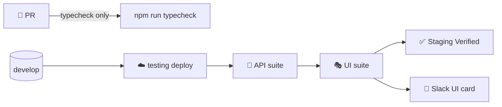

# 🎭 VMD UI Automation Suite

> Black-box browser tests against a **deployed** VMD environment — Playwright Test + TypeScript. Real browser →
> real frontend → real API → real database. Nothing is mocked.

[⬅️ Client README](../README.md) · [Engineering contract](CLAUDE.md) · API companion: [server/automation](../../server/automation/README.md)

| | |
|---|---|
| **Runs** | after the API suite in `staging-pipeline.yml` (merge to `develop`) |
| **Devices** | iPad (gen 7) portrait 810×1080 + landscape 1080×810 · Pixel 7 phone 412×839 — all Chromium |
| **Session** | one real admin sign-in per run, reused via `.auth/admin.json`; each salesman/dispatcher journey signs in as its own throwaway user |
| **Data** | arranged through the API as throwaway `E2E-…` records and removed afterwards (`src/seed.ts`) |
| **Reports** | `playwright-report/` (HTML), `test-results/` (traces, screenshots, `results.json`) |

---

## 🧭 Where it fits



## ⚡ Quick start

```bash
cd client/automation-ui
npm ci
npx playwright install --with-deps chromium     # first time only

WEB_BASE_URL=http://localhost:5173 \
E2E_ADMIN_USERNAME=... E2E_ADMIN_PASSWORD=... \
API_BASE_URL=http://localhost:3001 \
E2E_SUPERADMIN_USERNAME=... E2E_SUPERADMIN_PASSWORD=... E2E_EDIT_PIN=... E2E_PL_PIN=... \
  npm test                                     # npm run test:headed to watch · npm run report for HTML

npx playwright test --project=setup --project='*-ipad-portrait'   # one screen
npx playwright show-trace test-results/<test>/trace.zip           # debug a failure
```

| Script | Purpose |
|---|---|
| `npm test` | Run all projects |
| `npm run test:headed` | Watch the browser |
| `npm run typecheck` | `tsc --noEmit` (what PR CI runs) |
| `npm run report` | Open the last HTML report |

## 🗂️ Layout

```
client/automation-ui/
├── playwright.config.ts     # projects: setup → signed-in / signed-out on 2 iPad screens · salesman-phone
├── src/
│   ├── env.ts               # every setting, from environment variables
│   ├── seed.ts              # ARRANGE through the API (throwaway brand, product, salesperson, dispatch, ...) + cleanup
│   ├── fixtures.ts          # test: seed · superSeed · editPin · plPin · trackCreated
│   └── pages/               # page objects — all selectors live here (BasePage is the common parent)
└── tests/
    ├── auth.setup.ts        # sign in once, save .auth/admin.json
    ├── login.spec.ts        # sign-in, session, redirects, sign-out            (signed out)
    ├── navigation.spec.ts   # every admin screen opens cleanly · menu · redirects · role guard   (@layout: both iPads)
    ├── dairy-ledger.spec.ts # stock → what we owe → payments → dashboard
    ├── salesperson-ledger.spec.ts # dispatch → collections → outstanding / day balance / statement
    ├── catalog-setup.spec.ts# categories · routes · products
    ├── salesman-users.spec.ts # add / disable / credentials / delete + real sign-in
    ├── pricing-and-bills.spec.ts # a price reaches the phone · a bill matches the dispatch
    ├── reports.spec.ts      # dairy statement · stock summary
    ├── access-roles.spec.ts # dispatcher sees only dispatch screens · Profit & Loss PIN
    ├── superadmin.spec.ts   # create / disable / delete an office login
    └── salesman/            # phone: stock-entry.spec.ts · security.spec.ts
```

## 🧠 How the suite is built

- **Arrange by API, act and assert in the browser.** `seed.ts` creates exactly the data a journey needs (an
  `E2E-…` brand with a route and a product, a salesperson with a login, a dispatch) in milliseconds, and removes it
  afterwards, pass or fail. The browser then does what staff do and checks what they would see.
- **Journeys, not widgets.** Each test is a business journey that would hurt if it broke: money moves and agrees on
  every screen, a price set by an admin reaches the salesman's phone, a disabled salesperson cannot sign in.
- **Assertions come from the data.** Figures are computed from what was seeded (`10 × ₹10 = ₹100`), never copied from
  a screen, so a wrong calculation fails the test.
- **Throwaway brands protect real ledgers.** Money specs run on their own brand; cleanup zeroes the day's stock,
  deletes its payments and archives the brand, so shared reports are not polluted.
- **Rate limits are respected.** Sign-in is limited to 20/hour, `/salespeople` and `/stock-receipts` to 30/minute.
  Tokens are cached per run, 429s are waited out (never a 5xx retried), and layout-independent specs run on **portrait
  only** — only `@layout`-tagged specs repeat on landscape.

## 📋 Current coverage

| Spec | Journeys |
|---|---|
| `login.spec.ts` | admin signs in, reload keeps the session · wrong credentials keep the username, clear the password · button disabled until filled · protected pages redirect · sign-out ends the session |
| `navigation.spec.ts` | all 21 admin screens open with no crash, script error or 5xx · P&L is PIN-gated · menu reaches the main areas on sidebar and drawer · legacy URLs redirect · unknown URL → dashboard · Admin Users guarded by role |
| `dairy-ledger.spec.ts` | stock raises what we owe (stock page, reload, dashboard) · re-saving re-prices · a payment lowers it everywhere and delete (edit PIN) restores it · full pay → Settled, overpay → Credit · wrong PIN refused · zero amount refused |
| `salesperson-ledger.spec.ts` | submitted dispatch on the sheet, locked, correct total · admin unlock / lock · a collection lowers the balance on collections, outstanding, day balance and statement, delete restores it · full payment clears outstanding |
| `catalog-setup.spec.ts` | categories (trim, duplicate, edit, search, delete warning) · routes (duplicate, edit, delete) · products (required name, prices shown, edit price, archive) |
| `salesman-users.spec.ts` | add with login (validation, duplicate, persists, can sign in) · disable → locked out, enable, credentials replace the old password, mismatch refused · delete |
| `pricing-and-bills.spec.ts` | a price saved for a salesperson is what they see on the phone · bill preview matches the dispatch, issue and remove it |
| `reports.spec.ts` | dairy statement bill / paid / closing · stock summary by product and route |
| `access-roles.spec.ts` | dispatcher: only dispatch screens, office URLs bounce · P&L wrong PIN refused, right PIN opens |
| `superadmin.spec.ts` | create a dispatcher who can sign in, disable (blocked), delete · own account cannot be disabled or deleted |
| `salesman/stock-entry.spec.ts` | phone home and office URLs bounce · bottom bar · own price + draft survives reload · only enabled products · finalize locks, balance and statement show the bill |
| `salesman/security.spec.ts` | password rules · wrong current password refused · change replaces the password |

## ⚙️ Environment variables

| Variable | Needed by | Notes |
|---|---|---|
| `WEB_BASE_URL` | all | frontend origin |
| `E2E_ADMIN_USERNAME` / `_PASSWORD` | all signed-in | admin **without MFA** |
| `API_BASE_URL` | all data-driven specs | backend origin (no `/api/v1`); those specs skip without it |
| `E2E_SUPERADMIN_USERNAME` / `_PASSWORD` | money specs, dispatcher, superadmin | superadmin **without MFA** — creates throwaway brands / logins; skipped without it |
| `E2E_EDIT_PIN` | deleting a payment / collection | the edit PIN |
| `E2E_PL_PIN` | opening Profit & Loss | the P&L PIN |
| `E2E_STRICT=true` | optional | fail instead of skip when any of the above is missing |
| `VERCEL_BYPASS_SECRET`, `HEADLESS`, `UI_TIMEOUT_MS`, `PLAYWRIGHT_CHROMIUM_EXECUTABLE_PATH` | optional | as before |

## 📚 Documentation


| Document | Contents |
|---|---|
| [🏗️ Architecture](docs/architecture.md) | Projects, devices, session reuse, fixtures, page objects |
| [✍️ Writing tests](docs/writing-tests.md) | Page-object pattern, selectors, cleanup, salesman specs |
| [⚙️ Configuration & CI](docs/configuration-and-ci.md) | Variables, Vercel bypass, workflow, reports |
| [🛟 Troubleshooting](docs/troubleshooting.md) | Common failures and fixes |
| [🧭 Coverage map](docs/coverage-map.md) | Every business flow → the journey that covers it |
| [🗺️ Roadmap](docs/roadmap.md) | Journeys to automate next |

## ⚠️ Rules in one glance

1. Selectors only in `src/pages/`; specs describe behaviour.
2. `import { test, expect } from '../src/fixtures'`.
3. Everything created is `E2E-…` and registered for cleanup.
4. Never sign in per test (20 logins/hour/IP shared with the API suite).
5. Never run against production.
