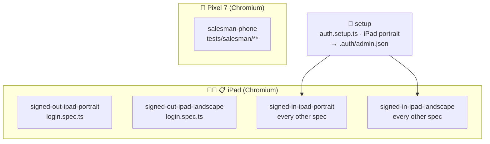
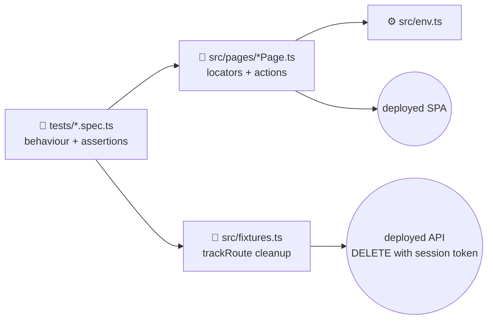
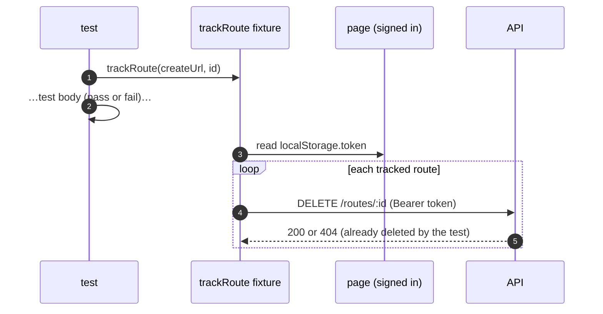

# 🏗️ UI Automation Architecture

[⬅️ Suite README](../README.md) · [Contract](../CLAUDE.md)

---

## 1. 📱 Projects & devices (`playwright.config.ts`)

| Project | Matches | Device | Session |
|---|---|---|---|
| `setup` | `auth.setup.ts` | iPad portrait | creates `.auth/admin.json` |
| `signed-out-ipad-{portrait,landscape}` | `login.spec.ts` | iPad gen 7, 810×1080 / 1080×810 | none |
| `signed-in-ipad-{portrait,landscape}` | `*.spec.ts` except login & salesman | same | `storageState` |
| `salesman-phone` | `tests/salesman/**/*.spec.ts` | Pixel 7, 412×839 | signs in as its own salesman |

> iPad **portrait** is below the app's `lg` (1024 px) breakpoint → hamburger menu; **landscape** → sidebar. Page
> objects must work in both.

## 2. ⚙️ Runner settings

| Setting | Value | Why |
|---|---|---|
| `workers` | 1, `fullyParallel: false` | Shared environment, rate limits |
| `retries` | 1 on CI, 0 locally | Absorb cold-start flakes only |
| Timeouts | `UI_TIMEOUT_MS` (60 s) for actions/navigation/expect; test = 2× | Render wake-up |
| Artifacts | screenshot on failure, trace retained on failure | Debugging |
| Reporters | `list`, `html`, `json → test-results/results.json` | Console, humans, Slack/summary |

## 3. 🧩 Layers

| Page object | Exposes |
|---|---|
| `LoginPage` | `open()` (adds Vercel bypass query when set), `signIn(u, p)`, `error(text)` |
| `DashboardPage` | `heading` (signed-in landmark) |
| `RouteSetupPage` | `open(brand)`, `reload()`, `addRoute()` (returns the API response), `editRoute()`, `deleteRoute()`, `row()`, `acknowledgeNotice()` |

## 4. 🧹 Cleanup fixture

## 5. 🔐 Vercel Deployment Protection

When `VERCEL_BYPASS_SECRET` is set, `LoginPage.open()` adds
`?x-vercel-protection-bypass=…&x-vercel-set-bypass-cookie=samesitenone` once; Vercel sets a cookie for the session.
A query string is used instead of a header so nothing extra is sent cross-origin to the API (which would trigger a
CORS preflight).
