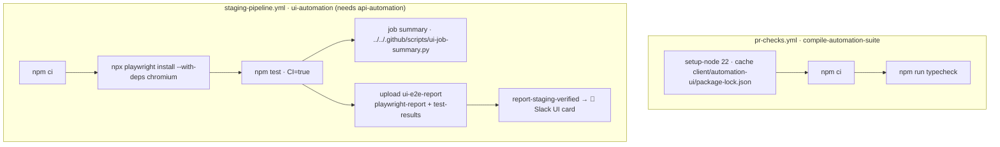

# ⚙️ Configuration & CI

[⬅️ Suite README](../README.md) · Pipeline: [docs/08-ci-cd-and-release.md](../../../docs/08-ci-cd-and-release.md)

---

## 1. 🔧 Environment variables (`src/env.ts`)

| Variable | Default | Notes |
|---|---|---|
| `WEB_BASE_URL` | `http://localhost:5173` | Frontend origin, trailing slash stripped |
| `E2E_ADMIN_USERNAME` / `E2E_ADMIN_PASSWORD` | — | Admin **without MFA**; read lazily |
| `VERCEL_BYPASS_SECRET` | — | Vercel Protection Bypass for Automation |
| `HEADLESS` | `true` | `false` to watch |
| `UI_TIMEOUT_MS` | `60000` | Action/navigation/expect timeout |
| `PLAYWRIGHT_CHROMIUM_EXECUTABLE_PATH` | — | Use a pre-installed Chromium (adds `--no-sandbox`) |
| `CI` | — | Enables `forbidOnly` and 1 retry |

## 2. 🔄 CI integration

| Item | Value |
|---|---|
| Working directory | `client/automation-ui` |
| Environment | `staging` (secrets `E2E_ADMIN_*`, `VERCEL_AUTOMATION_BYPASS_SECRET`) |
| Timeout | 30 min |
| Result file | `test-results/results.json` (Slack card + summary) |

## 3. 🧰 Toolchain

| Tool | Version |
|---|---|
| `@playwright/test` | 1.63.0 (pinned exactly) |
| TypeScript | 5.x |
| Node | 22 |
| Browser | Chromium only |
