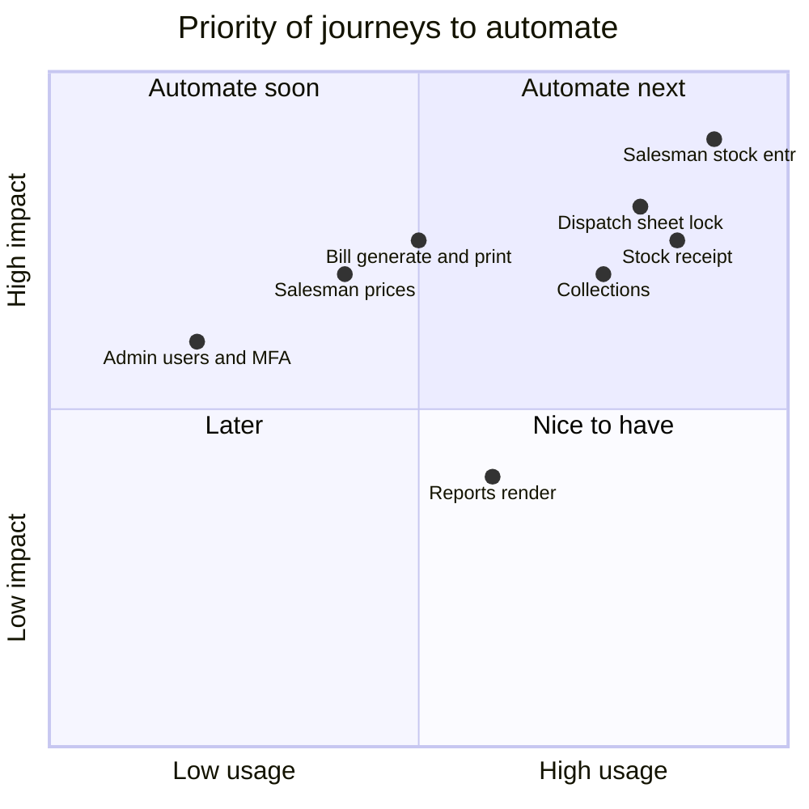

# 🗺️ UI Automation Roadmap

[⬅️ Suite README](../README.md)

---

Journeys ranked by business risk. API behaviour behind each is already covered by `server/automation`; these add the
browser layer.

| # | Journey | Device | Needs |
|---|---|---|---|
| 1 | 🛵 Salesman enters and submits today's stock | phone | run-scoped salesman fixture + dispatch cleanup |
| 2 | 📋 Dispatcher locks/unlocks an entry | iPad | dispatcher session (second `setup` project) |
| 3 | 📦 Admin saves a stock receipt on a throwaway brand | iPad | brand/product fixtures |
| 4 | 💰 Admin records a collection and sees the balance change | iPad | salesperson fixture |
| 5 | 🧾 Admin generates and opens a bill | iPad | dispatch data fixture |
| 6 | 🏷️ Admin edits a salesperson price | iPad | salesperson + product fixtures |
| 7 | 📊 Reports render for a date range | iPad | read-only |
| 8 | 👑 Superadmin manages an admin user | iPad | superadmin session |
