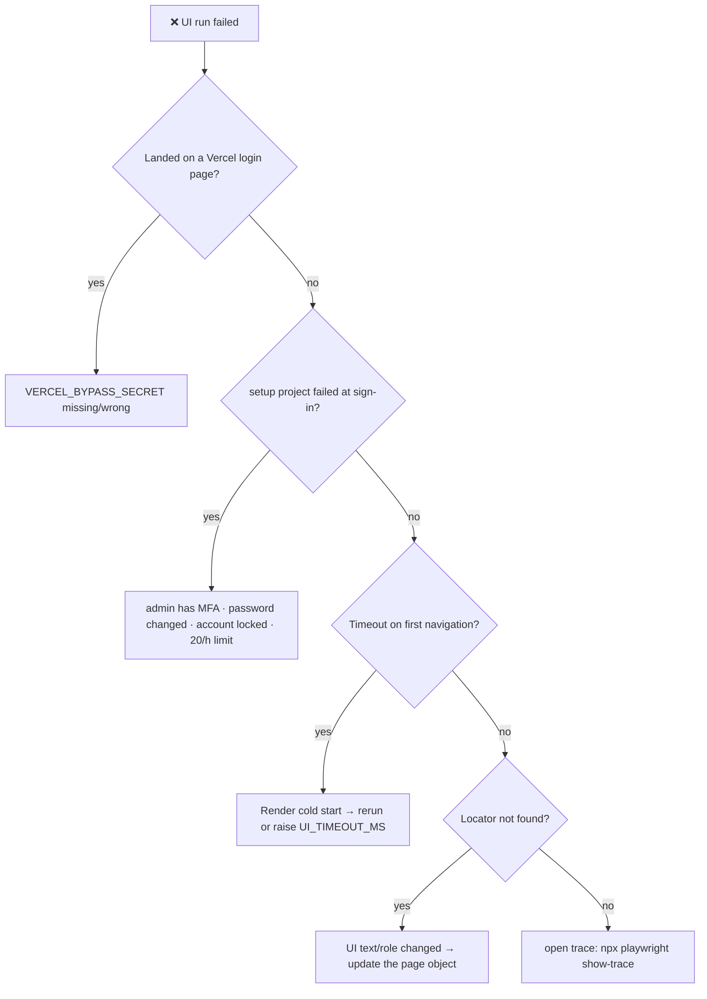

# 🛟 Troubleshooting

[⬅️ Suite README](../README.md)

---

| Symptom | Cause | Fix |
|---|---|---|
| Passes in landscape, fails in portrait | Element hidden behind the hamburger menu | Open the menu in the page object when narrow |
| "Element is outside viewport" | Wide tables | `scrollIntoViewIfNeeded()` in the page object |
| Next click does nothing after save | Blocking Success/Error modal | `acknowledgeNotice(...)` |
| Leftover `E2E-…` routes | Run killed before fixture teardown | Delete in Route Setup; harmless |
| `test.only` error on CI | `forbidOnly` | Remove `.only` |
| Browser download blocked locally | No internet / sandbox | Set `PLAYWRIGHT_CHROMIUM_EXECUTABLE_PATH` |
| Admin locked out | Wrong-password test used the real username | Use an unknown username; unlock via superadmin |
