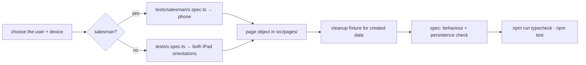

# ✍️ Writing UI Tests

[⬅️ Suite README](../README.md) · Rules: [CLAUDE.md](../CLAUDE.md)

---

## 1. 🧭 Workflow



## 2. 📄 Page object template

```ts
import { type Locator, type Page, type Response } from '@playwright/test';

export class ProductsPage {
  readonly addButton: Locator;

  constructor(private readonly page: Page) {
    this.addButton = page.getByRole('button', { name: 'Add Product' });
  }

  async open(): Promise<void> {
    await this.page.goto('/dairy/setup/products');
    await this.addButton.waitFor();
  }

  /** Returns the API response so the spec can register cleanup by id. */
  async addProduct(name: string): Promise<Response> {
    await this.addButton.click();
    await this.page.getByLabel('Name').fill(name);
    const [res] = await Promise.all([
      this.page.waitForResponse((r) => r.url().endsWith('/products') && r.request().method() === 'POST'),
      this.page.getByRole('button', { name: 'Save' }).click(),
    ]);
    return res;
  }

  row(name: string): Locator {
    return this.page.getByRole('row', { name: new RegExp(name) });
  }
}
```

> Illustrative — label and button names must match the real screen; prefer roles and labels over CSS.

## 3. 🧪 Spec template

```ts
import { expect, test } from '../src/fixtures';
import { RouteSetupPage } from '../src/pages/RouteSetupPage';

const unique = () => `E2E-${Date.now()}`;

test('admin can add a route and it survives a reload', async ({ page, trackRoute }) => {
  const routes = new RouteSetupPage(page);
  await routes.open();

  const name = unique();
  const created = await routes.addRoute(name);
  expect(created.status()).toBe(201);
  trackRoute(created.url(), (await created.json()).data.id);   // cleanup even if the test fails
  await routes.acknowledgeNotice('Route added');

  await routes.reload();                                        // persisted, not just React state
  await expect(routes.row(name)).toBeVisible();
});
```

## 4. 🎯 Selector priority

| Priority | Locator | Example |
|---|---|---|
| 1 | Role + name | `getByRole('button', { name: 'Sign In' })` |
| 2 | Label | `getByLabel('Route number')` |
| 3 | Visible text | `getByText('Route added')` |
| 4 | Stable id | `locator('#username')` |
| ❌ | CSS chains, nth-child, Tailwind classes | — |

## 5. ✅ Checklist

- [ ] Uses `test`/`expect` from `src/fixtures`
- [ ] All selectors in a page object
- [ ] Created data named `E2E-…` and tracked for cleanup (new fixture if a new entity type)
- [ ] Persistence verified after reload
- [ ] Modal notices acknowledged before the next action
- [ ] Works in iPad portrait (hamburger) and landscape (sidebar)
- [ ] No `test.only`, no hard-coded URLs or credentials
- [ ] Wrong-password tests use an **unknown** username
