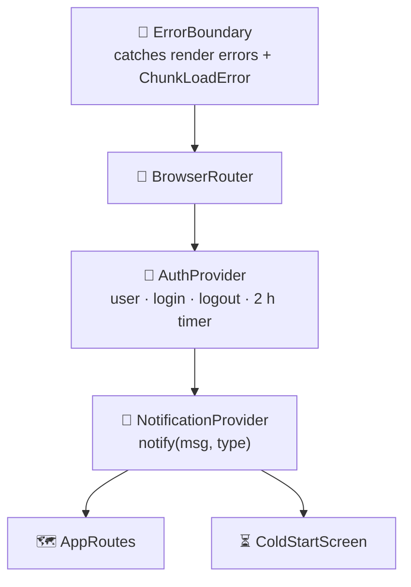
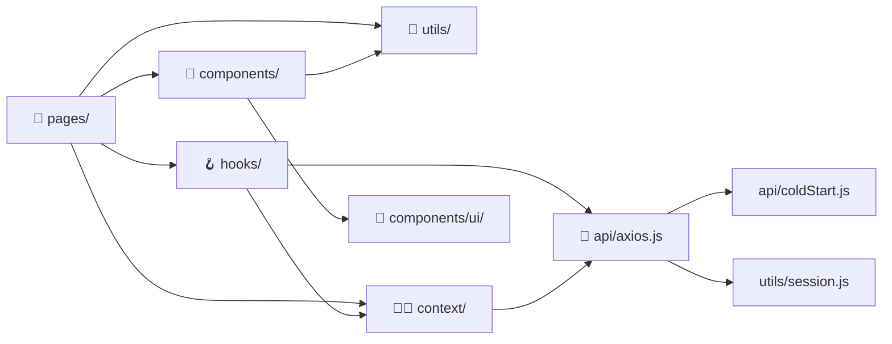
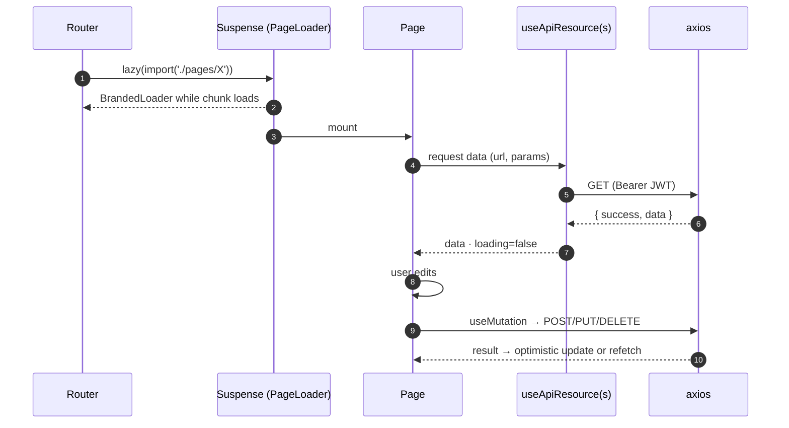

# 🏗️ Client Architecture

[⬅️ Client README](../README.md) · [System architecture](../../docs/02-system-architecture.md)

---

## 1. 🧅 Provider stack (`App.jsx`)

| Order matters because… |
|---|
| `ErrorBoundary` is outermost so a crash inside any provider is still caught and reported |
| `AuthProvider` needs the router to redirect on logout/expiry |
| `NotificationProvider` sits inside auth so login errors can be shown |

## 2. 🧱 Module boundaries

| Folder | Owns | Must not |
|---|---|---|
| `pages/` | Screen state, layout, orchestration | Talk to `fetch` / new axios instances |
| `components/` | Reusable widgets and modals | Know about routes beyond links |
| `components/ui/` | Design-system primitives | Fetch data |
| `hooks/` | Data fetching and UI state patterns | Render UI |
| `context/` | Auth + notifications only | Become a general store |
| `api/` | HTTP, auth header, 401, cold start | Import React components |
| `utils/` | Pure helpers (dates, sort, format, PDF) | Hold state |

## 3. 🔁 Page lifecycle

## 4. 🧭 Key design decisions

| Decision | Reason | ADR |
|---|---|---|
| No Redux/Zustand | Only auth + notifications are global | [ADR-010](../../docs/11-architecture-decisions.md#adr-010--no-global-state-library-on-the-client) |
| JWT in header from `localStorage` | No CSRF surface | [ADR-005](../../docs/11-architecture-decisions.md#adr-005--jwt-in-the-authorization-header-not-a-cookie) |
| Lazy pages | Small first load on phones | — |
| 60 s request timeout + cold-start screen | Render free plan wakes slowly | — |
| IST date helpers everywhere | Device clocks/timezones vary | [ADR-004](../../docs/11-architecture-decisions.md#adr-004--india-standard-time-is-the-business-clock) |
