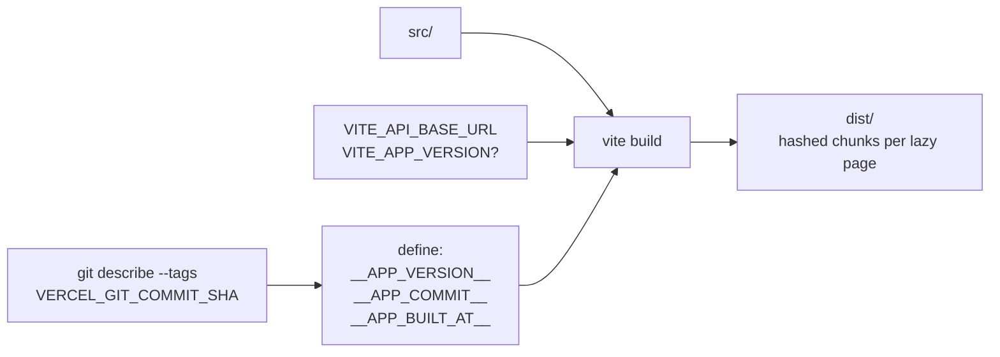
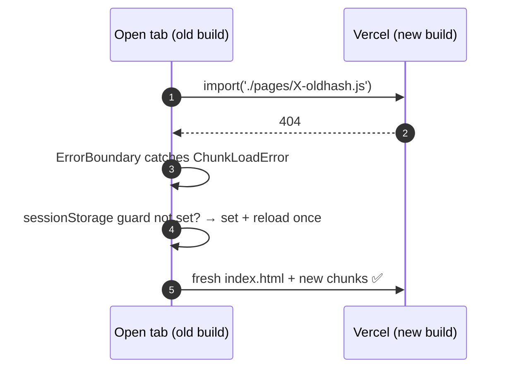

# 🚀 Build & Deploy

[⬅️ Client README](../README.md) · Environments: [docs/06-environments-and-deployment.md](../../docs/06-environments-and-deployment.md)

---

## 1. 🏗️ Build pipeline

| Build constant | Source | Read via |
|---|---|---|
| `__APP_VERSION__` | `VITE_APP_VERSION` › latest git tag › `package.json` | `utils/appVersion.js` |
| `__APP_COMMIT__` | `VERCEL_GIT_COMMIT_SHA` › `git rev-parse HEAD` (7 chars) | `utils/appVersion.js` |
| `__APP_BUILT_AT__` | build time (ISO) | `utils/appVersion.js` |

## 2. ☁️ Vercel

| Setting | Value |
|---|---|
| Root directory | `client` |
| Build | `npm run build` |
| Output | `dist` |
| SPA routing | `vercel.json` rewrites every path to `/index.html` |
| Upload exclusions | `.vercelignore` → `automation-ui/` |
| Environments | testing project ← `develop`, production project ← `main` |
| Protection | Testing may use Deployment Protection; CI passes `VERCEL_AUTOMATION_BYPASS_SECRET` |

## 3. 🔄 Stale chunks after a deploy

## 4. ⚙️ Configuration

| Variable | Required | Example |
|---|---|---|
| `VITE_API_BASE_URL` | ✅ | `https://dairy-distribution-manager-vmd.onrender.com/api/v1` |
| `VITE_APP_VERSION` | — | `1.5.0` |

Vite inlines `VITE_*` values at build time — changing one on Vercel requires a redeploy.
