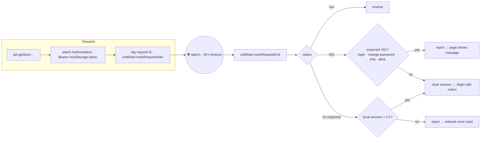
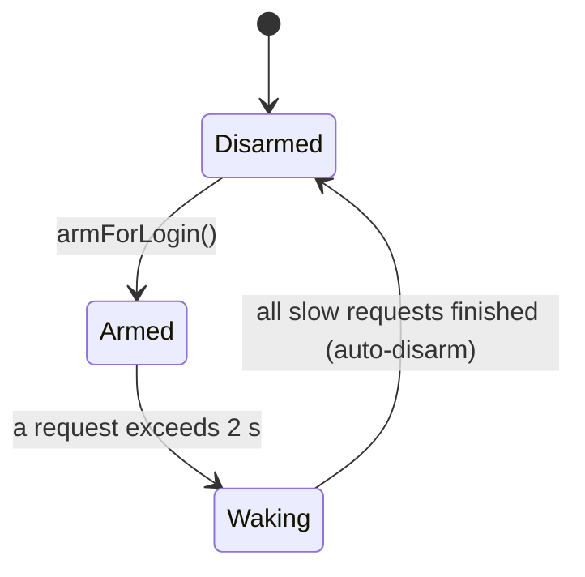
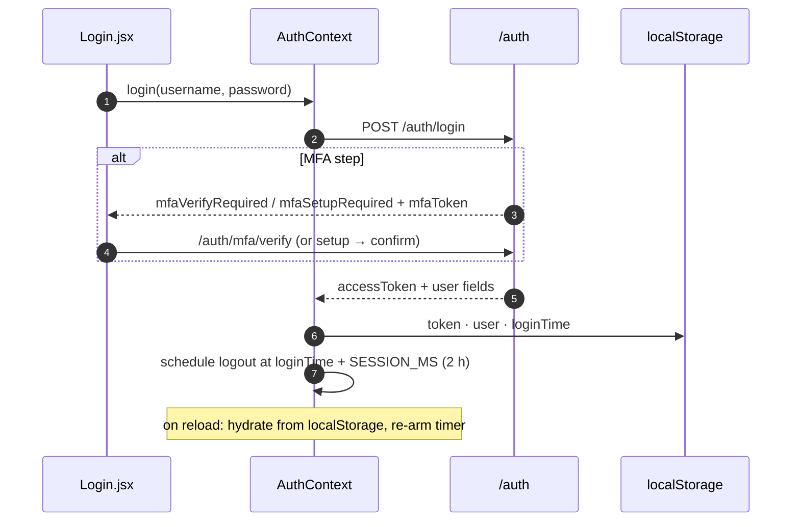

# 🔌 Data Layer

[⬅️ Client README](../README.md)

---

## 1. 🔌 The axios instance (`src/api/axios.js`)



| Feature | Detail |
|---|---|
| Base URL | `VITE_API_BASE_URL` (default `http://localhost:3001/api/v1`) |
| Timeout | 60 000 ms |
| Auth | `localStorage.token` → `Authorization: Bearer` |
| Session expiry | Real 401 → logout + redirect with a sessionStorage notice |
| Cold start | Every request reported to `coldStart.js` |

```js
import api from '../api/axios';
const { data } = await api.get('/brands');   // data = { success, data }
```

## 2. ⏳ Cold-start tracker (`src/api/coldStart.js`)



`Login.jsx` arms the tracker; `ColdStartScreen` subscribes and shows a branded "server is waking up" overlay only
while `Waking`. Once that screen hides it disarms, so ordinary slow requests later in the session never show it.

## 3. 🪝 Hooks

| Hook | Use for | Returns |
|---|---|---|
| `useApiResource(url, opts)` | One GET | `{ data, loading, error, refetch, setData }` |
| `useApiResources(urls, opts)` | Several GETs in lockstep | same, `select` receives payloads in URL order |
| `useMutation(fn, opts)` | Writes | `{ mutate, loading, error }`; `mutate` resolves `{ ok, result }` / `{ ok:false, error }` |
| `useDisclosure(initial)` | Modal open state | `{ isOpen, open, close, toggle }` |
| `usePaymentFilters(payments, opts)` | Payment list filters + paging | filters, `pagedPayments`, `clearFilters`… |
| `useDebouncedValue(value, ms)` | Search inputs | debounced value |

`useApiResource` options: `params`, `enabled` (skip when false / url null), `initialData`, `notifyOnError` (default
true), `select`. A monotonic request id drops stale responses when url/params change quickly.

```jsx
const { data: products = [], loading, refetch } = useApiResource(
  brandId ? '/products' : null, { params: { brandId } },
);
const { mutate: save, loading: saving } = useMutation(
  (body) => api.post('/products', body),
  { successMessage: 'Product created', onSuccess: refetch },
);
```

## 4. 🔑 `AuthContext`



`useAuth()` → `{ user, login, logout, loading }`; `user` carries `role`, `adminUserId`, `salespersonId`,
`salespersonName`, `businessName`.

## 5. 🔔 `NotificationContext`

```js
const { notify } = useNotification();
notify('Saved', 'success');           // success | error | warning | info
```

Notices render as a modal ("Success"/"Error") that the user acknowledges — the UI automation dismisses it with
`acknowledgeNotice(...)`.

## 6. 🕰️ Dates

```js
import { getIndiaDate, formatDateDisplay, formatCurrency, getPrevDate, getNextDate } from '../utils/dateUtils';
const today = getIndiaDate();          // "2026-11-05" in IST, whatever the device timezone
```

Never `new Date().toISOString().slice(0, 10)` — that is UTC and is wrong between 00:00 and 05:30 IST.
