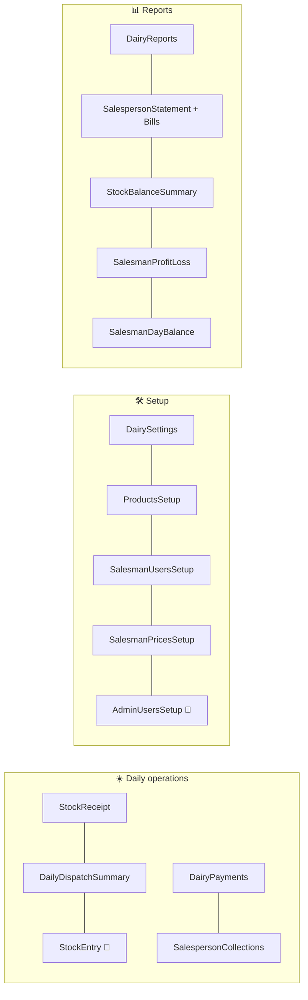

# 📄 Pages Catalogue

[⬅️ Client README](../README.md) · Routes: [routing-and-access.md](routing-and-access.md) · APIs: [server API reference](../../server/docs/api-reference.md)

---

## ☀️ Daily operations

| Page | File | Roles | Main APIs | Notes |
|---|---|---|---|---|
| Dashboard | `pages/Dashboard.jsx` | admin | `/dairy-balance`, quick links | Brand balances, shortcuts to receipt, collections, payments |
| Stock receipt | `pages/daily/StockReceipt.jsx` | admin | `GET /stock-receipts`, `POST /stock-receipts/bulk`, `/routes` | Brand tabs; per-route grid for Nandini |
| Dairy payments | `pages/payments/DairyPayments.jsx` | admin (top-ups: superadmin) | `/dairy-payments`, `/dairy-payments/bulk-topup`, `/dairy-deposit-topups/bulk` | Filters via `usePaymentFilters`; `?brandId` preselect |
| Collections | `pages/payments/SalespersonCollections.jsx` | admin | `/salesperson-payments`, `/bulk-topup`, `/salespeople/reset-ledger` | Reset ledger: superadmin |
| Dispatch sheet | `pages/reports/DailyDispatchSummary.jsx` | admin, dispatcher | `/reports/daily-dispatch`, `/dispatches/:id/lock`, `/finalize-day` | Lock/unlock, open-for-entry, finalize; `NotDispatchedModal` |
| Stock balance | `pages/reports/StockBalanceSummary.jsx` | admin, dispatcher | `/stock-receipts/availability` | Received vs dispatched |
| Stock entry | `pages/salesman/StockEntry.jsx` | salesman | `GET/POST /dispatches`, `PATCH /:id/submit`, `/salespeople/:id/prices` | Phone-first; locked after submit / past day |

## 🛠️ Setup

| Page | File | Roles | Notes |
|---|---|---|---|
| Dairy settings | `pages/setup/DairySettings.jsx` | admin | Tabs: Brands, Routes, Categories, Layout |
| Brands | `pages/setup/BrandsSetup.jsx` | admin (create: superadmin) | Deposit config, archive, copy products |
| Categories | `pages/setup/CategorySetup.jsx` | admin | Create, rename, delete, deposit flag |
| Layout | `pages/setup/LayoutSettings.jsx` | admin | Drag-to-reorder brands, categories, products (`@dnd-kit`) |
| Routes | `pages/setup/RouteSetup.jsx` | admin | Nandini routes |
| Products | `pages/setup/ProductsSetup.jsx` | admin | Effective-dated prices, unit/container, visibility flags |
| Salesman users | `pages/setup/SalesmanUsersSetup.jsx` | admin | Accounts, credentials, drag-to-reorder |
| Salesman prices | `pages/setup/SalesmanPricesSetup.jsx` + `salesmanPrices/*` | admin | Price table, history, copy, bulk update, **Exception Manager**, global access |
| Admin users | `pages/setup/AdminUsersSetup.jsx` | superadmin | Accounts, MFA required, unlock, own MFA, PIN settings |
| Rate master | `pages/dairy/PriceSetup.jsx` | — | ⚠️ Tested but **not routed** |

## 📊 Reports

| Page | File | Roles | Notes |
|---|---|---|---|
| Dairy reports hub | `pages/reports/DairyReports.jsx` | admin | Tabs: Dairy Statement, Stock Summary, Deposit |
| Dairy statement | `pages/reports/DairyStatement.jsx` | admin | Per-brand ledger; print |
| Stock summary | `pages/reports/StockSummary.jsx` | admin | Range/brand/route; print |
| Deposit | `pages/reports/DepositReport.jsx` | admin | Deposit + deposit top-ups; print |
| Salesperson statement | `pages/reports/SalespersonStatement.jsx` | admin | Ledger + **Bills tab** (preview, generate, reprint, cancel, share) |
| Day balance | `pages/reports/SalesmanDayBalance.jsx` | admin | All salespeople for a day |
| Profit & loss | `pages/reports/SalesmanProfitLoss.jsx` | admin | Behind P&L PIN when enabled |
| Outstanding | `pages/SalespersonOutstanding.jsx` | admin | No menu link (URL only) |

## 🛵 Salesman self-service

| Page | File | Notes |
|---|---|---|
| My balance | `pages/salesman/SalespersonBalance.jsx` | `GET /salesperson-balance/:id` (+ history) |
| My statement | `pages/salesman/MyStatement.jsx` | `GET /salesperson-statement/me`; print variant |
| Change password | `pages/salesman/ChangePassword.jsx` | Shared with dispatcher |

## 🖨️ Print pages

`StockSummaryPrint`, `DepositPrint`, `DairyStatementPrint`, `SalespersonStatementPrint`, `BillPrint`,
`MyStatementPrint` — see [printing-and-pdf.md](printing-and-pdf.md).
