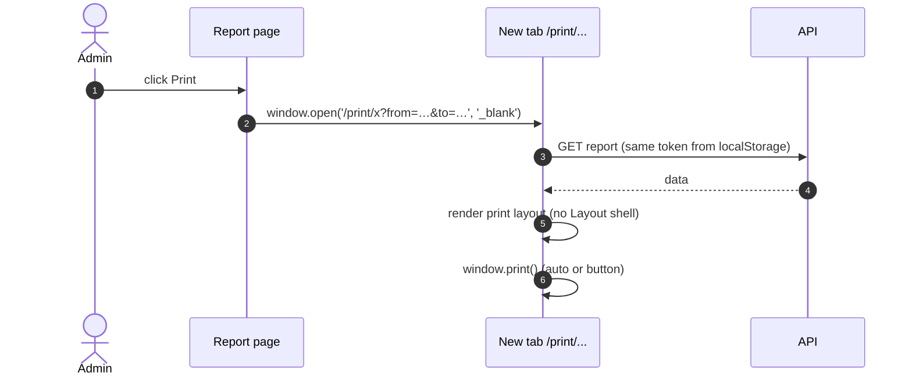
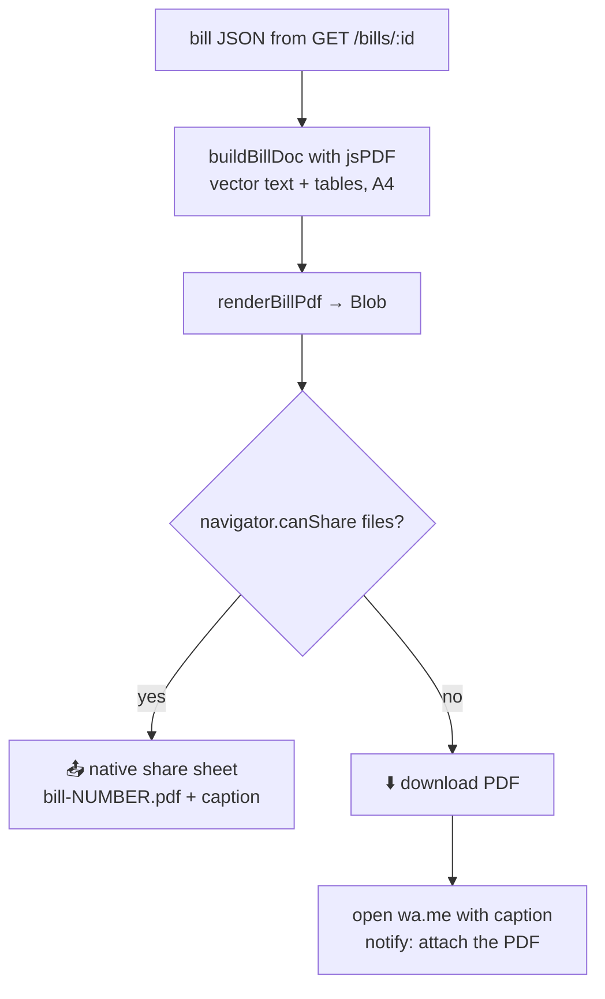

# 🖨️ Printing & PDF

[⬅️ Client README](../README.md)

---

## 1. 🧭 Print route pattern

| Print page | Opened from | Params |
|---|---|---|
| `/print/stock-summary` | Stock summary | `from, to, brandId?, routeId?` |
| `/print/deposit` | Deposit report | `brandId, from, to` |
| `/print/dairy-statement` | Dairy statement | `brandId, from, to` |
| `/print/salesperson-statement` | Salesperson statement | `salespersonId, from, to, type` |
| `/print/bill` | Bills tab | `id` |
| `/print/salesman-my-statement` | My statement | `from, to, type` (`balance` or `dispatch`) |

Controls carry `.no-print`; pages are laid out for A4 portrait.

## 2. 🧾 Bill PDF (`utils/billPdf.js`)

| Helper | Purpose |
|---|---|
| `renderBillPdf(bill)` | Build the PDF blob |
| `shareBillPdf({ bill, pdfPromise, notify })` | Share or download + WhatsApp fallback; pre-render with `pdfPromise` so iOS keeps the user-gesture permission |
| `utils/billDisplay.js` | `DAIRY` header details, `formatAmount`, `formatRate`, `formatQty` |
| `utils/numberToWords.js` | Amount in words (Indian numbering) |
| `components/BillSheet.jsx` | On-screen bill with the same layout |

Bills are frozen on the server, so a reprint always matches the original.
