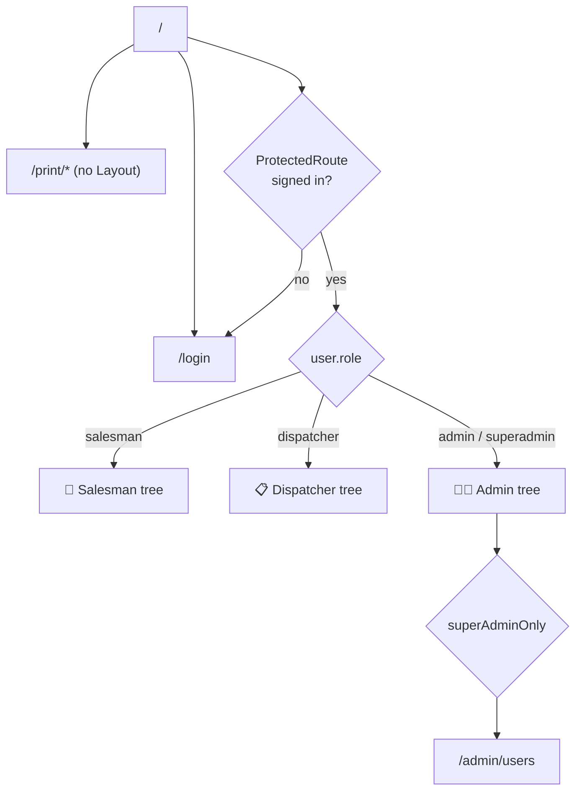
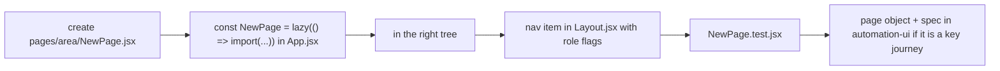

# 🗺️ Routing & Access

[⬅️ Client README](../README.md) · Security model: [docs/05-security.md](../../docs/05-security.md)

---

## 1. 🌳 Route trees



### 🛵 Salesman (phone, bottom navigation)

| Path | Page |
|---|---|
| `/`, `/salesman/stock-entry` | StockEntry |
| `/salesman/balance` | SalespersonBalance |
| `/salesman/my-statement` | MyStatement |
| `/salesman/change-password` | ChangePassword |
| `*` | → `/` |

### 📋 Dispatcher (iPad)

| Path | Page |
|---|---|
| `/` | → `/salesman/dispatch-sheet` |
| `/salesman/dispatch-sheet` | DailyDispatchSummary |
| `/reports/stock-balance` | StockBalanceSummary |
| `/dispatcher/change-password` | ChangePassword |

### 🧑‍💼 Admin / 👑 superadmin (iPad, sidebar ≥ 1024 px, hamburger below)

| Area | Path | Page |
|---|---|---|
| Dashboard | `/` | Dashboard |
| Dairy › Stock receipt | `/dairy/stock/:brandName` | StockReceipt |
| Dairy › Payments | `/dairy/payments` | DairyPayments |
| Dairy › Setup | `/dairy/setup`, `/dairy/setup/{categories,products,layout,routes,brands}` | DairySettings, CategorySetup, ProductsSetup, LayoutSettings, RouteSetup, BrandsSetup (brands menu: superadmin) |
| Dairy › Reports | `/dairy/reports`, `/reports/dairy`, `/reports/stock`, `/reports/deposit` | DairyReports, DairyStatement, StockSummary, DepositReport |
| Salesman › Management | `/reports/stock-balance`, `/salesman/dispatch-sheet`, `/salesman/day-balance`, `/salesman/payments` | StockBalanceSummary, DailyDispatchSummary, SalesmanDayBalance, SalespersonCollections |
| Salesman › Setup | `/salesman/setup/users`, `/salesman/setup/prices` | SalesmanUsersSetup, SalesmanPricesSetup |
| Salesman › Reports | `/reports/salespeople`, `/salesman/profit-loss`, `/salesperson-outstanding` | SalespersonStatement (+ Bills tab), SalesmanProfitLoss, SalespersonOutstanding |
| Admin | `/admin/users` | AdminUsersSetup (superadmin) |

> The sidebar (`components/Layout.jsx`) links the main screens. **Dairy Settings** embeds Brands, Routes, Categories
> and Layout as tabs, and **Dairy Reports** embeds Dairy Statement, Stock Summary and Deposit; their standalone URLs
> still work. `/salesperson-outstanding` is routed but currently has **no menu link** (reachable by URL only).

### 🖨️ Print routes (no Layout)

| Path | Guard |
|---|---|
| `/print/stock-summary`, `/print/deposit`, `/print/dairy-statement`, `/print/salesperson-statement`, `/print/bill` | adminOnly |
| `/print/salesman-my-statement` | any signed-in user |

### ↪️ Legacy redirects

`/reports/bills → /reports/salespeople`, `/daily/receipt → /dairy/stock/nandini`, `/daily/dispatch → /salesman/setup`,
`/payments/dairy → /dairy/payments`, `/payments/salespeople → /salesman/payments`, `/setup/products → /dairy/setup/products`,
`/setup/salespeople → /salesman/setup/users`.

## 2. 🛡️ Guards

```jsx
function ProtectedRoute({ children, adminOnly = false, superAdminOnly = false }) {
  // not signed in → /login
  // superAdminOnly && role !== 'superadmin' → /
  // adminOnly && role not admin/superadmin → /
}
```

> Guards are **UX only**. The API enforces every rule again (see [server auth](../../server/docs/auth-and-security.md)).

## 3. ➕ Adding a page


