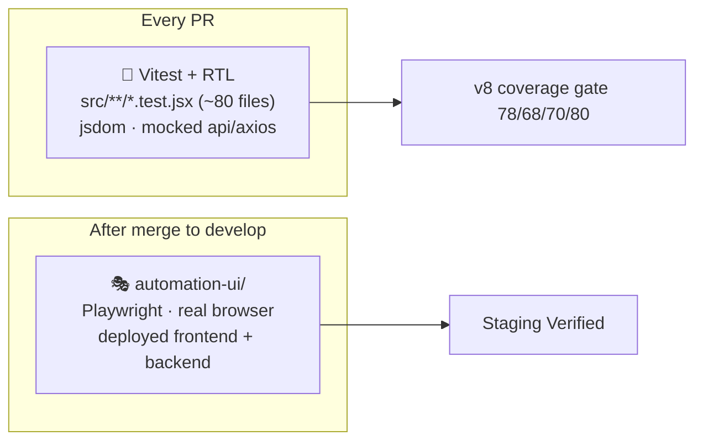

# 🧪 Client Testing

[⬅️ Client README](../README.md) · Strategy: [docs/07-quality-and-testing.md](../../docs/07-quality-and-testing.md)

---

## 1. 🗺️ Where client tests live



## 2. 🧱 Standard spec

```jsx
import { render, screen, within, fireEvent, waitFor } from '@testing-library/react';
import { describe, it, expect, vi, beforeEach } from 'vitest';
import api from '../../api/axios';
import ProductsSetup from './ProductsSetup';

vi.mock('../../api/axios', () => ({ default: { get: vi.fn(), post: vi.fn(), put: vi.fn(), delete: vi.fn() } }));

const notify = vi.fn();
vi.mock('../../context/NotificationContext', () => ({ useNotification: () => ({ notify }) }));

vi.mock('../../utils/dateUtils', async () => {
  const actual = await vi.importActual('../../utils/dateUtils');
  return { ...actual, getIndiaDate: () => '2026-08-09' };   // pin "today"
});

beforeEach(() => {
  vi.clearAllMocks();
  vi.mocked(api.get).mockImplementation((url) => {
    if (url.includes('/brands'))     return Promise.resolve({ data: { data: brands } });
    if (url.includes('/categories')) return Promise.resolve({ data: { data: categories } });
    return Promise.resolve({ data: { data: [] } });
  });
});

it('shows an error when products fail to load', async () => {
  vi.mocked(api.get).mockRejectedValueOnce({ response: { data: { error: 'boom' } } });
  render(<ProductsSetup />);
  await waitFor(() => expect(notify).toHaveBeenCalledWith(expect.any(String), 'error'));
});
```

## 3. ✅ Minimum per page

| # | Case |
|---|---|
| 1 | Renders initial state |
| 2 | Empty state when the API returns `[]` |
| 3 | API error → `notify(…, 'error')` |
| 4 | Core interactions (click, change, submit) |
| 5 | Optimistic update — no extra GET after save where the page updates locally |

## 4. 🧰 Tips

| Situation | Approach |
|---|---|
| Page uses `useAuth` | `vi.mock('../../context/AuthContext', () => ({ useAuth: () => ({ user: { role: 'admin' } }) }))` |
| Router hooks | Wrap in `<MemoryRouter initialEntries={['/path?x=1']}>` |
| `useMutation` network error | Expect fallback message `'Something went wrong'` |
| Lazy components | `await screen.findBy…` |
| Tables | `within(screen.getByRole('table'))` |

## 5. 📏 Coverage (`vite.config.js`)

| Statements | Branches | Functions | Lines |
|---:|---:|---:|---:|
| 78 % | 68 % | 70 % | 80 % |

Excluded: tests, `src/test/**`, `main.jsx`, `App.jsx`. `automation-ui/**` is excluded from collection entirely.

```bash
npm test                         # run once
npx vitest src/pages/setup       # a folder, watch mode
npm run test:coverage            # with gate, HTML in coverage/
```
