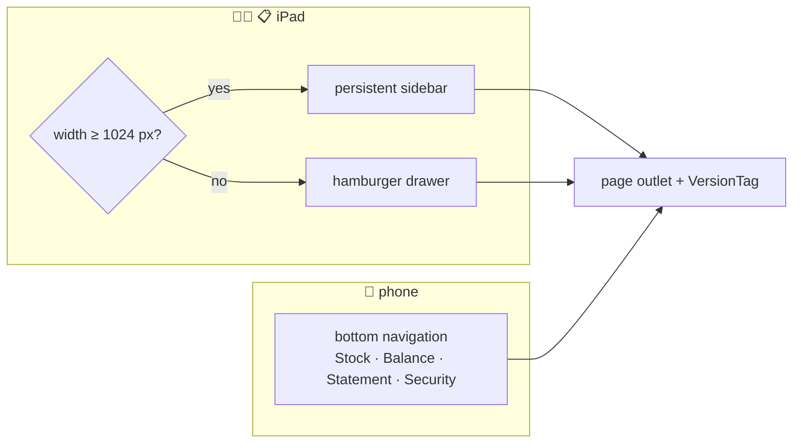

# 🧩 UI Components & Styling

[⬅️ Client README](../README.md)

---

## 1. 🧭 App shell (`components/Layout.jsx`)

Menus are defined per role in `Layout.jsx`; items can carry `superAdminOnly`. Brand stock links use brand colour dots.

## 2. 📦 Shared components

| Component | Purpose |
|---|---|
| `ErrorBoundary` | Friendly crash screen, auto-reload once on `ChunkLoadError`, posts crash report |
| `ColdStartScreen` | Wake-up overlay |
| `VersionTag` | Build tag + commit (sidebar, login) |
| `BrandTabs` | Brand switcher with brand colours |
| `DateSelector` | Date picker with optional prev/next navigation |
| `Pagination` | Shared paging control |
| `PinModal` | Edit/P&L PIN prompt (`verifyPath` prop) |
| `ConfirmationModal` | Destructive-action confirm |
| `PaymentForm`, `BulkTopUpModal`, `ResetLedgerModal` | Payment and ledger operations |
| `BalanceLedger`, `BalanceSummaryCard` | Ledger tables and totals |
| `BillSheet` | On-screen bill layout (matches the PDF) |
| `DispatchStockSummary` | Per-product dispatch totals with pinned product column |
| `SaveOverlay` | Top-right save toast (auto-dismiss on success, manual close on error) |
| `StatusBadge` | Cleared / outstanding / partial pill |

### `components/ui/` primitives

`BrandedLoader` (+ `TumblerSpinner`), `Modal`, `Button`, `Alert`, `EmptyState`, `LoadingOverlay`.

## 3. 🥛 BrandedLoader

| Situation | Usage |
|---|---|
| Lazy page load | `<BrandedLoader />` via `PageLoader` in `App.jsx` |
| Full-page blocking wait | `<BrandedLoader overlay open={loading} label="Saving…" />` |
| Section/card | `<BrandedLoader size="sm" />` |
| Save with dim backdrop | `<BrandedLoader overlay tone="transparent" open={saving} />` |
| Cold-start brand screen | `<BrandedLoader overlay tone="brand" lively />` |
| In-button / inline | `<TumblerSpinner size={14} />` — **never** `Loader2` |

| Prop | Default | Meaning |
|---|---|---|
| `overlay` | `false` | Fixed full-screen |
| `open` | `true` | Visibility in overlay mode |
| `label` | `"Loading…"` | Status text |
| `hideBrand` | `false` | Hide "Vikas Milk Dairy" title |
| `size` | `"md"` | `sm` · `md` · `lg` |
| `tone` | `"card"` | `card` · `transparent` · `brand` |
| `inlinePadY` | `"py-16"` | Inline padding |
| `lively` | `false` | Sonar ring (cold start only) |

## 4. 🎨 Styling

| Topic | Rule |
|---|---|
| Framework | Tailwind CSS 3 utilities; global CSS only in `index.css` |
| Merging | `twMerge(clsx(...))` for conditional classes |
| Brand colours | `BRAND_COLORS`, `getBrandColors(name, index)`, `getBrandHeaderHex` in `utils/constants.js` (Nandini amber, Jersey sky, Gowardhan violet; others get a default palette) |
| Icons | `lucide-react` |
| Print | `.no-print` hides controls; print pages use their own stylesheet-friendly layout |
| Touch | Targets sized for iPad/phone; tables scroll horizontally (`PRODUCT_COL_MIN_WIDTH`) |

## 5. 🔢 Product lists

Use `utils/productLayout.js`:

| Export | Purpose |
|---|---|
| `buildCategoryOrderMap(categories)` | name → displayOrder |
| `compareByLayout(a, b)` / `sortByLayout(products)` | brand → category → product order → name |
| `sortCategoryGroups(grouped, categories)` | Order grouped sections by category |

The Exception Manager relies on `categoryDisplayOrder` returned by the API.
