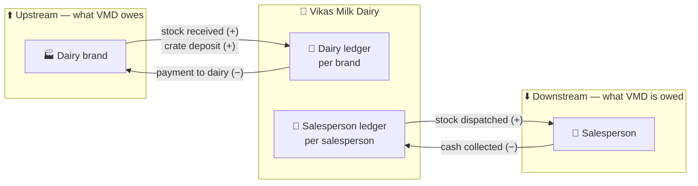
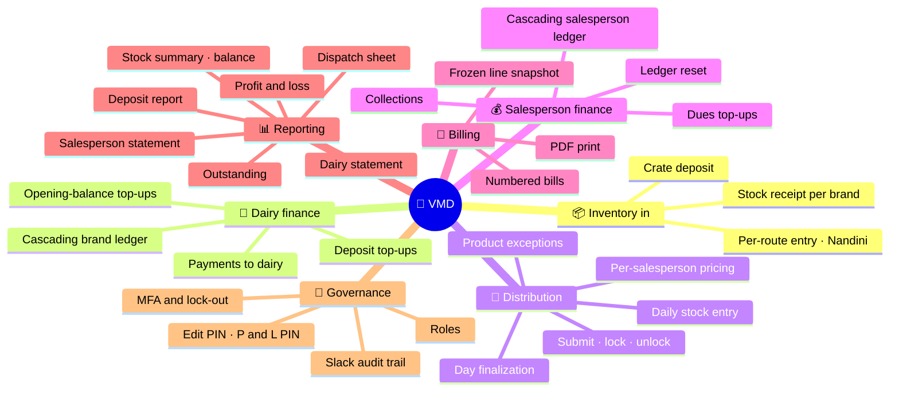

# 🎯 01 · Product Overview

[⬅️ Docs index](README.md) · [Next: System architecture ➡️](02-system-architecture.md)

---

## 1. Business context

**Vikas Milk Dairy** is a distributor. It buys milk and dairy products from several dairy brands, holds them for a
day, hands them to its own salespeople, and collects cash from those salespeople after they have delivered to
retailers and households.

Two money relationships therefore have to be tracked every single day:

Before VMD the business ran on paper pads. The application replaces the pads while keeping their layout
(printed bills, statements and the dispatch sheet look like the stationery the dairy already used).

## 2. Users & personas

| Persona | Role in app | Device | Primary jobs |
|---|---|---|---|
| 👑 Owner | `superadmin` | iPad | Everything an admin does, plus admin accounts, brand creation, PINs, MFA policy, ledger resets, opening-balance top-ups |
| 🧑‍💼 Office staff | `admin` | iPad | Stock receipts, dairy payments, salesperson collections, setup, reports, bills |
| 📋 Dispatcher | `dispatcher` | iPad | Watch the day's dispatch sheet, lock/unlock today's entries, finalize the day |
| 🛵 Salesperson | `salesman` | Phone | Enter the stock they took today, see their balance and statement |

➡️ Detailed permissions: [05-security.md](05-security.md#2--roles--authorization)

## 3. Capability map

| Area | Capability | Who | Screen |
|---|---|---|---|
| 📦 Inventory | Record stock received per brand/day (per route for Nandini) | admin | Dairy → Stock (`/dairy/stock/:brandName`) |
| 📒 Dairy finance | Pay the dairy, load opening dues and deposit top-ups | admin / superadmin | Dairy → Payments |
| 🛠️ Setup | Brands, categories, products, routes, layout ordering, dairy settings | admin (brand create: superadmin) | Dairy → Setup |
| 👥 Salespeople | Accounts, per-salesperson prices, product exceptions | admin | Salesman → Setup |
| 🚚 Distribution | Daily stock entry per salesperson | salesman (own) / admin | Stock Entry / Dispatch sheet |
| 💰 Collections | Record cash collected, load opening dues | admin | Salesman → Payments |
| 🧾 Billing | Generate, reprint, cancel bills | admin | Reports → Salespeople → Bills tab |
| 📊 Reporting | Statements, summaries, outstanding, P&L | admin (dispatch sheet + stock balance: dispatcher too) | Reports |
| 🔐 Admin | Admin users, MFA, unlock accounts | superadmin | Admin → Users |

## 4. Daily operating rhythm

```mermaid
gantt
    title A typical VMD business day (IST)
    dateFormat HH:mm
    axisFormat %H:%M
    section Morning
    Dairy trucks arrive · stock receipt entered   :a1, 04:30, 2h
    Salespeople take stock · enter their quantities :a2, 05:00, 2h
    Dispatcher reviews sheet · locks entries      :a3, 06:00, 1h
    section Day
    Deliveries to retailers                       :b1, 07:00, 6h
    Collections recorded as salespeople return    :b2, 12:00, 6h
    section Evening
    Dispatcher finalizes the day                  :c1, 19:00, 1h
    Office pays dairy · reviews reports           :c2, 18:00, 3h
```

At midnight IST every earlier day is treated as finalized automatically; today needs an explicit finalization
(see [04-business-workflows.md § Day finalization](04-business-workflows.md#6-day-finalization)).

## 5. Key business rules (summary)

| # | Rule | Detail |
|---|---|---|
| R1 | 📒 Balances cascade | Changing any day recalculates that day and **every later day** for the brand or salesperson |
| R2 | ➕ Top-ups add | A top-up is an old due loaded into the app; it increases what is owed |
| R3 | ➖ Payments subtract | A real payment decreases what is owed |
| R4 | 🏷️ Server-side pricing | A salesperson's line price comes from their price list on that date, never from the device |
| R5 | 🚫 Product exceptions | Per-salesperson enable/disable overrides the product's global setting |
| R6 | 🔒 Locking | Submitted or past-day entries are locked for the salesperson unless an admin unlocks them |
| R7 | 🧾 Bills are frozen | A bill stores a snapshot; later dispatch edits never change an issued bill |
| R8 | 🪙 Deposits | Crate products of enabled brands/categories add a per-litre deposit to the dairy ledger |
| R9 | 🕰️ Business time is IST | All "today" logic uses India time on both tiers |
| R10 | ⚠️ No oversell block | Dispatching more than was received is allowed by an explicit owner decision (2026-08-16) |

➡️ Full detail: [04-business-workflows.md](04-business-workflows.md) · [03-domain-model.md](03-domain-model.md)

## 6. Out of scope

- Retailer-level accounting (salespeople manage their own customers).
- Payment gateways — all money movement is recorded, not executed.
- Inventory carry-over between days (stock is received and dispatched daily).
- Offline mode — the app requires connectivity.
