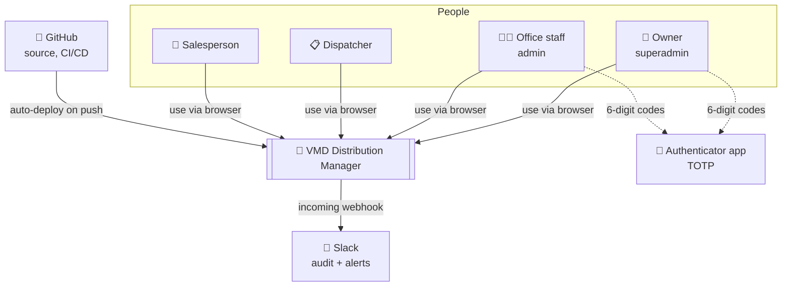
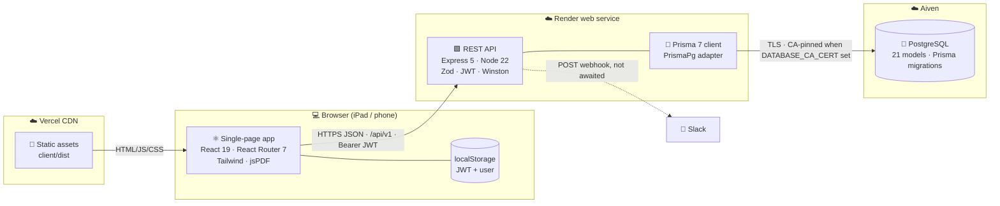
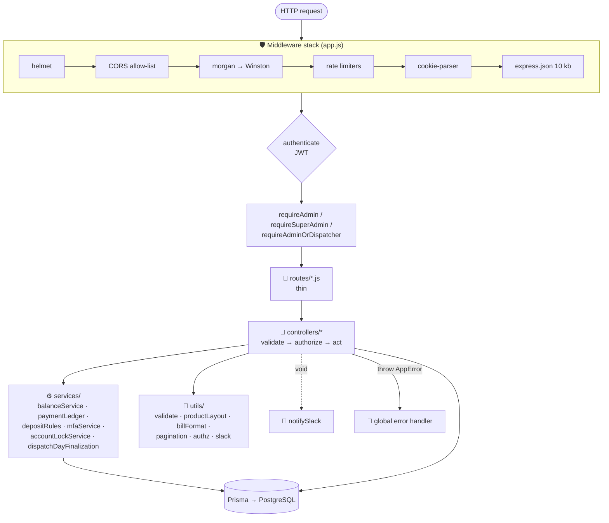
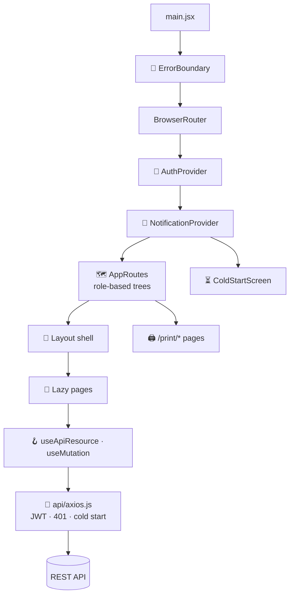
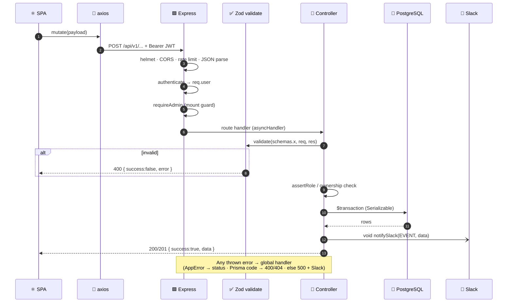
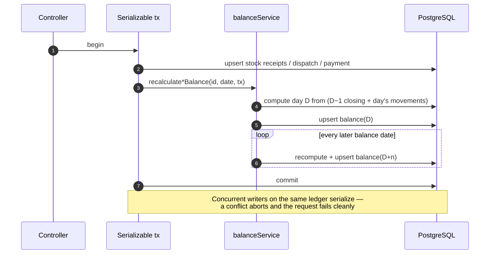
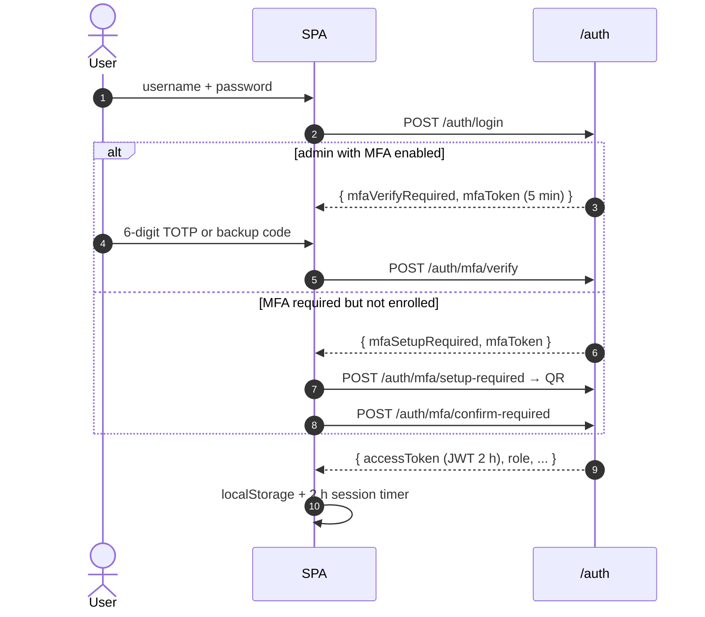

# 🏗️ 02 · System Architecture

[⬅️ Product overview](01-product-overview.md) · [Docs index](README.md) · [Next: Domain model ➡️](03-domain-model.md)

---

This document follows the **C4 model**: system context → containers → components, then the runtime views that
matter most (request lifecycle, ledger write, authentication).

## 1. 🌍 System context (C4 level 1)

## 2. 📦 Containers (C4 level 2)

| Container | Technology | Responsibility | Docs |
|---|---|---|---|
| ⚛️ SPA | React 19, Vite 8, React Router 7, Tailwind 3 | UI, role-based routing, print/PDF | [client/README.md](../client/README.md) |
| 🟩 REST API | Express 5, Node 22, Zod 4, jsonwebtoken, otplib | Validation, authorization, business rules, ledgers | [server/README.md](../server/README.md) |
| 🐘 Database | PostgreSQL 16 via Prisma 7 | System of record | [03-domain-model.md](03-domain-model.md) |
| 💬 Slack | Incoming webhook | Audit trail for every write, operational alerts | [09-observability-and-operations.md](09-observability-and-operations.md) |

## 3. 🧱 Components (C4 level 3)

### 3.1 Backend

➡️ [server/docs/architecture.md](../server/docs/architecture.md)

### 3.2 Frontend

➡️ [client/docs/architecture.md](../client/docs/architecture.md)

## 4. 🔁 Runtime views

### 4.1 Request lifecycle (authenticated write)

### 4.2 Ledger write with cascade

➡️ [04-business-workflows.md § Ledgers](04-business-workflows.md#2-the-cascading-ledgers)

### 4.3 Authentication

➡️ [05-security.md](05-security.md)

## 5. 🧰 Technology stack

| Layer | Choice | Version | Why |
|---|---|---|---|
| UI framework | React | 19 | Team familiarity, ecosystem, concurrent rendering |
| Build | Vite | 8 | Fast dev server, simple config, code-splitting |
| Routing | React Router | 7 | Nested role-based route trees |
| Styling | Tailwind CSS (+ clsx, tailwind-merge) | 3 | Utility-first, no CSS drift |
| PDF | jsPDF | 4 | Vector bill PDFs in the browser |
| API | Express | 5 | Minimal, native async error support |
| Validation | Zod | 4 | One schema = parse + type + message |
| ORM | Prisma (+ `@prisma/adapter-pg`) | 7 | Typed queries, migrations, transactions |
| Auth | jsonwebtoken, bcrypt, otplib, qrcode | — | JWT sessions, hashed secrets, TOTP MFA |
| Logging | Winston + morgan | 3 | Structured JSON in production |
| Hosting | Vercel · Render · Aiven | — | Managed, auto-deploy from Git |
| Tests | Vitest + RTL · Playwright · Cucumber + REST Assured | — | One tool per layer (see [07](07-quality-and-testing.md)) |

## 6. 🧭 Architectural principles

| Principle | How it is applied |
|---|---|
| **Thin edges, rich core** | Routes only wire; controllers orchestrate; services own shared domain logic |
| **Fail fast** | Zod at the boundary, env validated at boot, production refuses to start without secrets |
| **Single source of truth** | Ledger formula in `balanceService`, deposit rule in `depositRules`, sort in `productLayout` |
| **Consistency over throughput** | Serializable transactions for every ledger mutation |
| **Server is the authority** | Prices, permissions, locks and dates are decided server-side |
| **Observable by default** | Every write produces an audit card; every crash produces an alert |
| **Stateless API** | JWT in a header; any instance can serve any request |

➡️ Rationale for each decision: [11-architecture-decisions.md](11-architecture-decisions.md)
