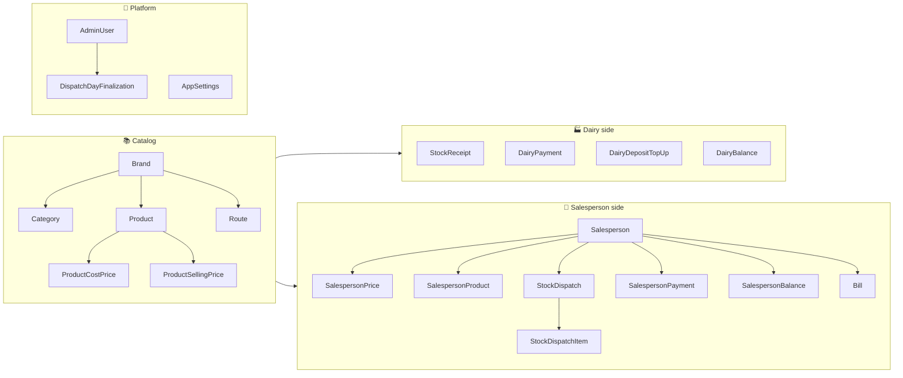
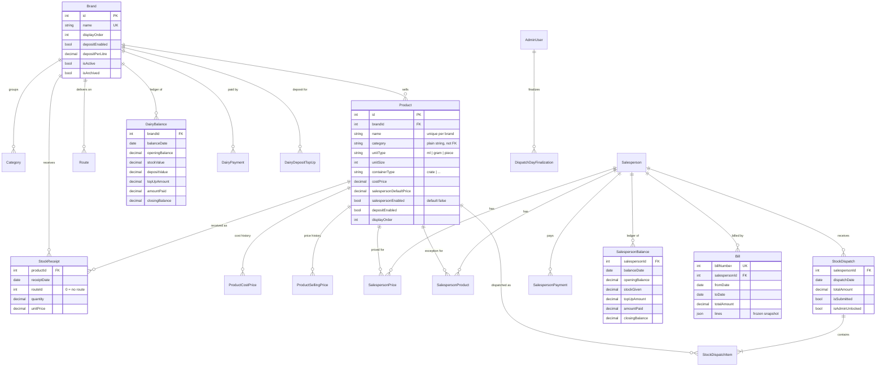

# 🗃️ 03 · Domain Model

[⬅️ System architecture](02-system-architecture.md) · [Docs index](README.md) · [Next: Business workflows ➡️](04-business-workflows.md)

---

The single source of truth is [`server/prisma/schema.prisma`](../server/prisma/schema.prisma). This page explains
the model in business terms. Physical details (column names, indexes, migrations) are in
[server/docs/data-model-and-migrations.md](../server/docs/data-model-and-migrations.md).

## 1. 🧭 Bounded contexts

## 2. 🧬 Entity-relationship diagram

> Not shown for brevity: `Category`, `Route`, `DairyPayment`, `DairyDepositTopUp`, `SalespersonPrice`,
> `SalespersonProduct`, `SalespersonPayment`, `AdminUser`, `DispatchDayFinalization`, `AppSettings` — described below.

## 3. 📋 Entity catalogue

### 📚 Catalog

| Entity | Meaning | Identity / constraints | Notes |
|---|---|---|---|
| **Brand** | A dairy VMD buys from (Nandini, Jersey, Gowardhan …) | unique `name` | Archived, never deleted. Carries deposit config (`depositEnabled`, `depositPerLitre`, `depositCalcMethod`) |
| **Category** | Product group within a brand (Milk, Curd …) | unique `(brandId, name)` | Has its own `displayOrder` and `depositEnabled` |
| **Product** | Something VMD sells | unique `(brandId, name)` | `category` is a **string**, not a relation — see ADR-003 |
| **ProductCostPrice / ProductSellingPrice** | Effective-dated price history | unique `(productId, effectiveFrom)` | `effectiveFrom` must be today (IST) or later |
| **Route** | A Nandini delivery route | unique `(brandId, routeNumber)` | `routeId = 0` on a receipt means "no route" |

### 🏭 Dairy side

| Entity | Meaning | Identity | Effect on dairy ledger |
|---|---|---|---|
| **StockReceipt** | Quantity of a product received on a day (per route) | unique `(productId, receiptDate, routeId)` | ➕ `quantity × unitPrice` to **stockValue**, ➕ deposit if eligible |
| **DairyPayment** | Money paid to the dairy | — | `isTopUp=false` ➖ **amountPaid** · `isTopUp=true` ➕ **topUpAmount** |
| **DairyDepositTopUp** | Opening crate-deposit balance | — | Reported in the deposit report; not part of the balance formula |
| **DairyBalance** | Computed ledger row per brand per day | unique `(brandId, balanceDate)` | **Derived** — written only by `balanceService` |

### 🛵 Salesperson side

| Entity | Meaning | Identity | Notes |
|---|---|---|---|
| **Salesperson** | Delivery agent; can sign in with `username` | unique `username` | `displayOrder` drives sheet order |
| **SalespersonPrice** | Price a salesperson pays for a product from a date | unique `(salespersonId, productId, effectiveFrom)` | Falls back to `Product.salespersonDefaultPrice` |
| **SalespersonProduct** | Per-salesperson enable/disable override | unique `(salespersonId, productId)` | `isEnabled ?? product.salespersonEnabled` |
| **StockDispatch** | One salesperson's stock for one day | unique `(salespersonId, dispatchDate)` | `isSubmitted`, `isAdminUnlocked` drive locking |
| **StockDispatchItem** | Line on a dispatch | — | `unitPrice` re-derived server-side |
| **SalespersonPayment** | Cash collected from a salesperson | — | `isTopUp` semantics same as dairy |
| **SalespersonBalance** | Computed ledger row per salesperson per day | unique `(salespersonId, balanceDate)` | **Derived** — written only by `balanceService` |
| **Bill** | Numbered bill for a salesperson and period | unique `billNumber` | `lines` = frozen JSON (brands → products) |

### 🔐 Platform

| Entity | Meaning | Notes |
|---|---|---|
| **AdminUser** | Superadmin / admin / dispatcher account | MFA fields (encrypted TOTP secret, hashed backup codes, `mfaRequired`) and lock-out counters |
| **DispatchDayFinalization** | Explicit "today is finalized" row | unique `date`; past days are finalized implicitly |
| **AppSettings** | Key/value configuration | `edit_pin`, `pl_pin` (bcrypt), `pl_pin_enabled`, `bill_number_start` |

## 4. 📐 Invariants

| # | Invariant | Enforced by |
|---|---|---|
| I1 | `closing = opening + stockValue + depositValue + topUpAmount − amountPaid` (dairy) | `balanceService._computeDairyBalance` |
| I2 | `closing = opening + stockGiven + topUpAmount − amountPaid` (salesperson) | `balanceService._computeSalespersonBalance` |
| I3 | `opening(D) = closing(previous balance date)`, or 0 | `balanceService` |
| I4 | Balance rows are never edited directly | Code review + `CLAUDE.md` |
| I5 | One dispatch per salesperson per day | DB unique constraint |
| I6 | One receipt row per product/day/route | DB unique constraint (upsert) |
| I7 | Bill numbers are strictly increasing | Serializable transaction on create |
| I8 | Every product list sorts brand → category → product order → name | `utils/productLayout.js` (both tiers) |
| I9 | Business dates are `DATE` columns interpreted in IST | `dateUtils` + CI timezone lint |

## 5. 🔢 Money & quantity precision

| Field type | Precision | Examples |
|---|---|---|
| Ledger amounts | `Decimal(10,2)` — rupees and paise | balances, payments, dispatch totals |
| Unit prices | `Decimal(10,4)` | `unitPrice`, `costPrice`, `sellingPrice` |
| Quantities | `Decimal(10,2)` | receipt and dispatch quantities |
| Bill totals | `Decimal(12,2)` | `Bill.totalAmount` |

Deposit lines are rounded to paise per line and summed without re-rounding (see `depositRules.calculateLineDeposit`).
