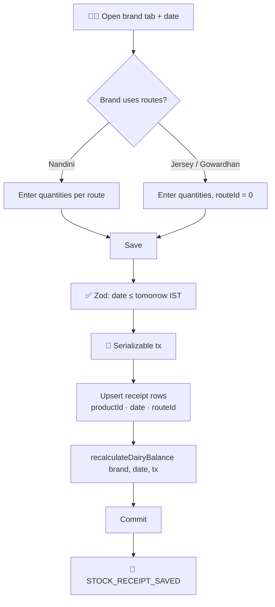
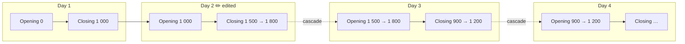
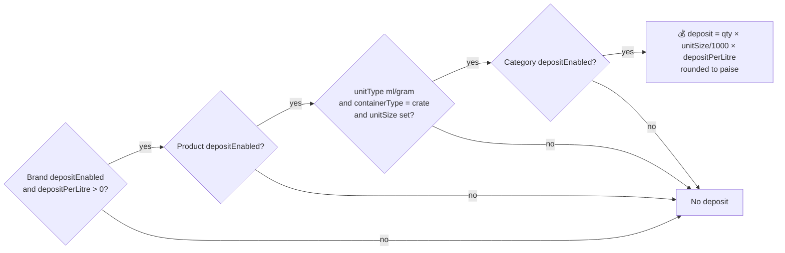
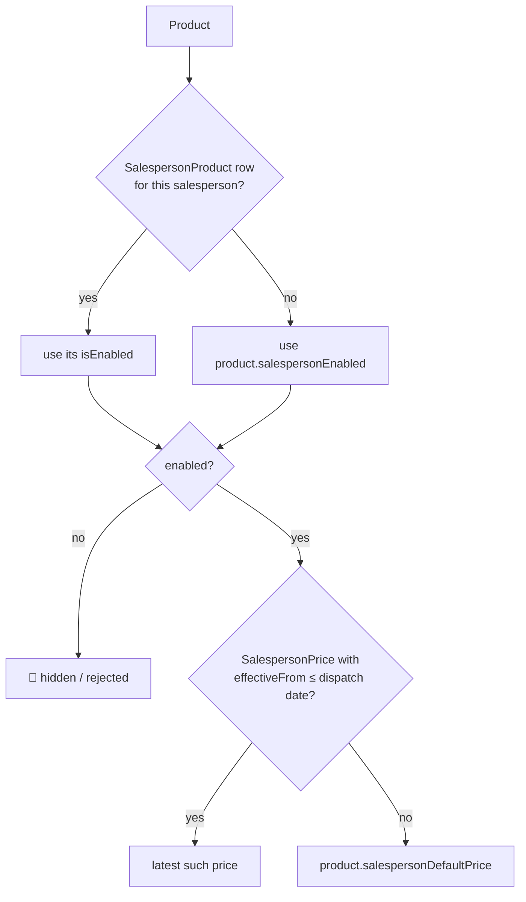
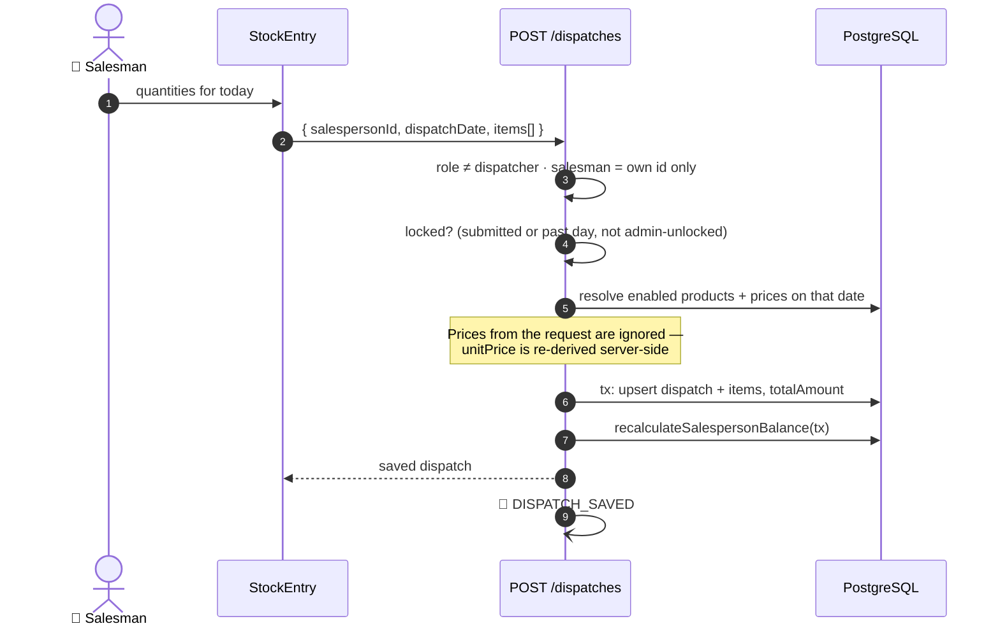
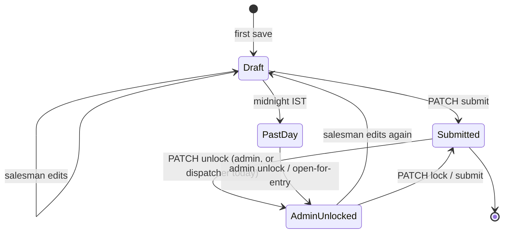
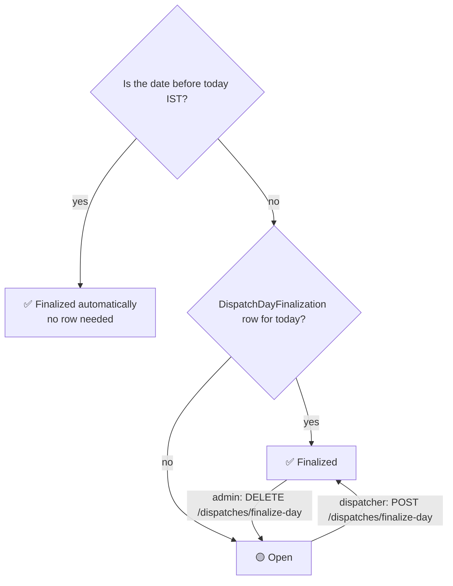
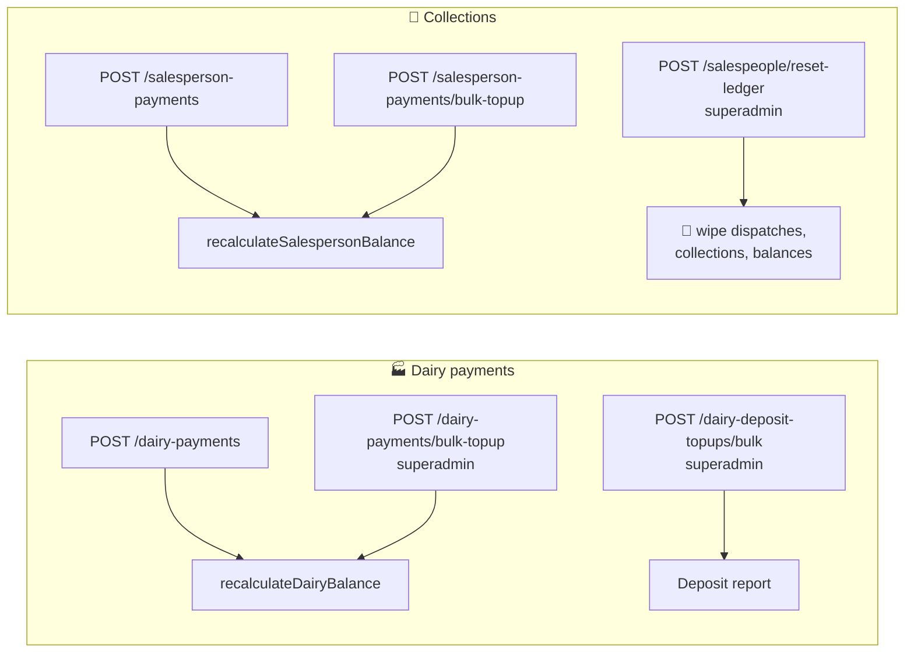
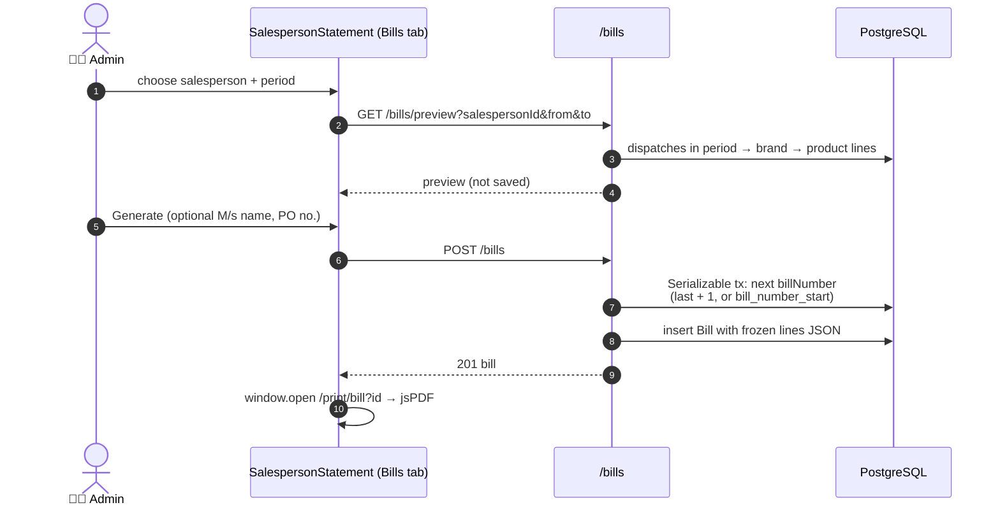
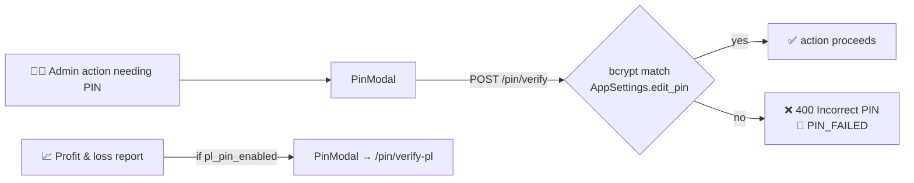

# 🔄 04 · Business Workflows

[⬅️ Domain model](03-domain-model.md) · [Docs index](README.md) · [Next: Security model ➡️](05-security.md)

---

Each workflow lists the **actors**, the **flow**, the **rules** and the **code** that implements it.

| # | Workflow |
|---|---|
| 1 | [📦 Stock receipt](#1-stock-receipt) |
| 2 | [📒 The cascading ledgers](#2-the-cascading-ledgers) |
| 3 | [🏷️ Salesperson pricing & product access](#3-salesperson-pricing--product-access) |
| 4 | [🚚 Daily dispatch (stock entry)](#4-daily-dispatch-stock-entry) |
| 5 | [🔒 Dispatch lock lifecycle](#5-dispatch-lock-lifecycle) |
| 6 | [✅ Day finalization](#6-day-finalization) |
| 7 | [💰 Payments, collections & top-ups](#7-payments-collections--top-ups) |
| 8 | [🧾 Bills](#8-bills) |
| 9 | [🔑 Protected actions (PIN)](#9-protected-actions-pin) |
| 10 | [📊 Reporting](#10-reporting) |

---

## 1. Stock receipt

**Actor:** admin · **Screen:** `/dairy/stock/:brandName` · **API:** `POST /stock-receipts/bulk`

| Rule | Detail |
|---|---|
| Dates | Up to **tomorrow** (IST) — trucks for tomorrow can be pre-entered |
| Price | `unitPrice` stored on each row (cost price at entry time) so history never changes |
| Visibility | Only products with `showInStockReceipt=true` appear |
| Rate limit | 30 bulk writes / minute |

## 2. The cascading ledgers

Both ledgers have one row per entity per day that had activity. A row's **opening** is the previous row's
**closing**, so a change to an old day ripples forward.

| Ledger | Formula | Inputs per day |
|---|---|---|
| 🏭 Dairy (per brand) | `closing = opening + stockValue + depositValue + topUpAmount − amountPaid` | receipts × price, crate deposit, dairy top-ups, dairy payments |
| 🛵 Salesperson | `closing = opening + stockGiven + topUpAmount − amountPaid` | dispatch totals, salesperson top-ups, collections |

**What triggers a recalculation**

| Event | Call |
|---|---|
| Stock receipt saved | `recalculateDairyBalance(brandId, date)` |
| Dairy payment / top-up created, updated, deleted | `recalculateDairyBalance` (old **and** new date if the date changed) |
| Dispatch saved, cleared, deleted, opened for entry | `recalculateSalespersonBalance(salespersonId, date)` |
| Collection / top-up created, updated, deleted | `recalculateSalespersonBalance` (old and new date) |
| Ledger reset (superadmin) | **Deletes** every dispatch, collection and balance row of the selected salespeople in one transaction — irreversible |

**Deposit rule** — a receipt line adds deposit only when *all* are true:

Code: `server/services/balanceService.js`, `server/services/depositRules.js`, `server/services/paymentLedger.js`.

## 3. Salesperson pricing & product access

| Operation | Who | API |
|---|---|---|
| Edit one salesperson's prices (effective today or later) | admin | `POST /salespeople/:id/prices/bulk` |
| Copy prices from another salesperson | admin | `POST /salespeople/:id/prices/copy-from/:sourceId` |
| Bulk update across salespeople | admin | `POST /salespeople/bulk-update` |
| Toggle global access | admin | `PATCH /products/salesperson-global` |
| Per-salesperson exceptions | admin | `POST /salespeople/:id/products/bulk`, `/salespeople/products/bulk-update` |

> ⚠️ Use `??`, never `&&`, when resolving access — `&&` would make exceptions for globally-disabled products impossible.

## 4. Daily dispatch (stock entry)

**Actors:** salesman (own phone) or admin · **API:** `POST /dispatches`

| Rule | Detail |
|---|---|
| Empty `items` | Clears the draft (deletes the dispatch) |
| Dates | Up to tomorrow (IST) |
| Stock availability | **Not enforced** — owner decision 2026-08-16. `stockGuard.validateDispatchStock` exists, unwired |
| Dispatcher | Read-only on entries (cannot create/delete) |

## 5. Dispatch lock lifecycle

**Effective lock** = `(isSubmitted OR date < today) AND NOT isAdminUnlocked`.

| Actor | Can lock/unlock |
|---|---|
| Admin / superadmin | Any date |
| Dispatcher | Only **today**, and only until today is finalized |
| Salesman | Submit own entry only |

`POST /dispatches/open-for-entry` (admin) creates or unlocks an entry for a salesperson/date even when none exists.

## 6. Day finalization

After finalization dispatchers can no longer lock/unlock; admins still can. Events: `DISPATCH_DAY_FINALIZED`,
`DISPATCH_DAY_UNFINALIZED`. Code: `services/dispatchDayFinalization.js`, `controllers/dispatches/dayFinalization.js`.

## 7. Payments, collections & top-ups

| Kind | `isTopUp` | Ledger effect | Typical use |
|---|---|---|---|
| Payment / collection | `false` | ➖ subtracts | Real money moved today |
| Top-up | `true` | ➕ adds | Dues that existed before the app (opening balance) |

Changing a payment's **date** recalculates both the old and the new date (`paymentLedger.cascadeAroundDateChange`).

## 8. Bills

**Actor:** admin · **Screen:** Reports → Salespeople → Bills tab · **Print:** `/print/bill?id=`

| Rule | Detail |
|---|---|
| Nothing dispatched | 400 — nothing to bill |
| Frozen | Reprints show exactly what was issued, even if dispatches are later edited |
| Party | `partyName` defaults to the salesperson's name |
| Cancel | `DELETE /bills/:id` (`BILL_DELETED`) |
| Lines | Brand → individual products, ordered by the canonical layout (`utils/billFormat.js`) |

## 9. Protected actions (PIN)

PINs are rotated by the superadmin (`PUT /pin/update`, `/pin/update-pl`); the P&L gate is toggled with
`PUT /pin/settings`. Verification is limited to 20 attempts per 15 minutes.

## 10. Reporting

| Report | Screen | API | Audience |
|---|---|---|---|
| Dairy statement | `/reports/dairy` (+ print) | `GET /reports/dairy-statement` | admin |
| Salesperson statement + bills | `/reports/salespeople` (+ print) | `GET /reports/salesperson-statement` | admin |
| Own statement | `/salesman/my-statement` (+ print) | `GET /salesperson-statement/me` | salesman |
| Stock summary | `/reports/stock` (+ print) | `GET /reports/stock-summary` | admin |
| Stock balance | `/reports/stock-balance` | `GET /stock-receipts/availability` | admin, dispatcher |
| Daily dispatch sheet | `/salesman/dispatch-sheet` | `GET /reports/daily-dispatch` | admin, dispatcher |
| Salesman day balance | `/salesman/day-balance` | `GET /salesperson-balance…` | admin |
| Deposit | `/reports/deposit` (+ print) | `GET /reports/deposit-summary` | admin |
| Outstanding | `/salesperson-outstanding` | `GET /reports/outstanding` | admin |
| Profit & loss | `/salesman/profit-loss` | `GET /reports/profit-loss` (P&L PIN) | admin |

Every report that lists products uses the canonical display order (brand → category → product → name).
