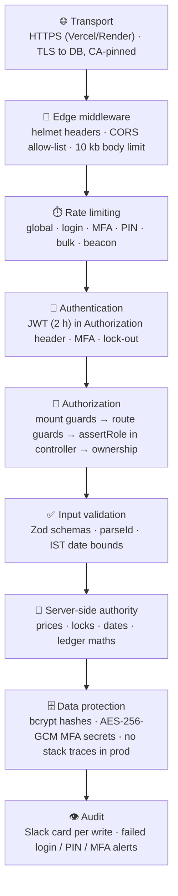
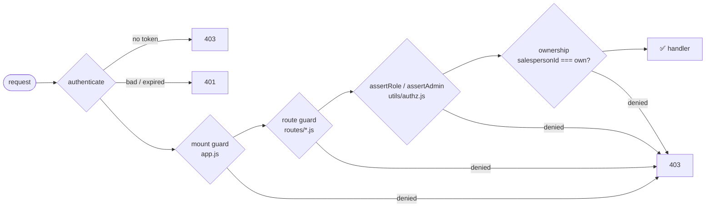
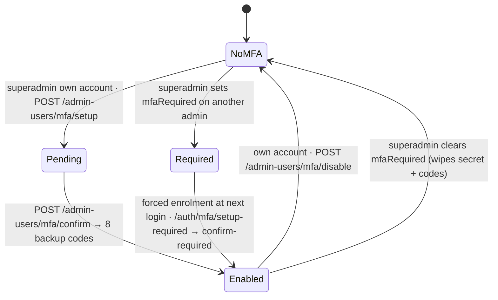
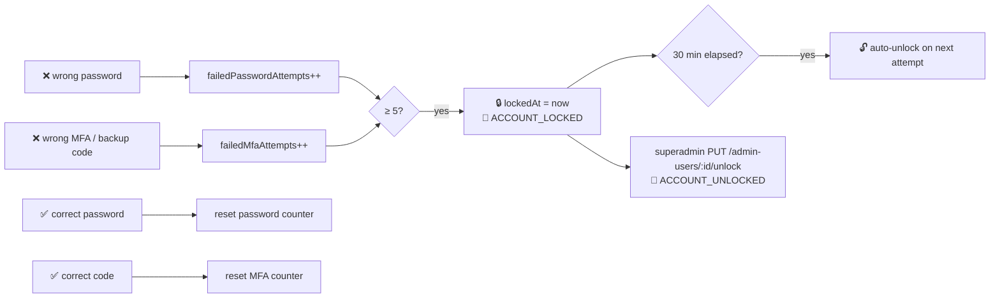

# 🔐 05 · Security Model

[⬅️ Business workflows](04-business-workflows.md) · [Docs index](README.md) · [Next: Environments & deployment ➡️](06-environments-and-deployment.md)

---

## 1. 🛡️ Defence in depth

## 2. 👥 Roles & authorization

| Capability | 👑 superadmin | 🧑‍💼 admin | 📋 dispatcher | 🛵 salesman |
|---|:-:|:-:|:-:|:-:|
| Dashboard, setup, stock receipts, payments, reports, bills | ✅ | ✅ | — | — |
| Create brand | ✅ | — | — | — |
| Admin users, MFA policy, unlock accounts | ✅ | — | — | — |
| Change edit PIN / P&L PIN / P&L gate | ✅ | — | — | — |
| Bulk dairy top-up, deposit top-up, ledger reset | ✅ | — | — | — |
| Daily dispatch sheet, stock balance | ✅ | ✅ | ✅ | — |
| Lock/unlock today's entries (until finalized) | ✅ | ✅ | ✅ | — |
| Finalize today | — | — | ✅ | — |
| Revert finalization, unlock past days | ✅ | ✅ | — | — |
| Own stock entry, balance, statement | — | — | — | ✅ |
| Change own password | ✅ | ✅ | ✅ | ✅ |

### Enforcement layers

The **frontend** mirrors these rules (`ProtectedRoute adminOnly / superAdminOnly`, separate route trees for
dispatcher and salesman) for usability only — the server is the authority.

## 3. 🔑 Authentication

| Control | Value | Where |
|---|---|---|
| Token | JWT HS256 signed with `JWT_SECRET` (≥ 32 chars) | `auth.controller.js` |
| Lifetime | 2 hours (`JWT_EXPIRES_IN = 7200`) | `utils/constants.js` |
| Transport | `Authorization: Bearer` (or `x-access-token`) — **the login cookie is not honoured** | `middleware/auth.js` |
| Client session | 2 h timer (`SESSION_MS`) — must equal JWT lifetime | `client/src/utils/session.js` |
| Passwords | bcrypt, 10 rounds | `utils/constants.js` |
| Salesman login | `Salesperson.username` + password, same endpoint | `POST /auth/login` |

> Why not cookies? An ambient cookie would let any cross-site form act as the user (CSRF). An explicit header cannot
> be attached by a foreign page. See [ADR-005](11-architecture-decisions.md#adr-005--jwt-in-the-authorization-header-not-a-cookie).

### 3.1 Multi-factor authentication (admin accounts)

| Who | How MFA is managed |
|---|---|
| 👑 Superadmin (own account) | Self-service tab: set up, confirm, disable |
| 🧑‍💼 Admin / other superadmin | Superadmin toggles **MFA required**; enrolment is forced at their next sign-in; turning it off removes their MFA |
| 📋 Dispatcher | Not supported |

| Control | Detail |
|---|---|
| Algorithm | TOTP (otplib), QR code via `qrcode` |
| Secret at rest | AES-256-GCM; key = SHA-256(`JWT_SECRET` + context) — **rotating `JWT_SECRET` invalidates all enrolments** |
| Backup codes | 8, bcrypt-hashed, single use |
| Pending step | `mfaToken` valid 5 minutes, only redeemable on MFA endpoints |
| Policy | `mfaRequired` can be set on admin/superadmin, never dispatcher |

### 3.2 Account lock-out

## 4. ⏱️ Rate limits

| Scope | Window | Max | Response when exceeded |
|---|---|---|---|
| All `/api` | 15 min | 5 000 | 429 |
| `POST /auth/login` | 1 h / IP | 20 (`LOGIN_RATE_LIMIT_MAX`) | 429 |
| MFA verify / setup / confirm | per limiter in `routes/auth.js` | 15–30 | 429 |
| `POST /pin/verify`, `/pin/verify-pl` | 15 min | 20 | 429 |
| Bulk writes (stock receipts, prices, product access) | 1 min | 30 | 429 |
| `POST /errors/client` (public) | 1 h / IP | 30 | **200** (silent drop) |

Client IP is `req.ip` with `trust proxy = 1`; `X-Forwarded-For` is never read directly.

## 5. 🔒 Protected actions

| Secret | Stored | Purpose | Rotated by |
|---|---|---|---|
| Edit PIN | `AppSettings.edit_pin` (bcrypt) | Confirms sensitive edits | superadmin (`PUT /pin/update`) |
| P&L PIN | `AppSettings.pl_pin` (bcrypt) | Opens the profit & loss report when `pl_pin_enabled` | superadmin (`PUT /pin/update-pl`) |

`EDIT_PIN` in the environment seeds both PINs on the **first** boot only (falls back to `123456` — always set it).

## 6. 🗄️ Data protection

| Data | Protection |
|---|---|
| Passwords, PINs, backup codes | bcrypt |
| TOTP secrets | AES-256-GCM, never returned after enrolment |
| Database link | TLS; CA certificate pinned when `DATABASE_CA_CERT` is set (warning at boot otherwise) |
| Error responses | Production hides stacks and Prisma internals (`{ success:false, error }`) |
| Slack cards | Untrusted text passes through `escapeSlack` |
| Secrets in config | Only via `config/env.js`; production refuses to boot without `JWT_SECRET`, `DATABASE_URL`, `ADMIN_PASSWORD` |
| Repository | `.env` files are git-ignored; CI secrets live in GitHub Environments |

## 7. 🧪 How security is verified

| Check | Where |
|---|---|
| Full endpoint × caller refusal matrix (361 rows) | `server/automation` `access-control-matrix.feature` |
| Forged / unsigned / not-yet-valid tokens, headers, no internals | `security.feature`, `server/tests/playwright/security*.spec.js` |
| MFA and lock-out flows | `server/tests/playwright/mfa*.spec.js`, `accountLock.spec.js` |
| Dependency vulnerabilities | `npm audit --audit-level=moderate` on every PR, Dependabot weekly |
| Timezone-unsafe date filters | `server/scripts/check-timezone-safety.js` in CI |

## 8. ⚠️ Known risks & accepted decisions

| Item | Status |
|---|---|
| Dispatch quantities are not limited by received stock | Accepted by the owner (2026-08-16); guard implemented but unwired |
| Malformed JSON / > 10 kb bodies return 500 | Known defect, tracked in `known-defects.feature` |
| Impossible calendar dates (`2026-02-30`) accepted | Known defect, tracked |
| Ids with trailing characters parsed by `parseInt` | Known defect, tracked |
| `ADMIN_PASSWORD` required but unused | Legacy configuration, safe to keep |

## 9. 🚨 Reporting a vulnerability

Do not open a public issue. Contact the code owner listed in `.github/CODEOWNERS` directly with reproduction steps;
fixes ship as a `hotfix/*` branch into `main` ([08-ci-cd-and-release.md](08-ci-cd-and-release.md#5-hotfix-flow)).
