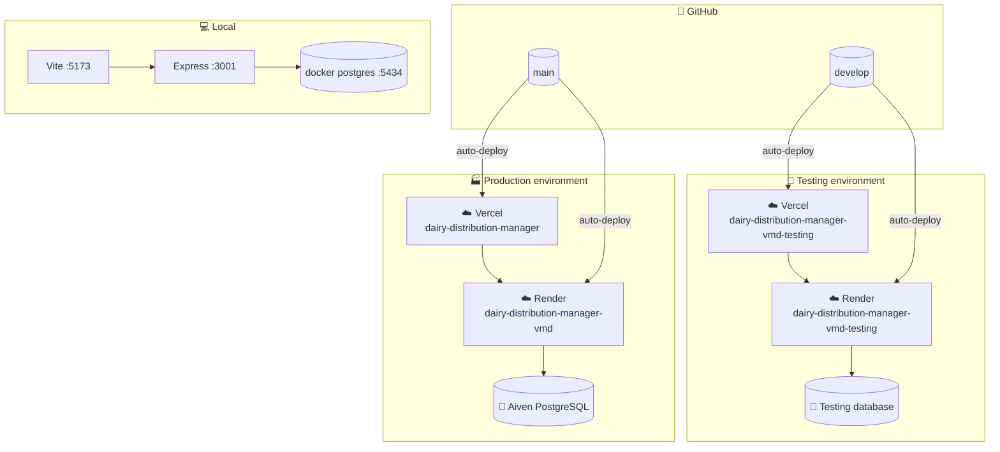
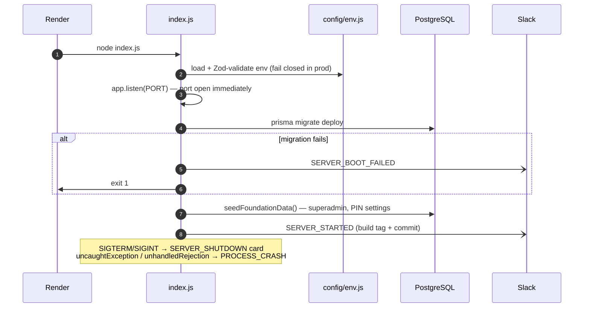
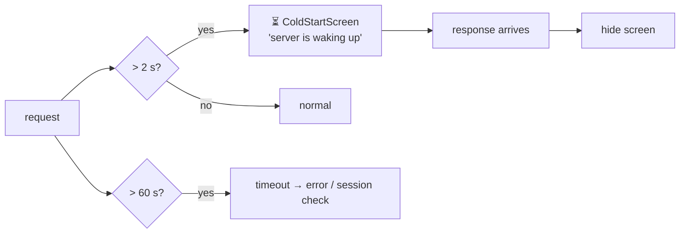
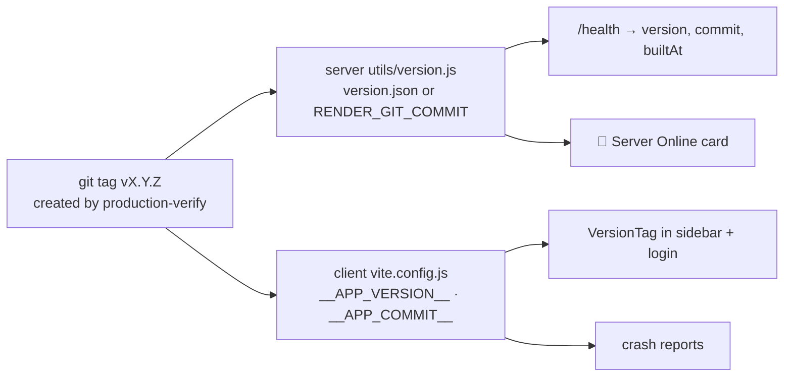

# ☁️ 06 · Environments & Deployment

[⬅️ Security model](05-security.md) · [Docs index](README.md) · [Next: Quality & testing ➡️](07-quality-and-testing.md)

---

## 1. 🗺️ Environment topology

| Environment | Frontend | Backend | Branch | Writes allowed by automation |
|---|---|---|---|---|
| 💻 Local | `http://localhost:5173` | `http://localhost:3001` | any | ✅ |
| 🧪 Testing | `https://dairy-distribution-manager-vmd-testing.vercel.app` | `https://dairy-distribution-manager-vmd-testing.onrender.com` | `develop` | ✅ (`E2E-…` data, cleaned up) |
| 🏭 Production | `https://dairy-distribution-manager-vmd.vercel.app` | `https://dairy-distribution-manager-vmd.onrender.com` | `main` | ❌ read-only `@smoke` only |

URLs can be overridden with the repository variables `STAGING_*` / `PROD_*` used by the workflows.

## 2. 🏗️ Build & deploy units

| Unit | Platform | Root directory | Build | Start | Ignores |
|---|---|---|---|---|---|
| ⚛️ SPA | Vercel | `client/` | `npm run build` → `dist/` | static + SPA rewrite (`vercel.json`) | `client/.vercelignore` → `automation-ui/` |
| 🟩 API | Render | `server/` | `npm run build` (`prisma generate` + `write-version.js`) | `node index.js` | — |

> 🔁 Because the automation suites live under each tier, a change to `server/automation/` redeploys the API and a
> change to `client/automation-ui/` redeploys the SPA. These deploys are harmless no-ops and keep the pipeline's
> "wait for deploy" step simple.

## 3. 🚦 Backend boot sequence

Listening before migrating lets Render's port check pass quickly; `/health/ready` reports `503` until the database
answers.

## 4. ⚙️ Configuration

### 4.1 Server

| Variable | Required | Purpose |
|---|:-:|---|
| `DATABASE_URL` | prod | Prisma connection string |
| `DIRECT_URL` | — | Direct connection for migrations |
| `DATABASE_CA_CERT` | — | PEM CA certificate; pins TLS verification |
| `JWT_SECRET` | prod | ≥ 32 chars; also keys MFA secret encryption |
| `ADMIN_PASSWORD` | prod | Legacy, unused by code |
| `SUPERADMIN_USERNAME` / `SUPERADMIN_PASSWORD` | — | Create/sync the superadmin on every boot |
| `EDIT_PIN` | — | Seeds edit + P&L PIN on first boot |
| `CLIENT_ORIGIN` | — | Comma-separated CORS origins |
| `NODE_ENV` | — | `development` · `test` · `production` |
| `PORT` | — | Default `3001` |
| `LOGIN_RATE_LIMIT_MAX` | — | Default 20; raise only on testing |
| `BULK_WRITE_RATE_LIMIT_MAX` | — | Default 30 requests/min on bulk-write routes; raise only on testing (UI automation) |
| `SLACK_WEBHOOK_URL` | — | Unset = silent |
| `APP_URL` | — | "Open App" link in Slack cards |
| `APP_VERSION` | — | Override build tag |

### 4.2 Client

| Variable | Required | Purpose |
|---|:-:|---|
| `VITE_API_BASE_URL` | ✅ | Backend URL including `/api/v1` |
| `VITE_APP_VERSION` | — | Override build tag |
| `VITE_BILL_PROPRIETOR`, `VITE_BILL_ADDRESS`, `VITE_BILL_PHONES` | — | Bill masthead details (blank if unset); set in Vercel |

### 4.3 CI (GitHub Environments `staging`)

| Secret / variable | Used by |
|---|---|
| `E2E_ADMIN_USERNAME` / `E2E_ADMIN_PASSWORD` | API + UI automation (admin **without MFA**) |
| `E2E_SUPERADMIN_USERNAME` / `E2E_SUPERADMIN_PASSWORD` | API automation |
| `VERCEL_AUTOMATION_BYPASS_SECRET` | Wait-for-Vercel + UI automation |
| `SLACK_WEBHOOK_URL` | Pipeline result cards |
| `RELEASE_BOT_APP_ID` / `RELEASE_BOT_PRIVATE_KEY` | Release PR + auto-merge |
| `E2E_STRICT` (variable) | Fail instead of skip when prerequisites are missing |

➡️ Setup steps: [release-pipeline.md](release-pipeline.md)

## 5. ⏳ Cold starts

Render's free plan sleeps after ~15 minutes idle; the first request can take 30–60 s.

Mitigations: 60 s axios timeout, cold-start screen (armed at login), 90 s HTTP read timeout and wake-up retries in
the API automation, 60 s UI timeouts.

## 6. 🏷️ Versioning

Semantic version tags are created automatically after a successful production smoke run (patch by default; minor
or major via a manual `workflow_dispatch`).

## 7. 🗄️ Database operations

| Task | How |
|---|---|
| Apply migrations | Automatic on every boot (`prisma migrate deploy`) |
| Create a migration | `cd server && npx prisma migrate dev --name <change>` locally |
| Edit a migration | ❌ Never — create a new one |
| `prisma db push` | ❌ Never in production |
| Backups | Managed by Aiven (point-in-time recovery per plan) |
| Seed | Idempotent; only superadmin + `AppSettings` rows |
