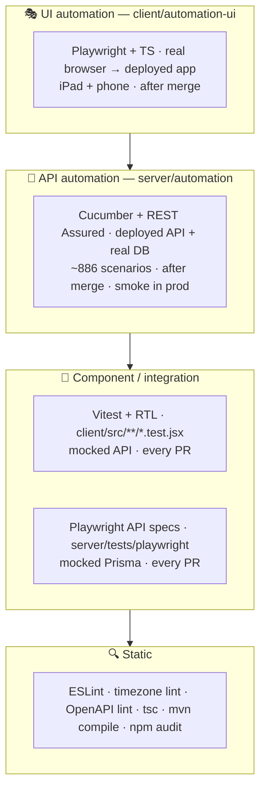
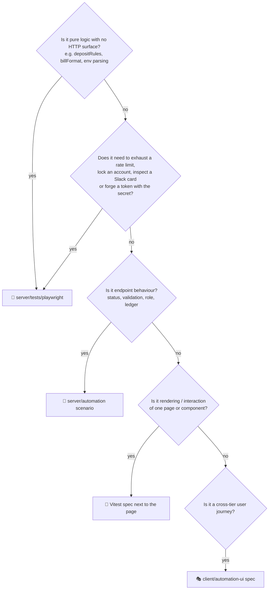

# 🧪 07 · Quality & Testing Strategy

[⬅️ Environments & deployment](06-environments-and-deployment.md) · [Docs index](README.md) · [Next: CI/CD & release ➡️](08-ci-cd-and-release.md)

---

## 1. 🔺 Test pyramid



| Layer | Tool | Location | Runs on | Proves |
|---|---|---|---|---|
| 🔍 Static | ESLint, `check-timezone-safety.js`, Redocly, `tsc`, `mvn test-compile`, `npm audit` | all | every PR | style, IST-safety, contract syntax, compile, CVEs |
| 🧩 Server | Playwright test runner + mocked Prisma, c8 | `server/tests/playwright` | every PR | unit logic, MFA, lock-out, rate limits, Slack cards, forged tokens |
| 🧩 Client | Vitest + React Testing Library, v8 | `client/src/**/*.test.jsx` | every PR | pages and components with a mocked API |
| 🧪 API | Cucumber 7 + REST Assured 5 (Java 21) | `server/automation` | merge to `develop`; `@smoke` on `main` | real endpoints, roles, ledgers, reports |
| 🎭 UI | Playwright Test + TypeScript | `client/automation-ui` | merge to `develop` | real user journeys on real devices |

## 2. 🧭 Which layer should my test go in?



## 3. 📏 Coverage gates

| Suite | Statements | Branches | Functions | Lines | Config |
|---|---:|---:|---:|---:|---|
| Server (c8) | 70 % | 80 % | 85 % | 70 % | `server/.c8rc.json` |
| Client (v8) | 78 % | 68 % | 70 % | 80 % | `client/vite.config.js` |

The server gate was lowered when 655 mocked tests moved to the API suite; endpoint behaviour is now measured there
(see [`server/automation/COVERAGE.md`](../server/automation/COVERAGE.md)).

## 4. ✅ Minimum tests per change

| Change | Required |
|---|---|
| New endpoint | API scenarios: no token (403), bad token (401), bad input (400), wrong role (403), happy path, business rule |
| Pure server logic | Mocked spec in `server/tests/playwright` |
| New page | Vitest: initial render, empty state, API error → `notify(…, 'error')`, core interactions, optimistic update |
| New user journey | UI spec + page object |
| Read-only endpoint safe for production | `@smoke` tag on its API scenario |
| Behaviour the API gets wrong today | `@known-defect` scenario documenting the correct behaviour |

## 5. 🧹 Test data policy

| Rule | Applies to |
|---|---|
| Everything created is named `E2E-…` and removed after the test, pass or fail | API + UI automation |
| Ledger tests use a **throwaway brand**, never Nandini / Jersey / Gowardhan | API automation |
| Assert on the entity you created, never on list position or totals | API + UI automation |
| One sign-in per role per run (login is 20 / hour / IP) | API + UI automation |
| Automation accounts have **no MFA** | API + UI automation |
| Nothing writes to production | `@smoke` is read-only |

## 6. 🏃 Running everything locally

```bash
# Static + server
cd server && npm run check            # eslint + timezone lint + mocked specs
cd server && npm run test:coverage    # with c8 gate

# Client
cd client && npm run lint && npm run test:coverage

# API automation (needs a running backend)
cd server/automation && mvn test -Dcucumber.filter.tags="@api and not @known-defect and not @shared-state"

# UI automation (needs a running frontend + backend)
cd client/automation-ui && npm ci && npx playwright install chromium && npm test
```

➡️ Per-suite guides: [server/docs/testing.md](../server/docs/testing.md) ·
[client/docs/testing.md](../client/docs/testing.md) ·
[server/automation/README.md](../server/automation/README.md) ·
[client/automation-ui/README.md](../client/automation-ui/README.md)
