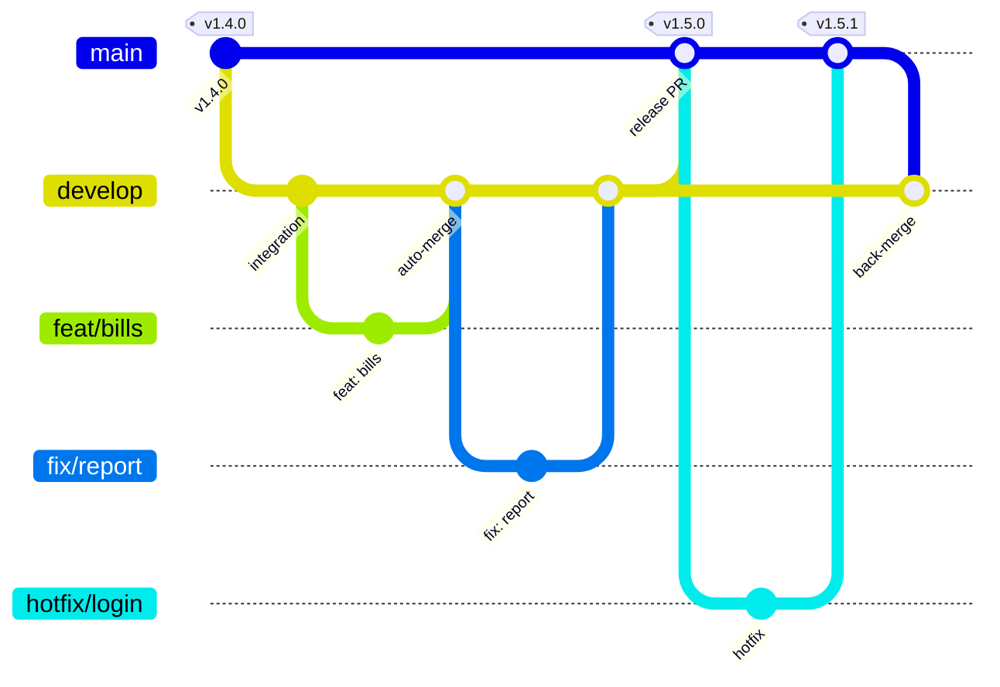
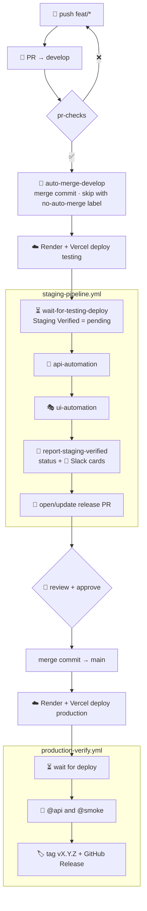
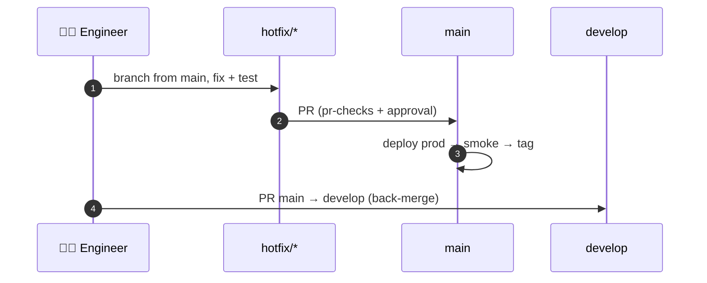

# 🚀 08 · CI/CD & Release Management

[⬅️ Quality & testing](07-quality-and-testing.md) · [Docs index](README.md) · [Next: Observability & operations ➡️](09-observability-and-operations.md)

---

> One-time repository, Vercel, Render and secret setup lives in [release-pipeline.md](release-pipeline.md). This page
> explains how the pipeline behaves.

## 1. 🌿 Branching model

| Branch | Purpose | Protection |
|---|---|---|
| `develop` | Integration, default branch, deploys **testing** | PR only; `pr-checks` green; auto-merge |
| `main` | Production | Release PR or hotfix only; `Staging Verified` + 1 approval; merge commit |
| `feat/*`, `fix/*`, `chore/*`, `docs/*` | Work branches from `develop` | — |
| `hotfix/*` | Urgent fix from `main` | Full `pr-checks` |

## 2. 🔁 End-to-end flow

## 3. ✅ Quality gates

### 3.1 `pr-checks.yml` (every PR to `develop` / `main`)

| Job | What it runs | Fails when |
|---|---|---|
| `lint-timezone-safety` | `server/scripts/check-timezone-safety.js` | `lte/gte/lt/gt: new Date()` in controllers/services |
| `lint-server` / `lint-client` | ESLint | any error |
| `api-tests-coverage-server` | mocked Playwright specs under c8 | test fails or coverage < 70/80/85/70 |
| `ui-tests-coverage-client` | Vitest under v8 | test fails or coverage < 78/68/70/80 |
| `build-client` | `vite build` | build error |
| `lint-openapi-spec` | Redocly on `docs/openapi.yaml` | invalid spec |
| `dependency-vulnerability-scan-{server,client}` | `npm audit --audit-level=moderate` | moderate+ CVE |
| `compile-automation-suite` | `mvn test-compile` (server/automation) + `tsc` (client/automation-ui) | compile/type error |

The release PR (`develop → main`) skips these jobs — the same commit already passed them and `Staging Verified`.

### 3.2 `staging-pipeline.yml` (every merge to `develop`)

| Job | Detail |
|---|---|
| `wait-for-testing-deploy` | `wait-for-backend.sh` polls `/health` until the commit matches (or no `server/` change since the running commit); `wait-for-vercel.sh` waits for the GitHub Deployment |
| `api-automation` | `@api and not @known-defect and not @shared-state`, 75 min budget |
| `ui-automation` | Playwright on iPad + phone projects, 30 min budget |
| `report-staging-verified` | Sets `Staging Verified` status, posts one Slack card per suite |
| `open-release-pr` | Opens or updates `Release: develop -> main (<sha>)` |

A newer merge cancels an in-progress run (`concurrency: staging-pipeline`).

### 3.3 `production-verify.yml` (every merge to `main`)

Waits for production deploy, runs read-only `@api and @smoke`, then tags the next semantic version
(`patch` by default, `minor`/`major` via manual dispatch) and publishes a GitHub Release with generated notes.

## 4. 🗓️ Release checklist

| Step | Owner | ✔ |
|---|---|---|
| Release PR exists and lists the expected commits | Release manager | ☐ |
| `Staging Verified` is green on the head commit | Pipeline | ☐ |
| Migrations reviewed for backward compatibility | Reviewer | ☐ |
| New env vars added to Render/Vercel production **before** merge | Release manager | ☐ |
| Approve and **merge with a merge commit** (never squash) | Approver | ☐ |
| `production-verify-and-release` green, tag created | Pipeline | ☐ |
| Spot-check production (login, today's dispatch sheet) | Release manager | ☐ |

## 5. Hotfix flow

## 6. ↩️ Rollback

| Situation | Action |
|---|---|
| Bad frontend deploy | Vercel → Deployments → promote the previous production deployment |
| Bad backend deploy, no migration | Render → Deploys → roll back to previous deploy |
| Bad backend deploy **with** migration | Ship a forward-fix migration via hotfix (migrations are never edited or reversed in place) |
| Data corruption | Restore from Aiven backup into a new service, verify, repoint `DATABASE_URL` |

## 7. 🤖 Automation helpers

| Script | Purpose |
|---|---|
| `.github/scripts/wait-for-backend.sh` | Wait until Render serves the commit (or equivalent `server/` code) |
| `.github/scripts/wait-for-vercel.sh` | Wait for the Vercel deployment of the commit |
| `.github/scripts/post-slack-card.sh` + `slack-test-card.py` | Slack result card per suite |
| `.github/scripts/ui-job-summary.py` | Markdown summary of UI results |
| `.github/workflows/auto-merge-develop.yml` | Merge green PRs into `develop` |
| `.github/dependabot.yml` | Weekly npm (server, client) + GitHub Actions updates |
