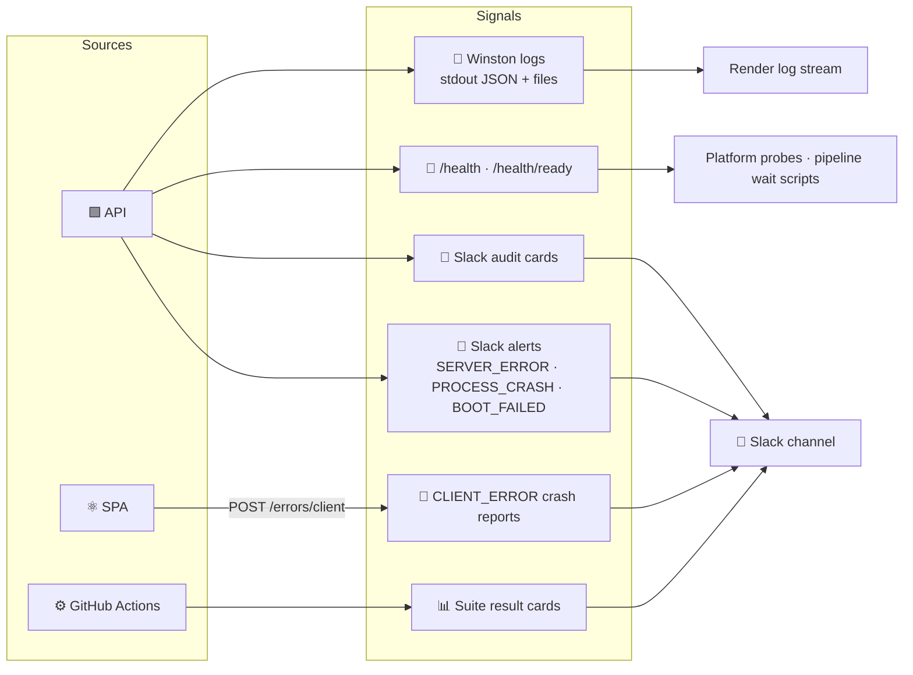
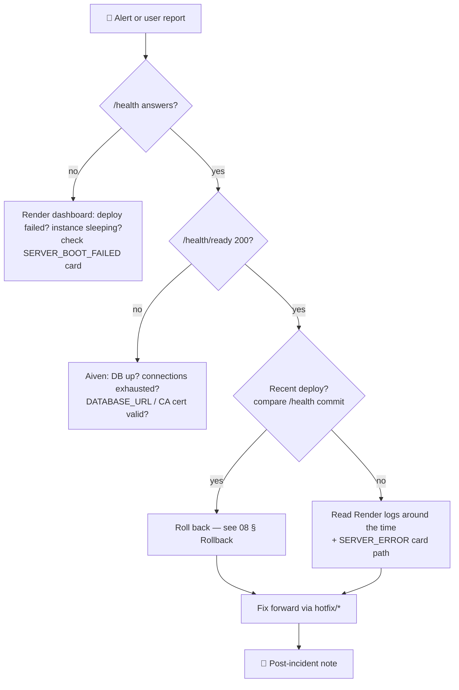

# 📡 09 · Observability & Operations

[⬅️ CI/CD & release](08-ci-cd-and-release.md) · [Docs index](README.md) · [Next: Contributing ➡️](10-contributing.md)

---

## 1. 👁️ Signals

| Signal | Where | Use |
|---|---|---|
| 📜 Logs | Render log stream (stdout); `server/logs/*.log` locally (5 MB × 5 rotation) | Debugging, request trace (morgan → `http` level) |
| 💓 Liveness | `GET /health` → `{ status, uptime, version, commit, builtAt }` | Is the process up, which build |
| 💓 Readiness | `GET /health/ready` → `200` or `503` when DB unreachable | Can it serve traffic |
| 💬 Audit | One Slack card per write action | Who did what, when |
| 🚨 Alerts | `SERVER_ERROR`, `PROCESS_CRASH`, `SERVER_BOOT_FAILED`, `FAILED_LOGIN`, `PIN_FAILED`, `MFA_FAILED`, `ACCOUNT_LOCKED` | Incident trigger |
| 🧯 Crash reports | ErrorBoundary → `POST /errors/client` → `CLIENT_ERROR` | Frontend failures with build version |
| 📊 Pipeline | API/UI result cards per staging run | Release health |

## 2. 💬 Slack event families

| Colour | Meaning | Examples |
|---|---|---|
| 🟢 GREEN | Create | `PRODUCT_CREATED`, `DISPATCH_SAVED`, `BILL_GENERATED` |
| 🟠 AMBER | Update | `PRODUCT_UPDATED`, `DISPATCH_LOCK_CHANGED`, `PIN_UPDATED` |
| 🔴 RED | Delete / failure | `DISPATCH_DELETED`, `BILL_DELETED`, `SERVER_ERROR` |
| 🔵 BLUE / 🩵 TEAL | Informational | `LOGIN`, `SALESPERSON_STATEMENT_VIEWED` |

Full catalogue: [CLAUDE.md § 10](../CLAUDE.md) · implementation: [server/docs/notifications-and-logging.md](../server/docs/notifications-and-logging.md)

> Slack is best-effort: `notifySlack` is never awaited, so an outage never fails a user request. Unset
> `SLACK_WEBHOOK_URL` to silence an environment.

## 3. 🚨 Incident response

### Severity matrix

| Sev | Definition | Example | Response |
|---|---|---|---|
| 🔴 S1 | Business cannot operate | Login or dispatch broken for everyone | Immediate rollback, hotfix |
| 🟠 S2 | Major feature degraded | Reports wrong, bills fail | Hotfix same day |
| 🟡 S3 | Minor / workaround exists | Cosmetic print issue | Next release |
| 🟢 S4 | Cosmetic | Typo | Backlog |

## 4. 📘 Runbooks

| Symptom | Likely cause | Action |
|---|---|---|
| ⏳ First request takes ~1 min | Render free plan cold start | Expected; cold-start screen shows. Upgrade plan if unacceptable |
| 🔒 Admin cannot log in, "locked" | 5 failed attempts | Wait 30 min or superadmin → Admin Users → Unlock |
| 📱 Admin lost authenticator | — | Use a backup code; or superadmin clears **MFA required** for them (wipes MFA), then turns it back on to force re-enrolment |
| 🔑 All MFA codes rejected after config change | `JWT_SECRET` rotated | Restore old secret, or have every MFA user re-enrol |
| 🔢 Wrong PIN for everyone | PIN changed in UI | Superadmin changes it in Admin Users → PIN settings (env `EDIT_PIN` is ignored after first boot) |
| 📒 Balance looks wrong after back-dated edit | Expected cascade not run? | Re-save the earliest affected entry (triggers recalculation); never edit balance rows |
| 🛵 Salesman cannot edit yesterday | Past days are locked | Admin unlocks or uses "open for entry" |
| 📋 Dispatcher cannot unlock | Today finalized or not today | Admin unlocks or reverts finalization |
| 🚫 CORS error in browser | Origin not in `CLIENT_ORIGIN` | Add the origin on Render, redeploy |
| 🧪 Staging pipeline hangs on wait | Render deploy failed | See [release-pipeline.md § Troubleshooting](release-pipeline.md#troubleshooting) |

## 5. 🔁 Routine operations

| Cadence | Task |
|---|---|
| Weekly | Review and merge Dependabot PRs |
| Per release | Review release PR, merge, verify tag |
| Monthly | Review Slack for repeated `FAILED_LOGIN` / `PIN_FAILED`; rotate testing credentials if shared |
| Quarterly | Verify Aiven backups restore; review admin accounts and MFA coverage |
