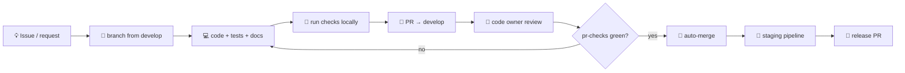
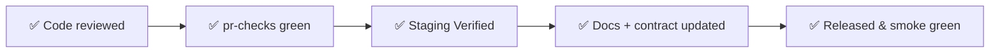

# 🤝 10 · Contributing Guide

[⬅️ Observability & operations](09-observability-and-operations.md) · [Docs index](README.md) · [Next: Architecture decisions ➡️](11-architecture-decisions.md)

---

## 1. 🔄 Workflow



```bash
git fetch origin develop
git checkout -b feat/<short-description> origin/develop
# … work …
git push -u origin feat/<short-description>
```

| Prefix | Use |
|---|---|
| `feat/` | New capability |
| `fix/` | Bug fix |
| `chore/` | Tooling, dependencies, refactors without behaviour change |
| `docs/` | Documentation only |
| `hotfix/` | Urgent production fix, cut from `main` |

## 2. ✍️ Commit messages

- Imperative mood, present tense: **add**, **fix**, **update** — not "added".
- Subject ≤ 72 characters; body explains *why*.
- One logical change per commit.

```
fix dispatcher unlock after day finalization

Dispatchers could still toggle locks once the day was finalized because the
check compared UTC dates. Compare IST dates instead.
```

## 3. 📋 Pull request checklist

| Area | Check |
|---|---|
| 🧪 Tests | Right layer chosen ([07](07-quality-and-testing.md#2--which-layer-should-my-test-go-in)); all suites green locally |
| 💬 Slack | Every new write fires `void notifySlack(...)`; new events added to the catalogue |
| 🔢 Ordering | Product lists use `productLayout` helpers |
| ⏳ Loading | `BrandedLoader` / `TumblerSpinner`, never `Loader2` |
| 🕰️ Dates | IST helpers; no `new Date()` for business dates |
| 🔐 Access | Guards on route **and** `assertRole` in controller; ownership checks for salesman |
| 🗃️ Schema | New migration (never edit old ones); reviewed for backward compatibility |
| 📘 Contract | `docs/openapi.yaml` updated for API changes |
| 📚 Docs | Affected `README`/`docs` and `CLAUDE.md` updated |
| 🤖 Automation | Page objects / scenarios updated when routes, fields or labels change |

## 4. 🏁 Definition of done



## 5. 🧑‍⚖️ Code review guidelines

| Reviewer looks for | Why |
|---|---|
| Ledger writes go through `balanceService` with `tx` | Data integrity |
| No try/catch in controllers, `AppError` not `Error` | Consistent error responses |
| Zod validation + early `return` | Fail fast |
| No secrets, no `process.env` outside `config/env.js` | Security |
| Tests assert behaviour, not implementation details | Maintainability |
| Small, focused PRs | Faster, safer reviews |

## 6. 📐 Coding standards

Component-specific standards: [server/docs/coding-standards.md](../server/docs/coding-standards.md) ·
[client/docs/coding-standards.md](../client/docs/coding-standards.md). Binding rules: the `CLAUDE.md` files.
