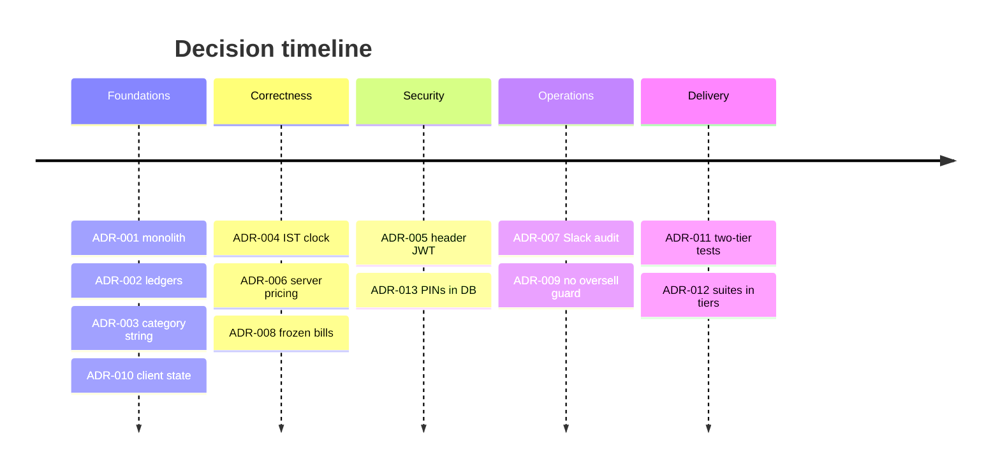

# 🧭 11 · Architecture Decision Records

[⬅️ Contributing](10-contributing.md) · [Docs index](README.md) · [Next: Glossary ➡️](12-glossary.md)

---

Lightweight ADRs (context → decision → consequences). Add a new record instead of rewriting an old one; mark the old
one **Superseded**.

| ADR | Title | Status |
|---|---|---|
| [001](#adr-001--modular-monolith-spa--rest-api) | Modular monolith: SPA + REST API | ✅ Accepted |
| [002](#adr-002--derived-ledgers-recalculated-in-serializable-transactions) | Derived ledgers recalculated in serializable transactions | ✅ Accepted |
| [003](#adr-003--productcategory-stays-a-string) | `Product.category` stays a string | ✅ Accepted |
| [004](#adr-004--india-standard-time-is-the-business-clock) | IST is the business clock | ✅ Accepted |
| [005](#adr-005--jwt-in-the-authorization-header-not-a-cookie) | JWT in the Authorization header, not a cookie | ✅ Accepted |
| [006](#adr-006--server-side-pricing-for-dispatch-lines) | Server-side pricing for dispatch lines | ✅ Accepted |
| [007](#adr-007--fire-and-forget-slack-audit-trail) | Fire-and-forget Slack audit trail | ✅ Accepted |
| [008](#adr-008--bills-store-a-frozen-snapshot) | Bills store a frozen snapshot | ✅ Accepted |
| [009](#adr-009--no-oversell-guard-on-dispatch) | No oversell guard on dispatch | ✅ Accepted (business) |
| [010](#adr-010--no-global-state-library-on-the-client) | No global state library on the client | ✅ Accepted |
| [011](#adr-011--two-tier-test-strategy-mocked-on-pr-live-after-merge) | Two-tier tests: mocked on PR, live after merge | ✅ Accepted |
| [012](#adr-012--automation-suites-live-inside-the-tier-they-test) | Automation suites live inside the tier they test | ✅ Accepted |
| [013](#adr-013--pins-and-settings-in-the-database-not-env) | PINs and settings in the database, not env | ✅ Accepted |

---

## ADR-001 — Modular monolith: SPA + REST API

- **Context:** One small team, one business, modest traffic, strong consistency needs across ledgers.
- **Decision:** A single Express API with domain-split controllers and services, a single PostgreSQL database and a
  React SPA. No microservices.
- **Consequences:** ✅ simple deploys, transactional integrity across domains. ⚠️ the API scales vertically; split
  by domain (controllers already are) if that ever becomes necessary.

## ADR-002 — Derived ledgers recalculated in serializable transactions

- **Context:** Back-dated edits are common (a missed receipt, a corrected payment). Each day's opening depends on the
  previous closing.
- **Decision:** Store balance rows as **derived data**. Every mutation calls `recalculate*Balance(id, date, tx)`,
  which recomputes that day and every later day inside a `Serializable` transaction.
- **Consequences:** ✅ balances are always consistent and auditable. ⚠️ long histories make old edits slower;
  concurrent writers on the same ledger serialize (a conflict fails the request rather than corrupting data).

## ADR-003 — `Product.category` stays a string

- **Context:** Historically products stored a category name. Categories are unique per brand.
- **Decision:** Keep the string; sort by category order via a lookup map (`utils/productLayout.js`) on both tiers.
- **Consequences:** ✅ no risky data migration. ⚠️ Prisma cannot `ORDER BY category.displayOrder`; every product list
  must use the helper. Renaming a category must also update products.

## ADR-004 — India Standard Time is the business clock

- **Context:** Servers run in UTC; between 00:00 and 05:30 IST the UTC date is still "yesterday", which once hid
  today's prices.
- **Decision:** All business dates are IST strings (`getIndiaDateStr`, `getIndiaDate`). A CI lint rejects
  `lte/gte/lt/gt: new Date()` in controllers and services.
- **Consequences:** ✅ correct day boundaries for users. ⚠️ developers must use the helpers; plain `new Date()` is only
  for timestamps.

## ADR-005 — JWT in the Authorization header, not a cookie

- **Context:** Cookie auth needs CSRF protection; the SPA and API are on different origins.
- **Decision:** The SPA keeps the JWT in `localStorage` and sends `Authorization: Bearer`. The login cookie is
  incidental and not honoured by `authenticate`.
- **Consequences:** ✅ no CSRF surface, stateless API. ⚠️ XSS would expose the token — mitigated by React escaping,
  helmet headers and a 2-hour lifetime.

## ADR-006 — Server-side pricing for dispatch lines

- **Context:** Salespeople enter their own stock on their phones.
- **Decision:** The server re-derives every `unitPrice` from `SalespersonPrice` (effective on the dispatch date) or
  the product default, and rejects products not enabled for that salesperson.
- **Consequences:** ✅ a modified client cannot change what a salesperson is billed. ⚠️ price changes must be entered
  before the day they apply (effective today or later).

## ADR-007 — Fire-and-forget Slack audit trail

- **Context:** The owner wants visibility of every change without building an audit UI.
- **Decision:** Every write calls `void notifySlack(EVENT, data)`; failures are logged, never surfaced.
- **Consequences:** ✅ zero latency cost, instant visibility. ⚠️ Slack is not a durable audit store; it is best-effort.

## ADR-008 — Bills store a frozen snapshot

- **Context:** A bill is a document handed to someone; back-dated dispatch edits would otherwise change it.
- **Decision:** `Bill.lines` stores the brand → product breakdown as JSON at issue time; reprints read the snapshot.
- **Consequences:** ✅ reprints are faithful. ⚠️ corrections require cancelling and re-issuing a bill.

## ADR-009 — No oversell guard on dispatch

- **Context:** Received stock may be entered late or in a different order than dispatch.
- **Decision (owner, 2026-08-16):** Do not block dispatch quantities above received stock. `stockGuard` is implemented
  and ready but not wired.
- **Consequences:** ✅ operations never blocked by data-entry order. ⚠️ the stock balance report must be reviewed.

## ADR-010 — No global state library on the client

- **Context:** Only auth and notifications are cross-cutting; each page owns its data.
- **Decision:** React Context for those two; page-local state with `useApiResource` / `useMutation` hooks.
- **Consequences:** ✅ less boilerplate and indirection. ⚠️ revisit if cross-page caching becomes necessary.

## ADR-011 — Two-tier test strategy: mocked on PR, live after merge

- **Context:** A mocked suite is fast but cannot catch real database or deployment issues; a live suite is slow and
  needs a deployed environment.
- **Decision:** PRs run mocked server specs + Vitest; endpoint behaviour is proven by the Java API suite and UI
  suite against the testing deploy after merge, gating the release PR.
- **Consequences:** ✅ fast PR feedback and real-system confidence. ⚠️ a live-suite failure is found after merge —
  fixed forward on `develop` before release.

## ADR-012 — Automation suites live inside the tier they test

- **Context:** Root-level `automation/` and `automation-ui/` were detached from the code they test.
- **Decision:** Move them to `server/automation` and `client/automation-ui`, excluded from the app's lint, tests and
  build.
- **Consequences:** ✅ ownership is obvious; changes to a tier and its tests travel together. ⚠️ suite-only changes
  trigger (harmless) redeploys of that tier.

## ADR-013 — PINs and settings in the database, not env

- **Context:** Rotating a PIN through environment variables required a redeploy.
- **Decision:** Store bcrypt-hashed PINs and toggles in `AppSettings`; `EDIT_PIN` only seeds the first value.
- **Consequences:** ✅ superadmin rotates PINs in the UI instantly. ⚠️ environment `EDIT_PIN` changes have no effect
  after the first boot.
