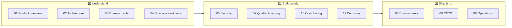

# 📚 VMD Documentation Library

> System-wide documentation for the Vikas Milk Dairy Distribution Manager. Component guides live next to the code
> they describe; this folder explains how the pieces fit together.

[⬅️ Back to repository README](../README.md)

---

## 🧭 How this library is organised

| # | Document | Audience | Purpose |
|---|---|---|---|
| 01 | [🎯 Product overview](01-product-overview.md) | Everyone | Business context, users and capabilities |
| 02 | [🏗️ System architecture](02-system-architecture.md) | Engineers, architects | Context/container/component views, request lifecycle |
| 03 | [🗃️ Domain model](03-domain-model.md) | Engineers, analysts | Entities, relationships and invariants |
| 04 | [🔄 Business workflows](04-business-workflows.md) | Engineers, operations | End-to-end process flows |
| 05 | [🔐 Security model](05-security.md) | Engineers, reviewers | Identity, access, protection controls |
| 06 | [☁️ Environments & deployment](06-environments-and-deployment.md) | Engineers, DevOps | Hosting, configuration, boot, versioning |
| 07 | [🧪 Quality & testing strategy](07-quality-and-testing.md) | Engineers, QA | Test pyramid and quality gates |
| 08 | [🚀 CI/CD & release management](08-ci-cd-and-release.md) | Engineers, release managers | Pipelines and promotion |
| 09 | [📡 Observability & operations](09-observability-and-operations.md) | On-call, DevOps | Monitoring, alerting, runbooks |
| 10 | [🤝 Contributing guide](10-contributing.md) | Contributors | Workflow and definition of done |
| 11 | [🧭 Architecture decisions](11-architecture-decisions.md) | Engineers, architects | ADR log |
| 12 | [📖 Glossary](12-glossary.md) | Everyone | Shared vocabulary |
| — | [🛠️ Release pipeline setup](release-pipeline.md) | Repository admins | One-time setup + troubleshooting |
| — | [📘 openapi.yaml](openapi.yaml) | API consumers | OpenAPI contract |

## 🧩 Component documentation

| Component | Entry point | Detailed docs |
|---|---|---|
| 🟩 Backend API | [server/README.md](../server/README.md) | [server/docs/](../server/docs/) |
| ⚛️ Frontend SPA | [client/README.md](../client/README.md) | [client/docs/](../client/docs/) |
| 🧪 API automation | [server/automation/README.md](../server/automation/README.md) | [server/automation/docs/](../server/automation/docs/) |
| 🎭 UI automation | [client/automation-ui/README.md](../client/automation-ui/README.md) | [client/automation-ui/docs/](../client/automation-ui/docs/) |

## ✍️ Documentation standards

| Standard | Rule |
|---|---|
| 📍 Location | System concerns here; component concerns in `<component>/docs/`; binding rules in `CLAUDE.md` |
| 📐 Diagrams | Mermaid only (renders on GitHub, diffs as text). No binary images for architecture |
| 🔗 Links | Relative links only, so docs work on any branch and fork |
| 🔄 Freshness | A PR that changes behaviour updates the affected doc in the same PR |
| 🧾 Source of truth | Code > `CLAUDE.md` > docs. If they disagree, fix the doc |
| 🏷️ Naming | `NN-kebab-case.md` for ordered system docs, `kebab-case.md` elsewhere |
