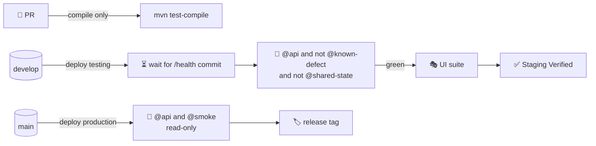

# 🧪 VMD API Automation Suite

> Black-box **API** tests against a **deployed** VMD backend and its real database — Java 21, Maven, Cucumber 7
> (Gherkin) and REST Assured 5. It proves what the mocked specs in `server/tests` cannot: the real system.

[⬅️ Server README](../README.md) · [Engineering contract](CLAUDE.md) · [Coverage map](COVERAGE.md)

| | |
|---|---|
| **Scope** | 886 scenarios · 26 features (outline rows counted) |
| **Runs** | after every merge to `develop` (gate) · `@smoke` after every merge to `main` |
| **Target** | any backend origin via `API_BASE_URL` |
| **Data** | throwaway `E2E-…` fixtures, removed after every scenario |
| **Reports** | `target/cucumber-reports/report.html` + `report.json` |

---

## 🧭 Where it fits



## ⚡ Quick start

```bash
cd server/automation
export API_BASE_URL=http://localhost:3001                      # backend origin, no /api/v1
export E2E_ADMIN_USERNAME=... E2E_ADMIN_PASSWORD=...            # admin WITHOUT MFA
export E2E_SUPERADMIN_USERNAME=... E2E_SUPERADMIN_PASSWORD=...  # optional superadmin WITHOUT MFA

mvn test -Dcucumber.filter.tags="@api and not @known-defect and not @shared-state"   # the staging gate
mvn test -Dcucumber.filter.tags="@api and @smoke"                                   # production-safe
mvn test -Dcucumber.filter.tags="@dispatch"                                         # one area
mvn -B -ntp test-compile                                                             # what PR CI runs
```

Open `target/cucumber-reports/report.html` — a failed scenario carries the exact, masked HTTP exchanges.

## 📦 What it covers

| Feature file | Area |
|---|---|
| `access-control-matrix.feature` | the full endpoint × caller refusal matrix (361 rows): no token, malformed token, salesman, dispatcher, admin |
| `access-control.feature` | the other half: who *is* allowed through |
| `security.feature` | forged / unsigned / not-yet-valid tokens, browser security headers, no internals in errors |
| `authentication.feature` | sign-in, wrong password, deactivated account, change password, cookie flags, two-step endpoints |
| `admin-users.feature` | create / edit / delete admin, dispatcher and superadmin accounts, self-protection rules |
| `brands.feature`, `categories.feature`, `products.feature`, `routes.feature`, `route-management.feature` | dairy setup |
| `salespeople.feature`, `salesperson-pricing.feature` | salespeople, per-salesman prices, product exceptions, global access |
| `dairy-ledger.feature` | stock receipts, dairy payments, top-ups, deposits and the cascading dairy balance |
| `dispatches.feature` | stock entries, server-side pricing, locking, past days, scoping |
| `salesperson-ledger.feature` | collections, dues, ledger reset and the cascading salesperson balance |
| `salesman-self-service.feature` | a salesman's own statement |
| `reports.feature`, `reports-detail.feature`, `deposit-summary.feature`, `profit-loss.feature`, `bills.feature` | statements, summaries, dispatch sheet, deposit, profit and loss, bills |
| `dispatch-day-finalization.feature` | finalising / reversing a day (**@shared-state**, run on demand) |
| `pin.feature`, `client-errors.feature`, `health.feature` | PIN gates, crash-report beacon, liveness / readiness |
| `known-defects.feature` | correct behaviour the API does **not** have yet (see below) |


### Deliberately not here

| Not ported | Why |
|---|---|
| Unit-level specs (`env`, `dbUrl`, `logger`, `validate`, `depositRules`, `billFormat`, `paymentLedger`, `mfaService`, `slack`, `version`, `authz`, `pagination`) | They call functions directly; there is no HTTP surface on a deployed system to test them through. |
| Rate-limit exhaustion (login, PIN, client-error beacon, bulk routes) | Tripping a limit locks the shared IP / PIN for up to an hour and would take the pipeline's own sign-in down with it. Only the limit *headers* are checked. |
| Account lock-out and full MFA enrolment (`accountLock`, `mfa`) | Every attempt counts toward the 20-sign-ins-an-hour limit and lock-outs affect real accounts. Only the token-level 401/400 behaviour is checked. |
| CORS allow-list | The allowed origins are environment configuration, not product behaviour. |


## 📚 Documentation

| Document | Contents |
|---|---|
| [🏗️ Architecture](docs/architecture.md) | Framework layers, request pipeline, sessions, fixtures, cleanup |
| [✍️ Writing scenarios](docs/writing-scenarios.md) | Gherkin style, placeholders, step library, adding steps |
| [🏷️ Tags & selection](docs/tags-and-selection.md) | Tag catalogue, filter expressions, run profiles |
| [⚙️ Configuration & CI](docs/configuration-and-ci.md) | Environment variables, workflows, reports, Slack cards |
| [🛟 Troubleshooting](docs/troubleshooting.md) | Rate limits, cold starts, skips, flaky data, known defects |
| [🗺️ Coverage map](COVERAGE.md) | Every mocked spec → its live scenarios |

## 🐞 Known defects (`known-defects.feature`)

Correct behaviour the API does **not** have yet; excluded from the gate with `@known-defect`:

1. A request body that is not valid JSON, or is over 10 KB, returns **500** (and posts a server-error
   Slack card) instead of 400 / 413.
2. A date that does not exist on the calendar is accepted or crashes: `2026-02-30` is **stored as
   2026-03-02**, and `2026-13-45` returns 500 - the Zod schemas only check the `YYYY-MM-DD` pattern.
3. An id with trailing characters is read as its leading digits (`/routes/12abc` is route 12, `/routes/1.5`
   is route 1), because ids are parsed with `parseInt`. A mistyped id can change or delete another record.


Fix the server, delete the `@known-defect` tag, and the scenario joins the gate.

## ⚠️ Side effects

Every write fires the normal Slack card. A full run performs several hundred writes — point the testing backend's
`SLACK_WEBHOOK_URL` at a quiet channel (or leave it unset).
