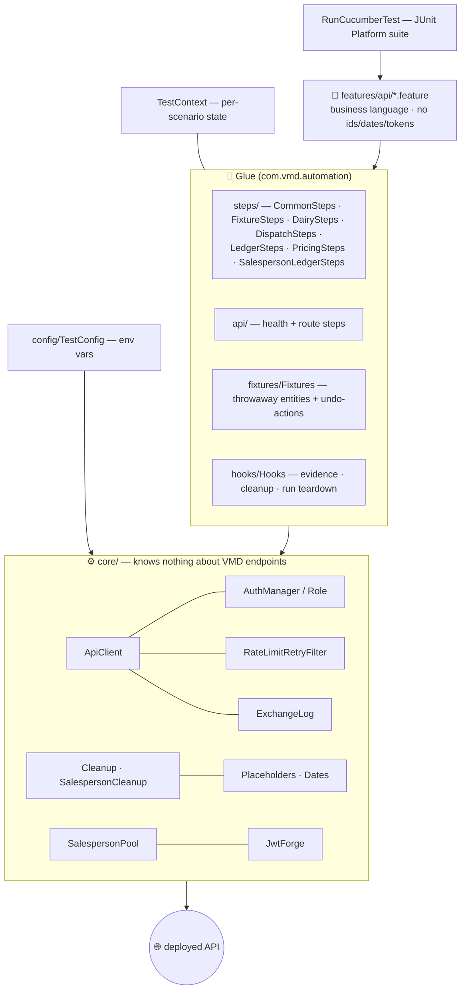
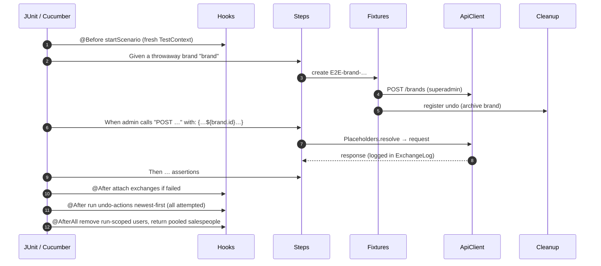
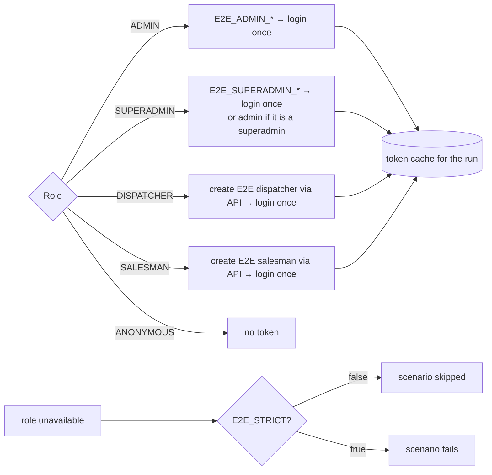
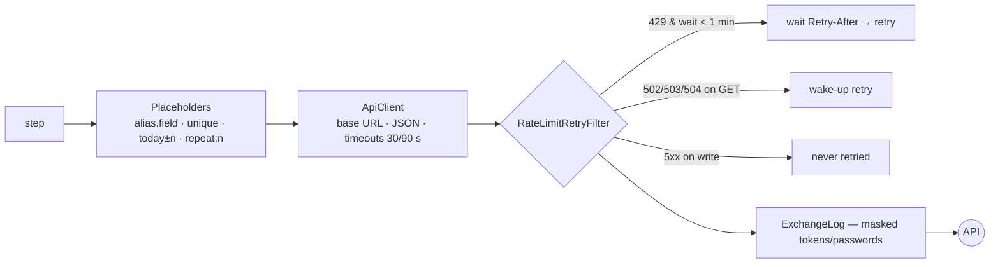

# 🏗️ API Automation Architecture

[⬅️ Suite README](../README.md) · [Contract](../CLAUDE.md)

---

## 1. 🧅 Layers

| Package | Responsibility | Rule |
|---|---|---|
| `features/` | What the business expects | No HTTP details beyond the call line |
| `steps/` | Map sentences to calls/assertions | Thin; delegate to fixtures/core |
| `fixtures/` | Create `E2E-…` data, register undo | Every create has an undo |
| `hooks/` | Lifecycle | Always attempt every cleanup |
| `core/` | Transport, auth, retries, evidence | Endpoint-agnostic |
| `config/` | Settings | Env vars only |

## 2. 🔁 Scenario lifecycle

## 3. 🔑 Sessions per role

A full run signs in about 15 times — well under the 20/hour/IP limit.

## 4. 🌐 Request pipeline

## 5. 🧹 Data hygiene

| Mechanism | Purpose |
|---|---|
| `E2E-…` names (+ `${unique}`) | Identify and isolate test data |
| `Cleanup` undo stack | Delete/archive everything a scenario created, pass or fail |
| Throwaway brand per ledger scenario | Never touch real Nandini/Jersey/Gowardhan balances |
| `SalespersonPool` | Pre-created clean salespeople, ledger reset between borrowers — saves ~4 calls per scenario against the 30/min `/salespeople` limit |
| `SalespersonCleanup` | Removes pooled / throwaway salespeople at run end |
| Archive instead of delete | Brands/products have no delete API; archived rows disappear from lists |
