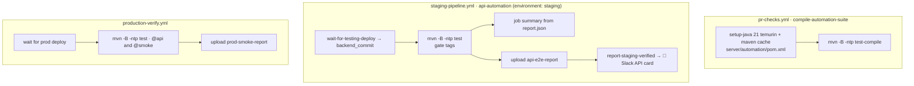

# ⚙️ Configuration & CI

[⬅️ Suite README](../README.md) · Pipeline: [docs/08-ci-cd-and-release.md](../../../docs/08-ci-cd-and-release.md)

---

## 1. 🔧 Environment variables (`config/TestConfig.java`)

| Variable | Default | Notes |
|---|---|---|
| `API_BASE_URL` | `http://localhost:3001` | Backend origin, **no** `/api/v1` |
| `E2E_ADMIN_USERNAME` / `E2E_ADMIN_PASSWORD` | — | Admin **without MFA**; required for authenticated scenarios |
| `E2E_SUPERADMIN_USERNAME` / `E2E_SUPERADMIN_PASSWORD` | — | Superadmin **without MFA**; falls back to the admin account if it is a superadmin |
| `E2E_STRICT` | `false` | `true` → missing prerequisite fails instead of skipping |
| `EXPECTED_COMMIT` | — | Commit `/health` must report (health scenario) |
| `HTTP_CONNECT_TIMEOUT_MS` / `HTTP_READ_TIMEOUT_MS` | 30 000 / 90 000 | Sleeping Render service needs ~1 min |

## 2. 🔄 CI integration

| Item | Value |
|---|---|
| Working directory | `server/automation` |
| Secrets | `E2E_ADMIN_*`, `E2E_SUPERADMIN_*` (GitHub Environment `staging`) |
| Variable | `E2E_STRICT` |
| `EXPECTED_COMMIT` | Output of `wait-for-backend.sh` (differs from the pushed SHA when Render skipped a deploy) |
| Timeout | 75 min |
| Artifacts | `server/automation/target/cucumber-reports` |

## 3. 📊 Reports

| File | Consumer |
|---|---|
| `target/cucumber-reports/report.html` | Humans — includes masked HTTP exchanges for failures |
| `target/cucumber-reports/report.json` | Job summary script, Slack card (`.github/scripts/slack-test-card.py`) |

> Do not change the report paths (`junit-platform.properties`) without updating the workflows and scripts.

## 4. 🧰 Toolchain

| Tool | Version |
|---|---|
| Java | 21 (`maven.compiler.release`) |
| Cucumber | 7.20 (JUnit Platform engine) |
| REST Assured | 5.5 |
| Build | Maven (`pom.xml`) |
