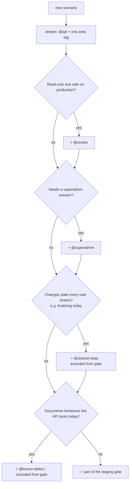

# 🏷️ Tags & Test Selection

[⬅️ Suite README](../README.md)

---

## 1. 🧭 Tag decision tree

## 2. 📋 Catalogue

| Tag | Meaning | In gate? | In prod smoke? |
|---|---|:-:|:-:|
| `@api` | Every API scenario | ✅ | with `@smoke` |
| `@smoke` | Read-only, production-safe | ✅ | ✅ |
| `@superadmin` | Needs `E2E_SUPERADMIN_*` (auto-skips otherwise) | ✅ | — |
| `@shared-state` | Changes shared state; run on demand on an unused environment | ❌ | ❌ |
| `@known-defect` | Expected to fail today | ❌ | ❌ |
| Area tags | `@access @security @auth @admin-users @brands @categories @products @routes @salespeople @salesperson @pricing @ledger @dairy @deposit @dispatch @salesman @reports @profit-loss @bills @pin @client-errors` | ✅ | — |

## 3. 🎛️ Run profiles

| Profile | Command |
|---|---|
| 🚦 Staging gate | `mvn test -Dcucumber.filter.tags="@api and not @known-defect and not @shared-state"` |
| 🏭 Production smoke | `mvn test -Dcucumber.filter.tags="@api and @smoke"` |
| 🐞 Known defects | `mvn test -Dcucumber.filter.tags="@known-defect"` |
| 🧨 Shared state (isolated env only) | `mvn test -Dcucumber.filter.tags="@shared-state"` |
| 🎯 One area | `mvn test -Dcucumber.filter.tags="@dispatch"` |
| 🔐 Security only | `mvn test -Dcucumber.filter.tags="@access or @security or @auth"` |
| 🧪 Without superadmin | `mvn test -Dcucumber.filter.tags="@api and not @superadmin and not @known-defect and not @shared-state"` |
| 📄 One feature | `mvn test -Dcucumber.features=src/test/resources/features/api/bills.feature` |

## 4. ⏱️ Run time

A full gate run is about six minutes against a local server — mostly waiting out the backend's 30 requests/minute
limits on `/salespeople` and `/stock-receipts`. Against the free-tier testing backend (≈ 3 s per write) it takes much
longer; the CI job allows 75 minutes. If it grows, look at the slowest scenarios in the HTML report first.
