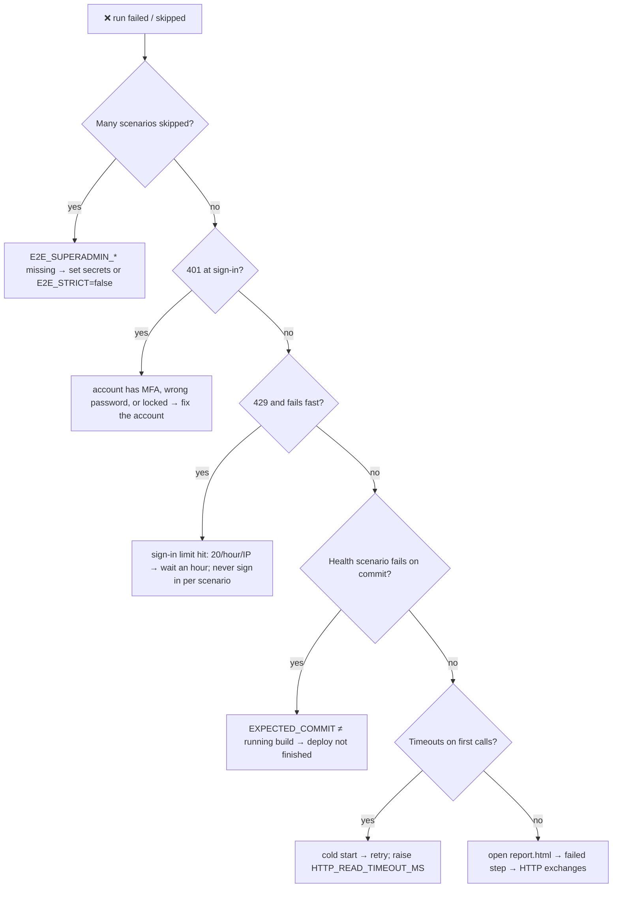

# 🛟 Troubleshooting

[⬅️ Suite README](../README.md)

---

| Symptom | Cause | Fix |
|---|---|---|
| ~125 scenarios skipped | No superadmin session | Add `E2E_SUPERADMIN_*` to the `staging` environment |
| Sign-in 429 with "try again after an hour" | Too many logins from one IP (UI suite, people, reruns) | Wait; `RateLimitRetryFilter` deliberately does not wait > 1 min |
| Short 429 stalls | `/salespeople`, `/stock-receipts` 30/min | Expected; the filter waits and retries |
| GET 502/503 at start | Render waking up | Retried automatically for GETs |
| Assertion finds another user's data | Asserting on list position | Look up by id of your fixture |
| Leftover `E2E-…` rows | Run killed before `@After` | Harmless; brands are archived, others removable via setup screens |
| Ledger numbers off by a top-up | Using a real brand | Always use a throwaway brand |
| `@shared-state` scenario skipped | Today already finalized / state not as needed | By design; run on an isolated environment |
| Compile error in PR | Step signature changed | `mvn -B -ntp test-compile` locally |

### 🐞 Known product defects

See the README section and `known-defects.feature`. When the server is fixed, remove `@known-defect` so the scenario
joins the gate.
