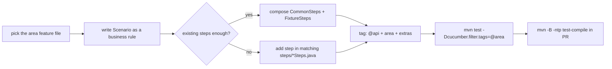

# ✍️ Writing Scenarios

[⬅️ Suite README](../README.md) · Rules: [CLAUDE.md](../CLAUDE.md)

---

## 1. 🧭 Workflow



## 2. 📝 Anatomy

```gherkin
@api @ledger @dairy @superadmin
Feature: Dairy ledger
  What is owed to a dairy brand … (why this feature exists)

  Background:
    Given a throwaway brand "brand"
    And a throwaway product "milk" in brand "brand"

  Scenario: A payment reduces what is owed
    Given admin receives 10 of "milk" at 20 into "brand" on "${today-2}"
    When admin calls "POST /api/v1/dairy-payments" with:
      """
      { "brandId": ${brand.id}, "paymentDate": "${today-2}", "amount": 50, "paymentMode": "UPI" }
      """
    Then the response status is 201
    And the JSON field "data.isTopUp" equals "false"
    And the dairy ledger of "brand" shows:
      | date       | opening | stock | paid | closing |
      | ${today-2} | 0       | 200   | 50   | 150     |
```

| Element | Guideline |
|---|---|
| Feature description | Why the behaviour matters, in business words |
| Scenario name | A rule: "A payment reduces what is owed" — not "test POST payments" |
| Background | Only fixtures every scenario needs |
| Data | Aliases (`"brand"`) and placeholders, never literal ids or dates |
| Assertions | On the entity you created (`find { it.id == ${x.id} }`) |

## 3. 🔣 Placeholders

| Placeholder | Resolves to |
|---|---|
| `${alias.field}` | Field of a remembered entity, e.g. `${brand.id}` |
| `${unique}` | Run-unique suffix |
| `${today}`, `${today-2}`, `${today+7}` | IST dates |
| `${repeat:501}` | A 501-character string (length validation) |

## 4. 📚 Step library (most used)

| Kind | Steps |
|---|---|
| Fixtures | `a throwaway brand/category/product/route "x"` · `a salesperson with a clean ledger "sp"` · `a throwaway salesperson "sp" (who can log in)` · `a throwaway admin user "u" with role "dispatcher"` · `the existing brand "Nandini" as "b"` · `the run's salesman/dispatcher as "x"` |
| Calls | `{{role}} calls "METHOD /path"` · `… with:` docstring · `a caller with a malformed token calls …` · `the holder of "x" calls …` · `a caller with {{expired/unsigned/…}} token for role {{role}} calls …` |
| Status | `the response status is N` · `the call succeeds` · `the call is rejected with status N and error "…"` · `the request is not blocked by access control` |
| JSON | `the JSON field "p" equals/contains/is present/is absent/is a number` · `the JSON amount "p" equals "…"` · `the JSON list "p" has N items / contains an item whose "k" is "v" / is ordered by "k" as "…"` |
| Security | `the response does not leak internals` · `the response header "h" is present/absent/contains/equals …` |
| Memory | `I remember the JSON field "p" as "alias"` · `I remember the item of "list" whose "k" is "v" as "alias"` |
| Cleanup | `afterwards {{role}} cleans up with "DELETE /path"` |
| Domain | ledger tables (`the dairy ledger of "b" shows:`), dispatch, pricing helpers in their `*Steps.java` |

`{{role}}` = `anonymous | admin | superadmin | dispatcher | salesman`.

## 5. ➕ Adding a step

```java
// steps/DairySteps.java (real implementation)
@Given("admin receives {int} of {string} at {int} into {string} on {string}")
public void receivesStock(int quantity, String product, int unitPrice, String brand, String date) {
    Response res = ApiClient.withToken(AuthManager.token(Role.ADMIN))
            .body(Map.of(
                    "brandId", ctx.idOf(brand),
                    "date", Placeholders.resolve(date, ctx.variables),
                    "items", List.of(Map.of("productId", ctx.idOf(product), "quantity", quantity, "unitPrice", unitPrice))))
            .post("/api/v1/stock-receipts/bulk");
    assertThat(res.statusCode()).as("save stock (%s)", res.asString()).isEqualTo(200);
    ctx.response = res;
}
```

| ✅ Do | ❌ Don't |
|---|---|
| Reuse `ApiClient`, `AuthManager`, `Placeholders` | Build RestAssured requests from scratch |
| Register an undo for anything you create | Leave data behind |
| Keep the sentence business-level | Put JSON paths in step names |
| Fail with a clear message | Swallow assertion errors |


## 6. ✅ New-endpoint checklist

- [ ] No token → 403 · malformed/expired token → 401
- [ ] Invalid body / bad id → 400
- [ ] Wrong role → 403 (and a row in `access-control-matrix.feature`)
- [ ] Happy path → 200/201 with the created entity asserted by id
- [ ] Business rule (cascade, default, lock…)
- [ ] `@smoke` **only** if read-only
- [ ] `COVERAGE.md` updated when a mocked spec moves here
