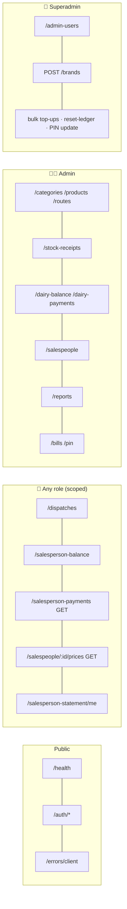

# 📍 API Reference

[⬅️ Server README](../README.md) · Machine-readable contract: [`docs/openapi.yaml`](../../docs/openapi.yaml)

---

## 1. 📐 Conventions

| Aspect | Convention |
|---|---|
| Base path | `/api/v1` (health probes are at the root) |
| Format | JSON in, JSON out; body ≤ 10 kb |
| Auth | `Authorization: Bearer <JWT>` |
| Success | `{ "success": true, "data": … }` — `201` on create |
| Failure | `{ "success": false, "error": "message", "code"?: "…" }` |
| Dates | `YYYY-MM-DD`, interpreted in **IST** |
| Ids | Positive integers (`parseId`) |
| Pagination | Opt-in `?page=&limit=` (default 20, max 100) → `{ items, pagination }` |

### Status codes

| Code | When | `code` field |
|---|---|---|
| `200` / `201` | Success | — |
| `400` | Zod validation failed, bad id, business rule, unique violation (`P2002`), FK violation (`P2003`) | `VALIDATION_ERROR` · `DUPLICATE` · `FK_CONSTRAINT` |
| `401` | Invalid / expired token, wrong current password, expired `mfaToken` | — |
| `403` | No token, wrong role, not your record, locked entry | — |
| `404` | Record not found (`P2025` or explicit) | `NOT_FOUND` |
| `429` | Rate limit | — |
| `500` | Unexpected error (Slack `SERVER_ERROR` raised) | — |
| `503` | `/health/ready` with database unreachable | — |

### Auth legend

🌐 public · 🔑 any signed-in role (controller scopes by role) · 🧑‍💼 admin + superadmin · 👑 superadmin ·
📋 dispatcher · 🛵 salesman

---

## 2. 💓 Health

| Method | Path | Auth | Response |
|---|---|---|---|
| GET | `/` | 🌐 | `{ name, status }` |
| GET | `/health` | 🌐 | `{ status, uptime, version, commit, builtAt }` |
| GET | `/health/ready` | 🌐 | `{ status: 'ready' }` or `503` |

## 3. 🔑 Auth — `/auth`

| Method | Path | Auth | Body | Notes |
|---|---|---|---|---|
| POST | `/login` | 🌐 (20/h) | `{ username, password }` | Returns `{ accessToken, role, … }`, or `{ mfaVerifyRequired, mfaToken }`, or `{ mfaSetupRequired, mfaToken }` |
| POST | `/mfa/verify` | 🌐 + `mfaToken` | `{ mfaToken, code }` | TOTP or backup code → session |
| POST | `/mfa/setup-required` | 🌐 + `mfaToken` | `{ mfaToken }` | `{ otpauth, qrCodeDataUrl }` |
| POST | `/mfa/confirm-required` | 🌐 + `mfaToken` | `{ mfaToken, code }` | Session + backup codes |
| POST | `/change-password` | 🔑 | `{ currentPassword, newPassword }` | Salesman or admin |
| POST | `/logout` | 🔑 | — | `LOGOUT` card |

## 4. 💥 Client errors — `/errors/client`

| Method | Path | Auth | Body | Notes |
|---|---|---|---|---|
| POST | `/` | 🌐 (30/h, always 200) | `{ message, stack?, page?, version? }` | Forwards a `CLIENT_ERROR` card |

## 5. 📚 Catalog

| Method | Path | Auth | Notes |
|---|---|---|---|
| GET | `/brands` | 🧑‍💼 | `?includeInactive` |
| POST | `/brands` | 👑 | Create brand |
| PUT | `/brands/:id` | 🧑‍💼 | Update, archive, deposit config |
| PATCH | `/brands/reorder` | 🧑‍💼 | `displayOrder` |
| POST | `/brands/:id/copy-products` | 🧑‍💼 | Copy catalog from another brand |
| GET · POST | `/categories` | 🧑‍💼 | `?brandId` |
| PUT · DELETE | `/categories/:id` | 🧑‍💼 | |
| PATCH | `/categories/reorder` | 🧑‍💼 | |
| GET · POST | `/products` | 🧑‍💼 | `?brandId`, `?all`, `?date` (list follows the date: bought-then-disabled products stay, newer products are not listed earlier — `hasReceiptOnDate`); effective-dated prices |
| PUT · DELETE | `/products/:id` | 🧑‍💼 | |
| PATCH | `/products/reorder` | 🧑‍💼 | |
| GET · PATCH | `/products/salesperson-global` | 🧑‍💼 | Global salesperson access |
| DELETE | `/products/:id/salesperson-prices` | 🧑‍💼 | Clear all per-salesperson prices |
| GET · POST | `/routes` | 🧑‍💼 | `?brandId` |
| PUT · DELETE | `/routes/:id` | 🧑‍💼 | |

## 6. 🏭 Dairy side

| Method | Path | Auth | Notes |
|---|---|---|---|
| GET | `/stock-receipts` | 🧑‍💼 | `?date&brandId` |
| GET | `/stock-receipts/availability` | 🧑‍💼 📋 | `?date` — received vs dispatched |
| POST | `/stock-receipts/bulk` | 🧑‍💼 (30/min) | Upsert + dairy cascade |
| GET | `/dairy-balance` | 🧑‍💼 | `?date` |
| GET | `/dairy-balance/route-breakdown` | 🧑‍💼 | `?date` |
| GET | `/dairy-balance/:brandId` | 🧑‍💼 | `?from&to` |
| GET · POST | `/dairy-payments` | 🧑‍💼 | `?brandId&from&to` |
| PUT · DELETE | `/dairy-payments/:id` | 🧑‍💼 | Re-cascades old + new date |
| POST | `/dairy-payments/bulk-topup` | 👑 | Opening dues |
| POST | `/dairy-deposit-topups/bulk` | 👑 | Opening deposit |
| DELETE | `/dairy-deposit-topups/:id` | 👑 | |

## 7. 🛵 Salespeople

| Method | Path | Auth | Notes |
|---|---|---|---|
| GET · POST | `/salespeople` | 🧑‍💼 | |
| GET · PUT · DELETE | `/salespeople/:id` | 🧑‍💼 | |
| PUT | `/salespeople/reorder` | 🧑‍💼 | |
| POST | `/salespeople/reset-ledger` | 👑 | ⚠️ Deletes dispatches, collections, balances |
| GET | `/salespeople/:id/prices` | 🔑 | Salesman: own id only |
| POST | `/salespeople/:id/prices/bulk` | 🧑‍💼 (30/min) | `effectiveFrom` ≥ today |
| POST | `/salespeople/:id/prices/copy-from/:sourceId` | 🧑‍💼 (30/min) | |
| POST | `/salespeople/bulk-update` | 🧑‍💼 (30/min) | Many salespeople at once |
| GET | `/salespeople/:id/products` | 🧑‍💼 | Includes `categoryDisplayOrder` |
| POST | `/salespeople/:id/products/bulk` | 🧑‍💼 (30/min) | Exceptions |
| POST | `/salespeople/products/bulk-update` | 🧑‍💼 (30/min) | Exceptions, many salespeople |

## 8. 🚚 Dispatches — `/dispatches`

| Method | Path | Auth | Notes |
|---|---|---|---|
| GET | `/` | 🧑‍💼 🛵 (own) | `?date&salespersonId` |
| GET | `/summary` | 🧑‍💼 | `?date` |
| POST | `/` | 🧑‍💼 🛵 (own, unlocked) | `{ salespersonId, dispatchDate, items[] }`; empty items = clear |
| DELETE | `/:id` | 🧑‍💼 🛵 (own, unlocked) | |
| POST | `/open-for-entry` | 🧑‍💼 | `{ salespersonId, dispatchDate }` |
| PATCH | `/:id/submit` | 🧑‍💼 🛵 (own) | |
| PATCH | `/:id/lock` · `/:id/unlock` | 🧑‍💼 · 📋 today until finalized | |
| POST | `/finalize-day` | 📋 | Today only |
| DELETE | `/finalize-day` | 🧑‍💼 | Revert |

## 9. 💰 Salesperson ledger

| Method | Path | Auth | Notes |
|---|---|---|---|
| GET | `/salesperson-balance` | 🔑 | `?date` |
| GET | `/salesperson-balance/:id` | 🔑 (own for salesman) | `?date` |
| GET | `/salesperson-balance/:id/history` | 🔑 (own for salesman) | `?page&limit&from&to` |
| GET | `/salesperson-payments` | 🔑 | `?salespersonId&from&to` |
| POST | `/salesperson-payments` | 🧑‍💼 | |
| PUT · DELETE | `/salesperson-payments/:id` | 🧑‍💼 | |
| POST | `/salesperson-payments/bulk-topup` | 🧑‍💼 | |
| GET | `/salesperson-statement/me` | 🛵 | `?from&to` |

## 10. 📊 Reports — `/reports`

| Path | Auth | Query |
|---|---|---|
| `/dairy-statement` | 🧑‍💼 | `brandId, from, to` |
| `/salesperson-statement` | 🧑‍💼 | `salespersonId, from, to` |
| `/stock-summary` | 🧑‍💼 | `from, to, brandId, date, routeId` |
| `/outstanding` | 🧑‍💼 | — |
| `/deposit-summary` | 🧑‍💼 | `brandId, from, to` |
| `/daily-dispatch` | 🧑‍💼 📋 | `date` |
| `/profit-loss` | 🧑‍💼 | `from, to` (UI gates with P&L PIN) |

## 11. 🧾 Bills — `/bills` (🧑‍💼)

| Method | Path | Notes |
|---|---|---|
| GET | `/` | `?salespersonId` — newest first |
| GET | `/preview` | `?salespersonId&from&to` — not saved |
| GET | `/:id` | Frozen bill |
| POST | `/` | `{ salespersonId, from, to, partyName?, poNumber? }` → `201` |
| DELETE | `/:id` | Cancel |

## 12. 🔢 PIN — `/pin`

| Method | Path | Auth | Notes |
|---|---|---|---|
| POST | `/verify` | 🧑‍💼 (20 wrong/15 min) | Edit PIN |
| POST | `/verify-pl` | 🧑‍💼 (20 wrong/15 min) | P&L PIN |
| GET | `/settings` | 🧑‍💼 | `{ plPinEnabled }` |
| PUT | `/settings` | 👑 | Toggle P&L gate |
| PUT | `/update` · `/update-pl` | 👑 | `{ currentPin, newPin }` |

## 13. 👑 Admin users — `/admin-users` (👑)

| Method | Path | Notes |
|---|---|---|
| GET · POST | `/` | Roles `admin` · `superadmin` · `dispatcher` |
| PUT · DELETE | `/:id` | Self-protection rules apply |
| PUT | `/:id/mfa-required` | `{ required }`; off = wipe their MFA |
| PUT | `/:id/unlock` | Clear lock-out |
| GET | `/mfa/status` | Own account |
| POST | `/mfa/setup` · `/mfa/confirm` · `/mfa/disable` | Own account |

---

### 🧪 Contract testing

Every row above is exercised by the live API suite ([`server/automation`](../automation/README.md)); the
access-control matrix alone covers 361 endpoint × caller combinations.
