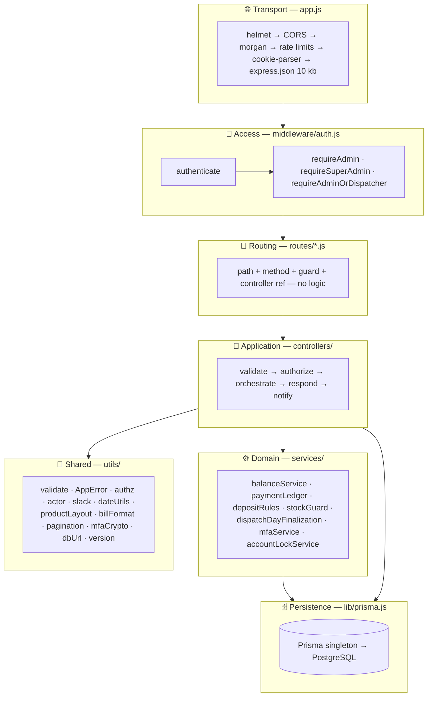
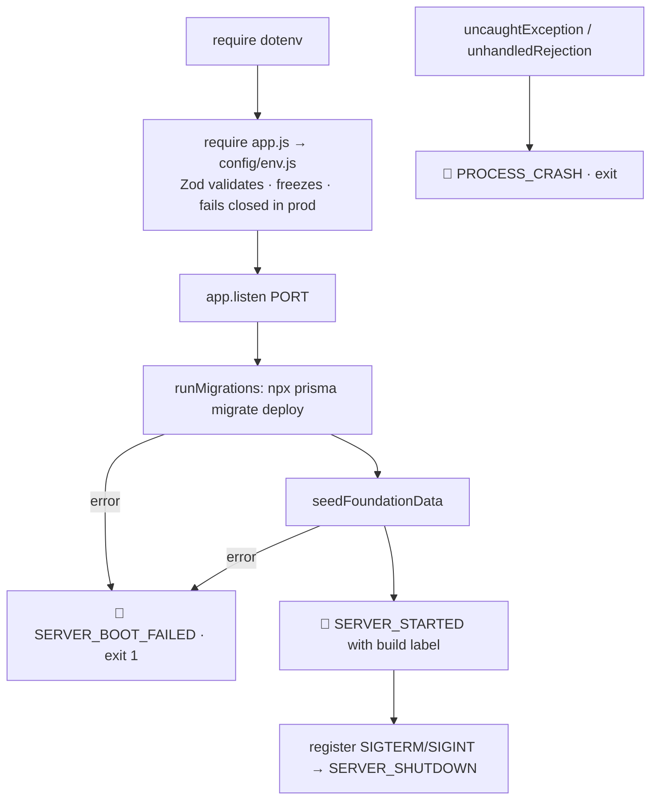
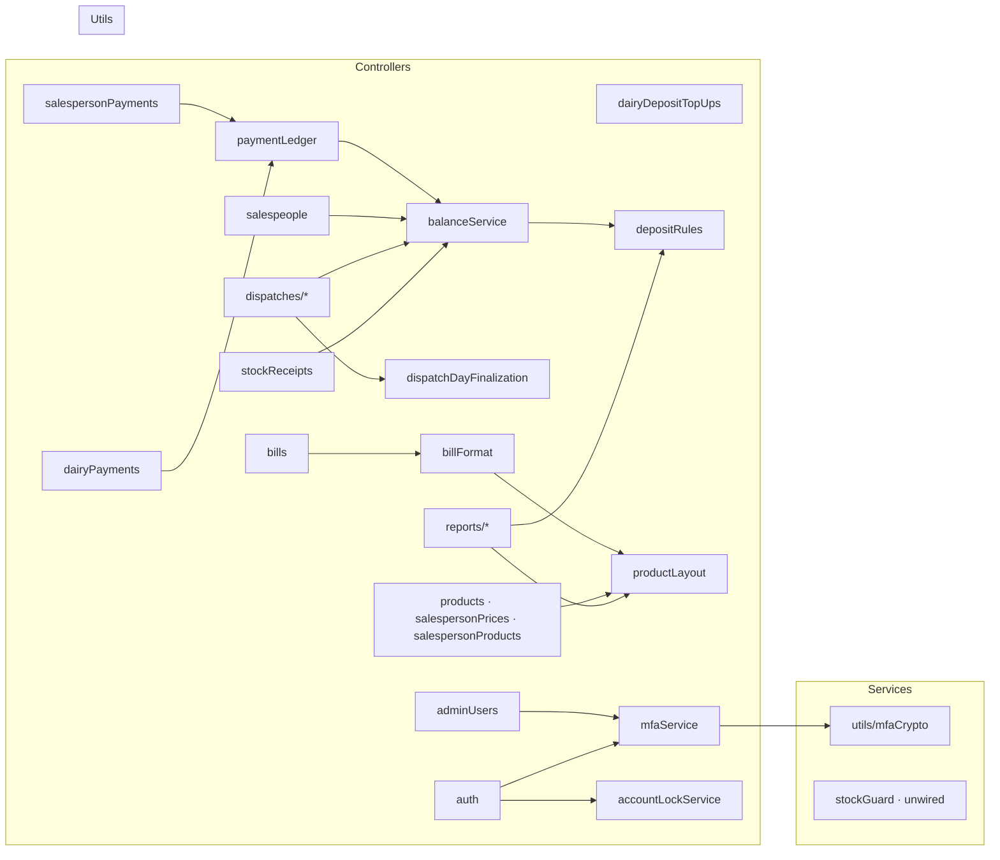
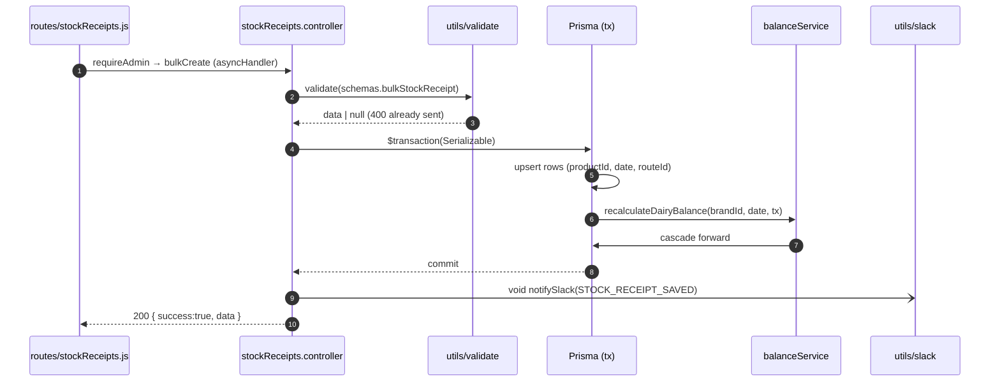

# 🏗️ Server Architecture

[⬅️ Server README](../README.md) · [System architecture](../../docs/02-system-architecture.md)

---

## 1. 🧅 Layered design



| Layer | May depend on | Must not |
|---|---|---|
| routes | middleware, controllers | contain logic, call Prisma |
| controllers | services, utils, `lib/prisma` | `try/catch`, `throw new Error`, `console.*` |
| services | utils, `lib/prisma` (or a passed `tx`) | read `req`/`res` |
| utils | `config/env`, other utils | depend on controllers |

## 2. 🛡️ Middleware order (`app.js`)

| # | Middleware | Scope | Purpose |
|:-:|---|---|---|
| 1 | `trust proxy = 1` | app | Correct `req.ip` behind Render |
| 2 | `helmet()` | all | Security headers |
| 3 | `cors()` | all | Allow-list from `CLIENT_ORIGIN`, credentials on |
| 4 | `morgan('combined')` → Winston `http` | all | Access log |
| 5 | Global limiter | `/api` | 5 000 / 15 min |
| 6 | Login limiter | `/api/v1/auth/login` | `LOGIN_RATE_LIMIT_MAX` / hour |
| 7 | `cookieParser()` | all | Used only by the crash beacon for attribution |
| 8 | `express.json({ limit: '10kb' })` | all | Body size cap |
| 9 | `GET /`, `/health`, `/health/ready` | public | Liveness, readiness, build identity |
| 10 | `/api/v1/auth`, `/api/v1/errors/client` | public | Sign-in steps, crash beacon |
| 11 | `authenticate` | `/api/v1/*` | Everything below needs a JWT |
| 12 | Mounted routers (+ guards, bulk limiter) | per resource | See [api-reference.md](api-reference.md) |
| 13 | Global error handler | last | Prisma codes, `AppError`, 500 + Slack |

## 3. 🚦 Boot sequence (`index.js`)



`resolveFailedMigrations()` exists in `index.js` as a manual recovery helper (marks half-applied migrations as rolled
back) but is intentionally **not** wired into boot.

## 4. 🧩 Module map



## 5. 🔁 Request flow (example: save stock receipts)



## 6. 📦 Response envelope

```jsonc
// success
{ "success": true, "data": { /* resource or list */ } }
// paginated list (opt-in ?page=&limit=)
{ "success": true, "data": { "items": [], "pagination": { "total": 0, "page": 1, "limit": 20, "pages": 0, "hasMore": false } } }
// failure (global handler)
{ "success": false, "error": "Human-readable message", "code": "DUPLICATE" }
```

## 7. 🗃️ Controllers split by concern

| Barrel | Sub-modules | Responsibility |
|---|---|---|
| `dispatches.controller.js` | `read`, `write`, `lockLifecycle`, `dayFinalization`, `_shared` | Entries, pricing, locking, finalization |
| `reports.controller.js` | `dailyDispatch`, `dairyStatement`, `salespersonStatement`, `stockSummary`, `depositSummary`, `outstanding`, `profitLoss`, `_shared` | Read models |

Split a controller this way when it grows past ~500 lines; keep the barrel so routes do not change.
