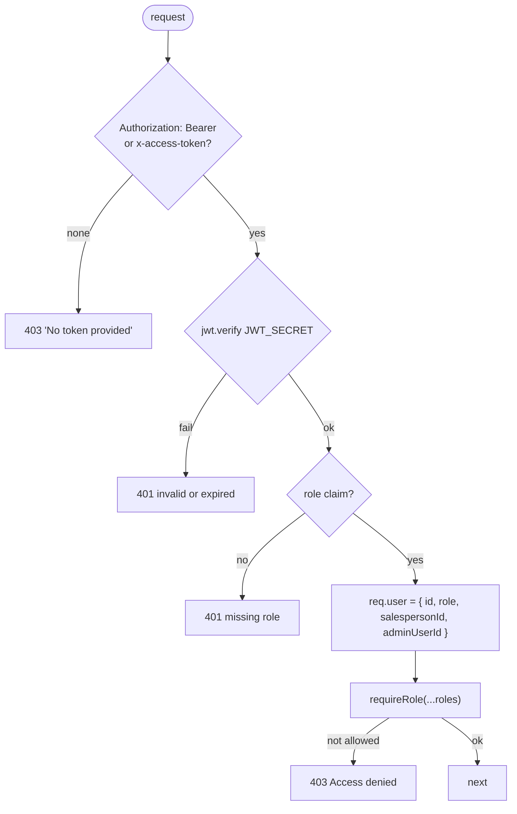
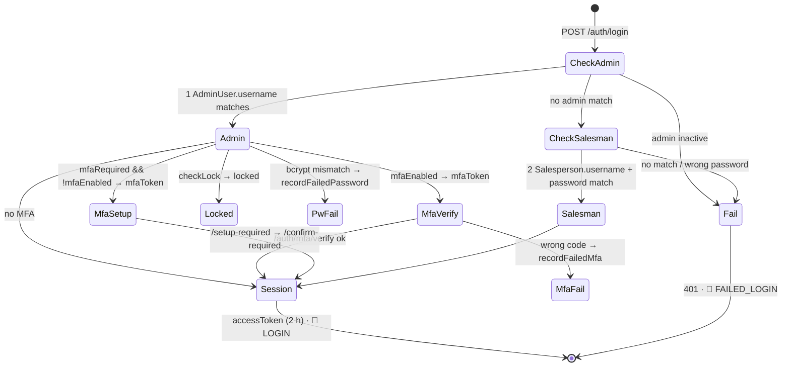
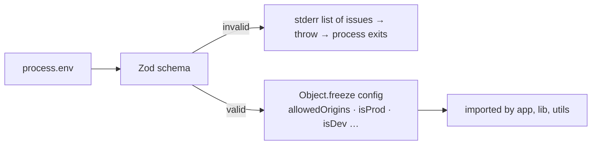

# 🔐 Auth & Security (server)

[⬅️ Server README](../README.md) · System view: [docs/05-security.md](../../docs/05-security.md)

---

## 1. 🔑 `middleware/auth.js`

| Guard | Roles |
|---|---|
| `requireAdmin` | admin, superadmin |
| `requireSuperAdmin` | superadmin |
| `requireAdminOrDispatcher` | admin, superadmin, dispatcher |
| `assertRole(req, …roles)` / `assertAdmin(req)` (`utils/authz.js`) | in-controller re-check |

> The login cookie is **not** read by `authenticate`. Only the crash beacon looks at it, to attribute a report.

## 2. 🚪 Login state machine (`auth.controller.js`)

## 3. 🔐 Secrets handling

| Secret | Storage | Code |
|---|---|---|
| Passwords | bcrypt (10 rounds) | `auth`, `adminUsers`, `salespeople` controllers |
| TOTP secret | AES-256-GCM (`utils/mfaCrypto.js`), key = sha256(`JWT_SECRET:mfa-secret-encryption`) | `mfaService` |
| Backup codes | bcrypt, removed on use | `mfaService.verifyLoginCode` |
| PINs | bcrypt in `AppSettings` | `pin.controller.js`, `seed.js` |
| Env | Zod-validated + frozen in `config/env.js` | everywhere |

## 4. 🔒 Lock-out (`services/accountLockService.js`)

| Constant | Value |
|---|---|
| `ACCOUNT_LOCK_THRESHOLD` | 5 failures (password **or** MFA counter) |
| `ACCOUNT_LOCK_COOLDOWN_MS` | 30 minutes, evaluated on the next attempt |
| Events | `ACCOUNT_LOCKED`, `ACCOUNT_UNLOCKED` |

## 5. ⏱️ Rate limiters

| Limiter | File | Window / max |
|---|---|---|
| Global | `app.js` | 15 min / 5 000 |
| Login | `app.js` | 1 h / `LOGIN_RATE_LIMIT_MAX` (20) |
| Bulk writes | `app.js`, `routes/salespersonPrices.js` | 1 min / `BULK_WRITE_RATE_LIMIT_MAX` (30) |
| MFA verify / setup / confirm | `routes/auth.js` | dedicated limiters (15 code guesses, 30 setup) |
| PIN | `routes/pin.js` | 15 min / 20 wrong PINs (`skipSuccessfulRequests`) |
| Bulk writes | `app.js` (`bulkWriteLimiter`) + `routes/salespersonPrices.js` | 1 min / 30 |
| Crash beacon | `routes/clientErrors.js` | 1 h / 30, answers 200 |

## 6. ⚙️ Fail-closed configuration (`config/env.js`)

In production `DATABASE_URL`, `JWT_SECRET` (≥ 32) and `ADMIN_PASSWORD` are required; dev gets safe local
defaults that are never used in production.

## 7. 🧱 Hardening checklist for new endpoints

- [ ] Mounted under `authenticate`; guard at mount or route
- [ ] `assertRole` in the controller
- [ ] Salesman ownership check (`req.user.salespersonId`)
- [ ] `validate()` for body, `parseId()` for params
- [ ] No secrets or internals in responses
- [ ] Rate-limited if it is bulk, public or guessable
- [ ] Row in `access-control-matrix.feature`
