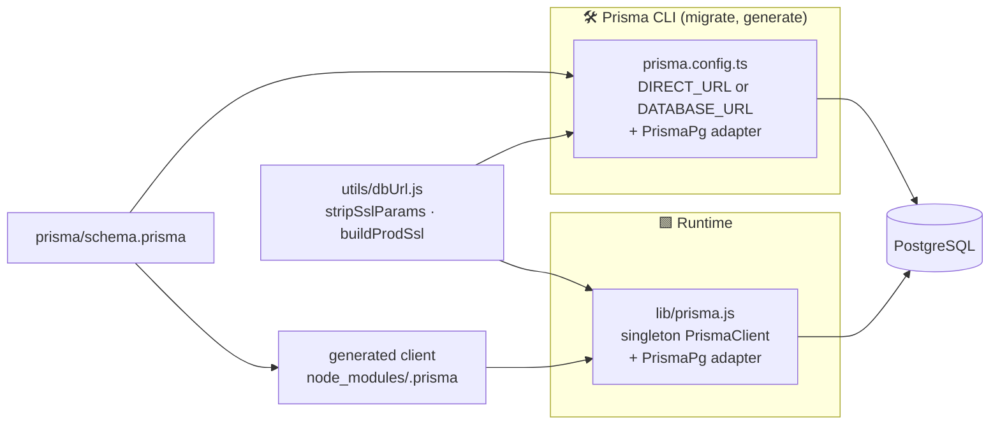
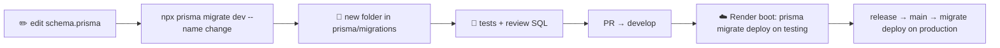
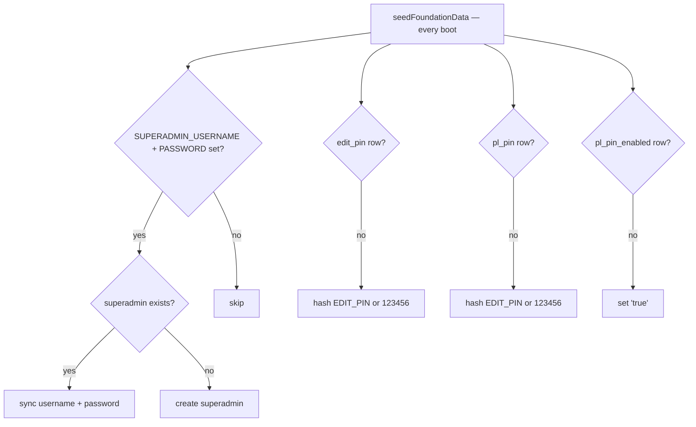

# 🗃️ Data Model & Migrations

[⬅️ Server README](../README.md) · Business view: [docs/03-domain-model.md](../../docs/03-domain-model.md)

---

## 1. 🔷 Prisma 7 setup

| Concern | Detail |
|---|---|
| Datasource URL | Lives in `prisma.config.ts` (Prisma 7), **not** in `schema.prisma` |
| Runtime client | `lib/prisma.js` — the only `new PrismaClient()` in the codebase; reused across hot reloads in dev |
| TLS in production | `sslmode` stripped from the URL and replaced by an explicit `ssl` option; CA pinned with `DATABASE_CA_CERT`, otherwise unverified TLS + boot warning |
| Query logging | `query, error, warn` in development; `error, warn` otherwise |

## 2. 🧬 Physical model

| Table | Model | Unique / indexes | FK delete rule |
|---|---|---|---|
| `brands` | Brand | `name` | — |
| `categories` | Category | `(brand_id, name)` | brand: cascade |
| `products` | Product | `(brand_id, name)` | brand: cascade |
| `product_cost_prices` | ProductCostPrice | `(product_id, effective_from)` | product: cascade |
| `product_selling_prices` | ProductSellingPrice | `(product_id, effective_from)` | product: cascade |
| `routes` | Route | `(brand_id, route_number)` | brand: cascade |
| `stock_receipts` | StockReceipt | `(product_id, receipt_date, route_id)`; idx `(brand_id, receipt_date)`, `receipt_date` | restrict |
| `dairy_balances` | DairyBalance | `(brand_id, balance_date)` | restrict |
| `dairy_payments` | DairyPayment | idx `(brand_id, payment_date)` | restrict |
| `dairy_deposit_topups` | DairyDepositTopUp | idx `(brand_id, top_up_date)` | restrict |
| `salespeople` | Salesperson | `username` | — |
| `salesperson_prices` | SalespersonPrice | `(salesperson_id, product_id, effective_from)` | cascade |
| `salesperson_products` | SalespersonProduct | `(salesperson_id, product_id)` | cascade |
| `stock_dispatches` | StockDispatch | `(salesperson_id, dispatch_date)`; idx `dispatch_date` | restrict |
| `stock_dispatch_items` | StockDispatchItem | idx `dispatch_id`, `product_id` | dispatch: cascade |
| `salesperson_balances` | SalespersonBalance | `(salesperson_id, balance_date)` | restrict |
| `salesperson_payments` | SalespersonPayment | idx `(salesperson_id, payment_date)` | restrict |
| `admin_users` | AdminUser | `username` | — |
| `dispatch_day_finalizations` | DispatchDayFinalization | `date` | admin: set null |
| `app_settings` | AppSettings | PK `key` | — |
| `bills` | Bill | `bill_number`; idx `(salesperson_id, from_date)`, `created_at` | salesperson: restrict |

Column names are `snake_case` via `@map`; models are `PascalCase`; fields `camelCase`.

## 3. 🗓️ Date & money columns

- Business dates are `@db.Date` (no time) and represent **IST** calendar days.
- Money: `Decimal(10,2)`; unit prices: `Decimal(10,4)`; bill totals `Decimal(12,2)`. Convert with `Number()` only at
  the edge of a calculation.

## 4. 🔁 Migration workflow

| ✅ Do | ❌ Don't |
|---|---|
| One migration per logical change, descriptive name | Edit or delete an applied migration |
| Make changes backward-compatible (add → backfill → switch → drop later) | `prisma db push` against a shared database |
| Review the generated SQL in the PR | Rename columns in one step on a live table |
| Add indexes for new filter patterns (dates!) | Rely on the default sort order |

Recovery helper: `resolveFailedMigrations()` in `index.js` (manual use only) marks half-applied migrations as rolled
back so `migrate deploy` can retry.

## 5. 🌱 Seeding

Seeding is idempotent and never creates brands, products or sample data.
