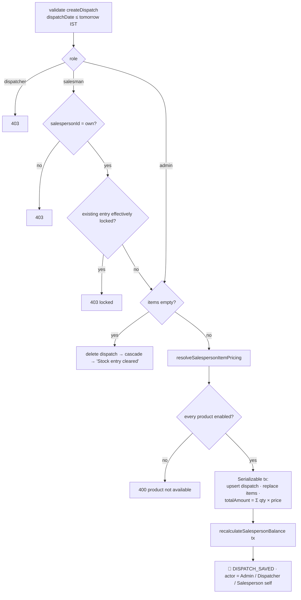
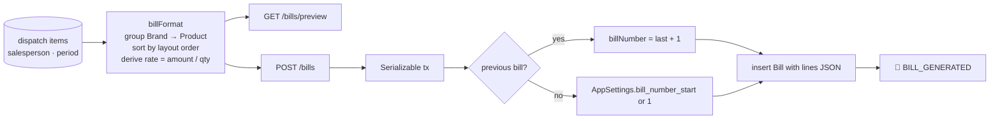

# 🚚 Dispatch Engine

[⬅️ Server README](../README.md) · Business view: [docs/04-business-workflows.md § 4–8](../../docs/04-business-workflows.md#4-daily-dispatch-stock-entry)

---

Code: [`controllers/dispatches/`](../controllers/dispatches), [`services/dispatchDayFinalization.js`](../services/dispatchDayFinalization.js),
[`controllers/bills.controller.js`](../controllers/bills.controller.js), [`utils/billFormat.js`](../utils/billFormat.js).

## 1. 🧩 Module layout

| File | Handlers | Concern |
|---|---|---|
| `dispatches/read.js` | `getAll`, `getSummary` | Lists (salesman: own only; dispatcher: refused) |
| `dispatches/write.js` | `createOrUpdate`, `remove` | Upsert entries + salesperson cascade |
| `dispatches/lockLifecycle.js` | `submit`, `lock`, `unlock`, `openForEntry` | Lock state machine |
| `dispatches/dayFinalization.js` | `finalizeDay`, `unfinalizeDay` | Day close |
| `dispatches/_shared.js` | `resolveActor`, `isEffectivelyLocked`, `resolveSalespersonItemPricing`, `assertDispatcherCanToggleLock` | Shared rules |

## 2. 💾 Save flow (`POST /dispatches`)



### Pricing resolution (`resolveSalespersonItemPricing`)

| Step | Source |
|---|---|
| 1. Enabled? | `SalespersonProduct.isEnabled ?? Product.salespersonEnabled`, product must be active |
| 2. Price | Latest `SalespersonPrice` with `effectiveFrom ≤ dispatchDate` |
| 3. Fallback | `Product.salespersonDefaultPrice` |
| 4. Client value | **Ignored** |

### Stock guard

`services/stockGuard.validateDispatchStock(items, date, excludeId)` computes `received − dispatched` per product. It
is deliberately **not called** (owner decision, 2026-08-16); the hook point is marked in `write.js`.

## 3. 🔒 Lock rules

```js
// _shared.js
isEffectivelyLocked = (isSubmitted || dispatchDate < todayIST) && !isAdminUnlocked;
```

| Action | Admin | Dispatcher | Salesman |
|---|---|---|---|
| `PATCH /:id/submit` | ✅ | ❌ | own |
| `PATCH /:id/lock` · `/unlock` | ✅ any date | today only, not after finalization | ❌ |
| `POST /open-for-entry` | ✅ (creates empty unlocked entry if missing) | ❌ | ❌ |
| Edit / delete entry | ✅ | ❌ | own, when not locked |

## 4. ✅ Finalization

```js
// services/dispatchDayFinalization.js
isDayFinalizedForDispatcher(date, today) =
  date < today  ||  exists DispatchDayFinalization(date)
```

| Endpoint | Role | Effect |
|---|---|---|
| `POST /dispatches/finalize-day` | dispatcher | Insert row for today (`finalizedBy`) · `DISPATCH_DAY_FINALIZED` |
| `DELETE /dispatches/finalize-day` | admin | Remove today's row · `DISPATCH_DAY_UNFINALIZED` |

## 5. 🧾 Bills



| Rule | Implementation |
|---|---|
| Nothing to bill | `totalAmount === 0` → 400 |
| `from > to` | 400 |
| Party name | trimmed input or salesperson name |
| Attribution | `createdBy` from `utils/actor.js` |
| Cancel | `DELETE /bills/:id` → `BILL_DELETED` |

## 6. 🧪 Tests

Mocked: `dispatches.spec.js`, `dispatchDayFinalization.spec.js`, `bills.spec.js`, `billFormat.spec.js`.
Live: `dispatches.feature`, `dispatch-day-finalization.feature` (`@shared-state`), `bills.feature`.
