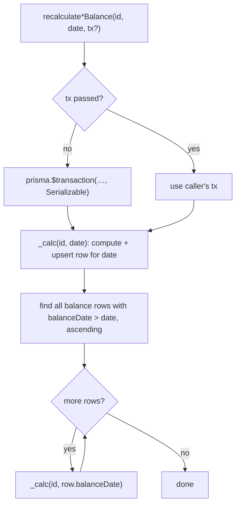
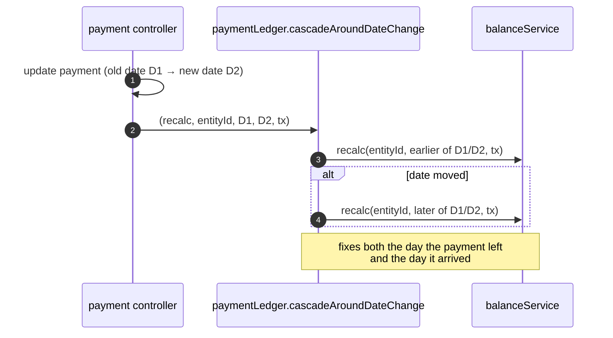
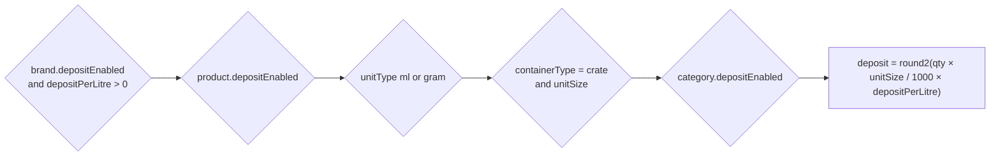

# 📒 Ledger Engine

[⬅️ Server README](../README.md) · Business view: [docs/04-business-workflows.md § 2](../../docs/04-business-workflows.md#2-the-cascading-ledgers)

---

Code: [`services/balanceService.js`](../services/balanceService.js), [`services/depositRules.js`](../services/depositRules.js),
[`services/paymentLedger.js`](../services/paymentLedger.js).

## 1. 📐 Formulas

| Ledger | Formula |
|---|---|
| 🏭 `DairyBalance` (brand, day) | `closing = opening + stockValue + depositValue + topUpAmount − amountPaid` |
| 🛵 `SalespersonBalance` (salesperson, day) | `closing = opening + stockGiven + topUpAmount − amountPaid` |

| Component | Dairy source | Salesperson source |
|---|---|---|
| `opening` | closing of the latest earlier `DairyBalance` (or 0) | closing of the latest earlier `SalespersonBalance` (or 0) |
| stock | Σ receipts `quantity × unitPrice` for the day | Σ `StockDispatch.totalAmount` for the day |
| `depositValue` | Σ `calculateLineDeposit` for qualifying receipt lines | — |
| `topUpAmount` | Σ `DairyPayment.amount` where `isTopUp = true` | Σ `SalespersonPayment.amount` where `isTopUp = true` |
| `amountPaid` | Σ `DairyPayment.amount` where `isTopUp = false` | Σ `SalespersonPayment.amount` where `isTopUp = false` |

## 2. 🔁 Cascade algorithm



- `_compute*` is the **single** implementation of each formula; `compute*Balance` (read-time fallback for a day with
  no row) and the writer both use it, so they cannot drift.
- Rows are created lazily: a day gets a balance row when something is recalculated for it.

## 3. 🧷 Using it correctly

```js
// ✅ standalone
await recalculateSalespersonBalance(salespersonId, '2026-11-05');

// ✅ inside your own transaction — pass tx so it joins it
await prisma.$transaction(async (tx) => {
  await tx.salespersonPayment.create({ data });
  await recalculateSalespersonBalance(data.salespersonId, data.paymentDate, tx);
}, { isolationLevel: 'Serializable' });

// ❌ global client inside a transaction — runs outside it, can deadlock / race
await prisma.$transaction(async (tx) => {
  await tx.salespersonPayment.create({ data });
  await recalculateSalespersonBalance(data.salespersonId, data.paymentDate);
});

// ❌ never
await prisma.salespersonBalance.update({ … });
```

## 4. 📆 Changing a payment's date



`paymentLedger.validateBulkEntities` checks that each id in a bulk top-up appears once and exists before any write.

## 5. 🪙 Deposit rule



`depositRules` is shared by the ledger writer and the deposit report — they must agree to the paisa.

## 6. ⚡ Performance notes

| Concern | Mitigation |
|---|---|
| Old edits recompute many days | Cascade only touches rows **after** the edited date for that one entity |
| Concurrent edits to one ledger | Serializable isolation; one transaction fails instead of corrupting |
| Date-range reports | Indexes on `(brand_id, receipt_date)`, `(salesperson_id, payment_date)`, `dispatch_date` |

## 7. 🧪 Tests

- Mocked: `tests/playwright/balanceServiceStandalone.spec.js`, `dairyBalance.spec.js`, `salespersonBalance*.spec.js`,
  `paymentLedger.spec.js`, `depositRules.spec.js` (helpers in `tests/helpers/mock-cascade.js`).
- Live: `dairy-ledger.feature`, `salesperson-ledger.feature` in [`automation/`](../automation/README.md).
