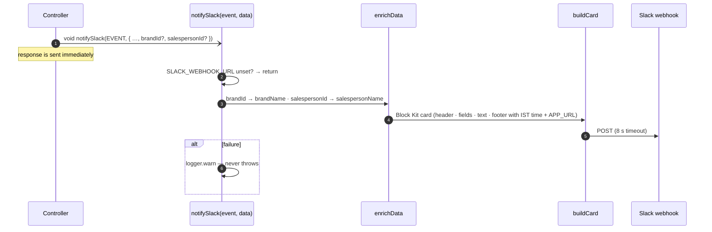
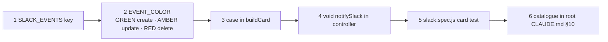
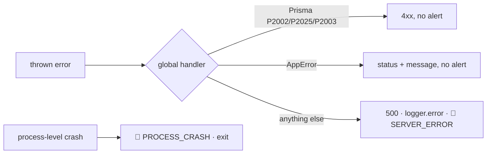

# 💬 Notifications & Logging

[⬅️ Server README](../README.md) · System view: [docs/09-observability-and-operations.md](../../docs/09-observability-and-operations.md)

---

## 1. 💬 Slack pipeline (`utils/slack.js`)



| Building block | Helper |
|---|---|
| Title | `headerBlock(text)` |
| Key/value grid | `fieldsBlock([[label, value], …])` |
| Free text | `textBlock(md)` — escape user input with `escapeSlack` |
| Separator | `dividerBlock()` |
| Footer | `footerBlock()` — IST timestamp + "Open App" link |
| Wrapper | `card(event, blocks, fallbackText, colorOverride?)` |
| Formatting | `formatINR`, `formatDate`, `istNow`, `joinNames` |

### Adding an event



### Event families

| Family | Events |
|---|---|
| 🖥️ System | `SERVER_STARTED`, `SERVER_SHUTDOWN`, `SERVER_BOOT_FAILED`, `SERVER_ERROR`, `PROCESS_CRASH`, `CLIENT_ERROR` |
| 🔑 Auth / PIN / MFA | `LOGIN`, `LOGOUT`, `FAILED_LOGIN`, `PASSWORD_CHANGED`, `PIN_FAILED`, `PIN_UPDATED`, `PL_PIN_UPDATED`, `PIN_SETTINGS_UPDATED`, `MFA_ENABLED`, `MFA_DISABLED`, `MFA_FAILED`, `MFA_REQUIRED_SET`, `MFA_REQUIRED_UNSET`, `ACCOUNT_LOCKED`, `ACCOUNT_UNLOCKED` |
| 📦 Operations | `STOCK_RECEIPT_SAVED`, `DAIRY_PAYMENT_*`, `DISPATCH_*`, `SALESPERSON_PAYMENT_*`, `*_TOPUP_RECORDED`, `SALESPERSON_LEDGER_RESET`, `BILL_*` |
| 🛠️ Setup | `SALESPERSON_*`, `SALESPERSON_PRICES_*`, `PRODUCT_*`, `CATEGORY_*`, `ROUTE_*`, `BRAND_*`, `ADMIN_USER_*` |
| 👀 Self-service | `SALESPERSON_BALANCE_VIEWED`, `SALESPERSON_STATEMENT_VIEWED` |

Exact list: `SLACK_EVENTS` in `utils/slack.js` and [CLAUDE.md § 10](../../CLAUDE.md).

## 2. 📜 Logging (`config/logger.js`)

| Setting | Production | Development |
|---|---|---|
| Level | `info` | `debug` |
| Console | JSON with timestamp | colourised simple |
| Files | `logs/error.log`, `logs/combined.log` (5 MB × 5) | same |
| HTTP access | morgan `combined` → `logger.http` | same |

```js
const logger = require('../config/logger');
logger.info('Stock receipts saved', { brandId, date, count });
logger.error('Readiness check failed', { message: err.message });
```

Rules: never `console.*` (ESLint `no-console`), never log secrets/tokens/PINs, log context as an object.

## 3. 💓 Health probes

| Probe | Checks | Use |
|---|---|---|
| `GET /health` | process alive; returns `version`, `commit`, `builtAt` | liveness, deploy verification (`wait-for-backend.sh`) |
| `GET /health/ready` | `SELECT 1` against PostgreSQL | readiness |

## 4. 🚨 Error alerting


