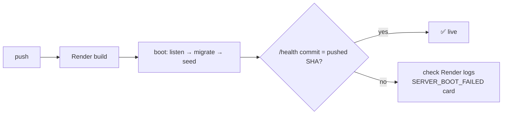

# 🛟 Server Operations Runbook

[⬅️ Server README](../README.md) · System runbook: [docs/09-observability-and-operations.md](../../docs/09-observability-and-operations.md)

---

## 1. ☁️ Render service

Expected configuration (the Render dashboard is the source of truth — verify there before changing anything):

| Setting | Value |
|---|---|
| Root directory | `server` |
| Build command | `npm install && npm run build` |
| Start command | `npm start` |
| Health check path | `/health` |
| Branch | `develop` (testing) · `main` (production) |
| Auto-deploy | on |

## 2. 🚀 Deploy verification



```bash
curl -s https://<api>/health | jq        # { status, version, commit, builtAt }
curl -s -o /dev/null -w '%{http_code}\n' https://<api>/health/ready
```

## 3. 🧯 Diagnostics

| Symptom | Check | Fix |
|---|---|---|
| Boot loop | Logs: `[env] Invalid environment configuration` | Set the listed variables |
| `migrate deploy` failed | `_prisma_migrations` row with `finished_at IS NULL` | Fix forward; if needed run `resolveFailedMigrations` logic manually, then redeploy |
| TLS warning at boot | `DATABASE_CA_CERT` unset | Paste the Aiven CA PEM into the env var |
| 500s with `SERVER_ERROR` cards | Card shows method + path + message | Reproduce locally with the same payload |
| 429 on login from office | 20 logins/hour/IP shared by the office | Wait; never raise in production |
| Slack silent | `SLACK_WEBHOOK_URL` unset/invalid | Logs show `Slack [EVENT]: …` warnings |
| Everyone's MFA fails | `JWT_SECRET` changed | Restore the previous secret |

## 4. 🔐 Credential operations

| Task | How |
|---|---|
| Reset superadmin password | Change `SUPERADMIN_PASSWORD` on Render → restart (seed syncs it) |
| Unlock an admin | Superadmin → Admin Users → Unlock (`PUT /admin-users/:id/unlock`) |
| Rotate edit / P&L PIN | Superadmin UI (`PUT /pin/update`, `/pin/update-pl`) |
| Rotate `JWT_SECRET` | Plan it: all sessions end **and** all MFA enrolments become invalid |

## 5. 🗄️ Data operations

| Task | How | Risk |
|---|---|---|
| Fix a wrong historical entry | Edit it through the UI/API — the cascade fixes later balances | low |
| Reset a salesperson's history | Superadmin `POST /salespeople/reset-ledger` | 🔴 irreversible |
| Restore data | Aiven point-in-time restore to a new service, verify, repoint `DATABASE_URL` | high |
| Manual SQL | Read-only queries only; never `UPDATE` balance tables | — |
