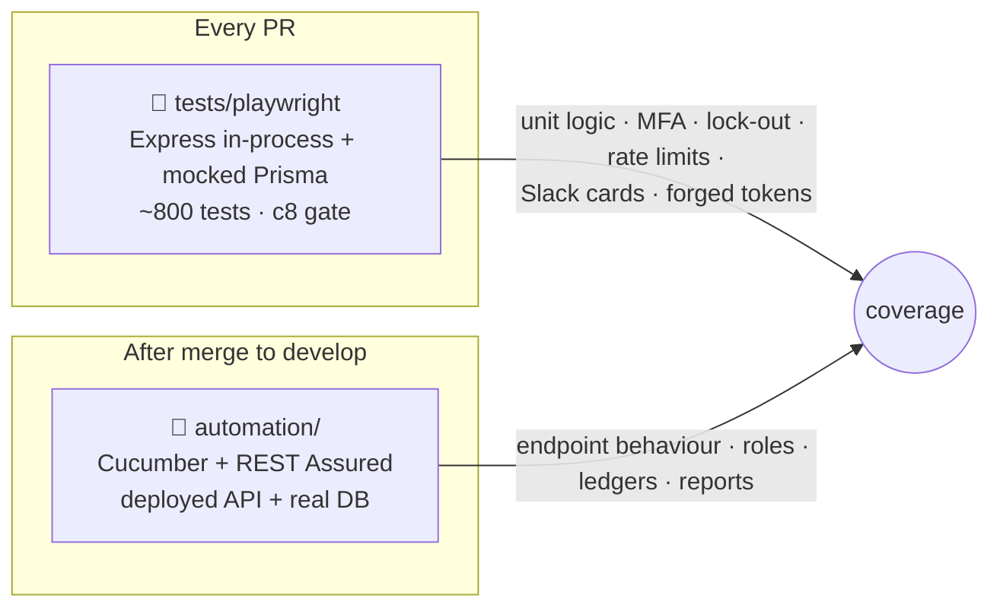
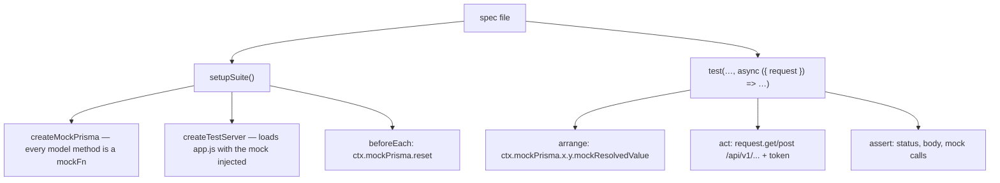

# 🧪 Server Testing

[⬅️ Server README](../README.md) · Strategy: [docs/07-quality-and-testing.md](../../docs/07-quality-and-testing.md)

---

## 1. 🗺️ Two suites, two purposes



Mapping of every mocked spec to its live coverage: [`automation/COVERAGE.md`](../automation/COVERAGE.md).

## 2. 🧱 How the mocked suite works



```js
const { expect } = require('@playwright/test');
const { setupSuite, makeSalesmanToken } = require('../helpers/test-setup');
const { test, ctx, makeAuthToken, makeSuperAdminToken, makeDispatcherToken } = setupSuite();

test.beforeEach(() => {
  ctx.mockPrisma.category.findMany.mockResolvedValue([{ brandId: 1, name: 'Milk', displayOrder: 1 }]);
});

test('admin lists products in layout order', async ({ request }) => {
  ctx.mockPrisma.product.findMany.mockResolvedValue([/* … */]);
  const res = await request.get('/api/v1/products', {
    headers: { Authorization: `Bearer ${makeAuthToken()}` },
  });
  expect(res.status()).toBe(200);
  expect((await res.json()).success).toBe(true);
});
```

| Helper | Purpose |
|---|---|
| `tests/helpers/test-setup.js` | `setupSuite()`, token makers (admin, superadmin, dispatcher, salesman) |
| `create-mock-prisma.js` | Mock of every model + `$transaction` |
| `create-test-server.js` | In-process server on a random port |
| `mock-cascade.js` | Shortcuts for balance-cascade mocks |
| `mock-fn.js` | Minimal `jest.fn`-style mock |

> ⚠️ If a handler calls a Prisma model your test did not mock, it returns `undefined` and the handler crashes with
> "Cannot read properties of undefined". Mock it in `beforeEach`.

## 3. 📏 Coverage gate (`.c8rc.json`)

| Statements | Branches | Functions | Lines |
|---:|---:|---:|---:|
| 70 % | 80 % | 85 % | 70 % |

Scope: `controllers/`, `services/`, `utils/`, `middleware/`, `config/`. Run `npm run test:coverage`; HTML report in
`coverage/`.

## 4. 🧭 What goes where

| Test type | Suite |
|---|---|
| Pure functions (`depositRules`, `billFormat`, `productLayout`, `pagination`, `validate`, `dbUrl`, `env`, `version`) | mocked |
| Rate-limit exhaustion, lock-out, full MFA, Slack card shape, forged tokens | mocked |
| Status codes, validation messages, role matrix, cascades, reports | live (`automation/`) |
| Day finalization | mocked (live scenarios are `@shared-state`, on demand) |

## 5. ▶️ Commands

```bash
npm test                                   # all mocked specs
npx playwright test tests/playwright/bills.spec.js
npx playwright test -g "locks the account"
npm run test:coverage                      # with gate
npm run check                              # lint + timezone lint + tests
```
